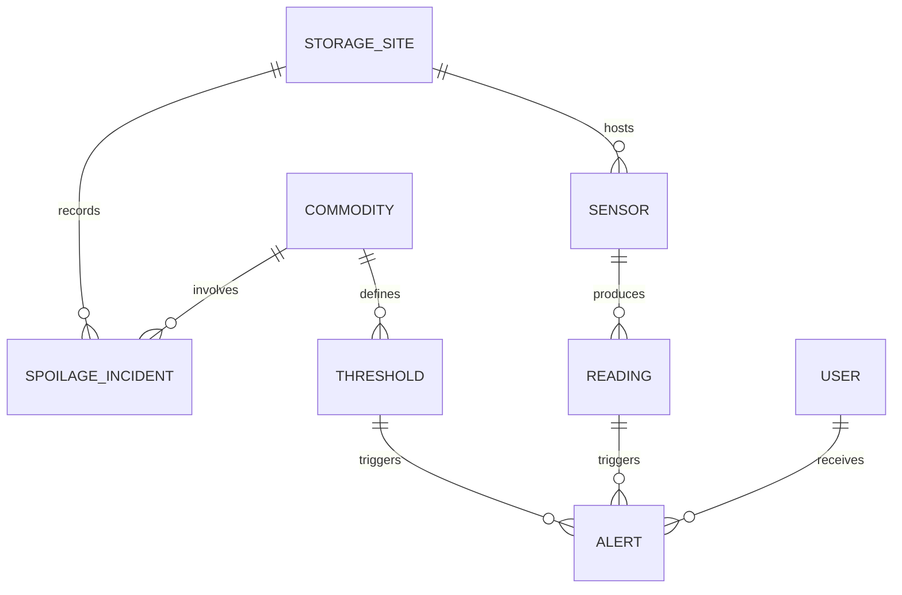

# FINAL PROJECT REPORT

## Development of a Low-Cost IoT-Based Post-Harvest Storage Monitoring and Spoilage-Risk Alert System: A Case Study of [TODO: Cooperative/Aggregator name]

**Research Capstone Project (C7-RCP-23) | Level 7 | Semester 7**
**BSc Cybersecurity and Risk Management, Year 4 — Botho University**

**Group 3**
- Montwedi Kobe (2333143)
- Hlabo Pelompe (2332874) *[verify ID — one logbook shows 461913611]*
- Boitshoko Seitshiro (2332806)
- Paul Mukupe (2332248)

**Supervisor:** Lefentse Sorinyane
**Submission date:** [dd Month yyyy]
**Word count:** [TODO — excluding references and appendices]

---

> ## CONSISTENCY RULES APPLIED THROUGHOUT THIS REPORT
> - **Simulation, not hardware.** The project is validated by simulation. Simulated readings are never described as real sensor data and no real SMS was sent. SMS is validated at dispatch-logic level.
> - **Same numbers everywhere.** Crop thresholds, costs and test results are identical in the report, database, app and presentation, each traced to a source.
> - **No forecasting claims.** Predictive/ML forecasting is out of scope in the approved proposal. Trend charts show historical data only.
> - **Evidence for every result.** Every result has a figure, table, log or screenshot with a caption.
> - **Objective 5 (physical pilot) is partially met** — stated and justified, not dropped.
> - **AI use is disclosed** (see declaration page), consistent with each member's logbook.
> - **One reference style (Harvard).**

---

## Declaration and Statement of AI Use

We declare that this report is our own work, that sources are acknowledged, and that no part has been submitted for another assessment.

**Use of AI tools**

| Tool | Used for | How the output was checked |
|---|---|---|
| Cursor (AI coding agent) | Generating and editing parts of the backend, sensor simulator, control panel, dashboard extensions and Flutter app code from written specifications | Code reviewed line-by-line by the IT team; server run and API endpoints tested with curl; breach tests and benchmarks executed and results observed by the team |
| AI assistant (Kimi/Claude-class chat tool) | Project planning, task assignment, report structure, drafting and reviewing documents | Content verified against sources, the approved proposal and the working system |
| Wokwi (ESP32 simulator) | Validating ESP32 + DHT22 firmware behaviour without physical hardware | Serial output observed; readings confirmed arriving in the live backend |

| Member | Signature | Date |
|---|---|---|
| Montwedi Kobe | | |
| Hlabo Pelompe | | |
| Boitshoko Seitshiro | | |
| Paul Mukupe | | |

---

## Abstract

*[150–250 words — write last, once results are final. Draft below reflects current state; update numbers before submission]*

Post-harvest losses among small agricultural aggregators in Botswana remain high because storage conditions are monitored through infrequent manual checks, and storage condition data is not linked to loss outcomes. This project designed and developed a low-cost IoT-based storage monitoring and spoilage-risk alert system targeting small aggregators with unreliable internet connectivity. The system comprises an ESP32-class sensing layer, a Node.js/Express backend with a SQLite database, a web dashboard, an Android application, and SMS-first alerting with Botswana number formatting and cooldown logic. Because hardware procurement was infeasible within the project timeline and budget, validation was performed by simulation: a modelled sensor source with normal, random and busy-day operating modes, and SMS dispatch validated at logic level. Testing confirmed threshold-breach alerts are created and dispatched correctly (breach test at 32.4°C produced a timestamped alert), alert latency of [TODO: mean] ms across [TODO: N] benchmarked readings, data persistence across server restarts, and correct per-crop alerting across six commodities. The bill of materials indicates an indicative landed component cost of approximately P1,056 and installed cost of P1,400–P1,600 per unit. The main limitation is the absence of a physical pilot: Objective 5 is partially met, with a field pilot identified as essential future work.

**Keywords:** post-harvest loss; IoT; temperature and humidity monitoring; SMS alerts; Botswana; simulation

---

## Acknowledgements (optional)

[TODO: Supervisor Lefentse Sorinyane; any aggregators/cooperative staff who gave time; [TODO: names]]

---

## Table of Contents / List of Figures / List of Tables
*[Generate in Word: References → Update Table, after headings are final]*

---

## List of Abbreviations

| Abbreviation | Meaning |
|---|---|
| API | Application Programming Interface |
| BOM | Bill of Materials |
| DHT22 | Digital temperature/humidity sensor (AM2302 class) |
| ESP32 | Low-cost Wi-Fi/Bluetooth microcontroller |
| GSM | Global System for Mobile Communications |
| IoT | Internet of Things |
| MaaS | Monitoring-as-a-Service |
| RH | Relative Humidity |
| SMS | Short Message Service |
| SQLite | Serverless, file-based relational database engine |
| TCO | Total Cost of Ownership |

---

# 1. Introduction

## 1.1 Background and problem statement

Small agricultural aggregators in Botswana occupy a critical position between farmers and markets: they buy and temporarily store produce, making storage conditions a direct determinant of how much value survives to market. Yet harvested produce is commonly stored using informal methods with no continuous monitoring of temperature or humidity. Staff rely on periodic manual checks that are inconsistent, prone to late detection of spoilage-inducing conditions such as heat build-up and humidity spikes, and impossible to maintain around the clock.

A second problem compounds the first: storage condition data is not recorded or linked to loss outcomes. Aggregators cannot identify which conditions, commodities or time periods are associated with their highest spoilage rates, so even experienced staff lack the evidence base for better storage decisions.

A value-chain assessment of digital agricultural innovation in Botswana found smart-farming technologies reasonably represented at the production stage, but identified no digital storage solutions anywhere in the value chain — a complete, documented gap rather than a partial one [TODO: full citation]. There is currently no low-cost digital system in use that automates storage-condition monitoring and alerts staff to spoilage risk in real time. This project addresses that gap.

## 1.2 Aim and objectives

**Aim:** To design, develop, and evaluate a low-cost IoT-based storage monitoring and spoilage-risk alert system for small agricultural aggregators at [TODO: named cooperative/aggregator].

| # | Objective (from the approved proposal) |
|---|---|
| 1 | Investigate current post-harvest storage practices and loss patterns through consultation with aggregator staff and/or smallholder farmers |
| 2 | Identify the cost, connectivity, and power constraints affecting the design of an appropriate low-cost monitoring solution for this context |
| 3 | Design a sensor architecture and alert logic linking real-time storage conditions to configurable spoilage-risk thresholds |
| 4 | Develop a functional prototype comprising IoT sensor hardware for condition monitoring and an alert mechanism (SMS and/or mobile dashboard) for aggregator staff |
| 5 | Pilot the prototype at a storage site and evaluate its accuracy, usability, and impact on spoilage detection compared to current (non-digital) practice |

## 1.3 Scope and exclusions

**In scope:** temperature and humidity monitoring for a single defined storage site/structure; configurable spoilage-risk thresholds per commodity type; automated alerts (SMS and dashboard) to designated staff when readings exceed safe thresholds; a historical log of storage conditions against recorded spoilage/loss incidents.

**Out of scope** (potential future work): multi-site or multi-commodity *deployment*; integration with commercial cold-chain or logistics systems; computer-vision-based spoilage detection; predictive/machine-learning forecasting of spoilage risk.

## 1.4 Case study site

[TODO: Name the cooperative/aggregator from the proposal title. Current status: stakeholder identification in progress; site confirmation pending — see §8.3. State plainly why if unresolved.]

## 1.5 Significance

For aggregators, the system offers continuous, evidence-generating monitoring and earlier warning of spoilage conditions, directly targeting post-harvest loss. Because alerting works over GSM/SMS, it is designed for the low-connectivity reality of small Botswana operations rather than assuming reliable Wi-Fi. For the student team, the project applies embedded systems, database design, software engineering and cybersecurity knowledge to an authentic national problem.

## 1.6 Report structure

Section 2 reviews related work and positions the project against the gap. Section 3 sets out the methodology, including the simulation-based validation approach and deviations from the approved proposal. Section 4 covers requirements and design; Section 5 the implementation; Section 6 testing and results; Section 7 the business case; Section 8 discusses achievement of objectives, limitations and lessons; Section 9 concludes and identifies future work.

---

# 2. Literature Review

## 2.1 Low-cost IoT monitoring of storage conditions

ESP32-based environmental monitoring with DHT22-class sensors is well represented in the literature and in practitioner projects, demonstrating that accurate temperature/humidity capture is achievable at very low component cost. However, reviewed systems typically assume reliable Wi-Fi for backhaul and mains power — assumptions that do not hold for small aggregator storage sites in Botswana [TODO: cite Smart Grain Monitoring System; ESP32 Soil/Air Monitoring; Textile Storage Control — full references]. The reviewed academic systems also generally target research instrumentation rather than day-to-day operational alerting for non-technical staff.

## 2.2 Commercial and existing solutions

Commercial products such as SensorPush (Bluetooth-first temperature/humidity sensing) and Pulse One (Wi-Fi environmental monitor) demonstrate polished consumer-grade monitoring with mobile dashboards, but both assume smartphone proximity or continuous internet connectivity, carry per-unit costs in the hundreds of pula, and provide no SMS alerting path for low-connectivity contexts [TODO: cite product documentation]. Cold-chain monitoring systems are designed for logistics fleets, not static smallholder storage.

## 2.3 SMS and GSM alerting in low-connectivity settings

GSM/SMS alerting remains the most connectivity-tolerant notification channel available in Botswana. A study of SMS-based agricultural information services in Uganda maize farming demonstrated the practicality of SMS as a primary channel for smallholder-facing agricultural alerts, though it also documented delivery-delay variability that any SMS-dependent design must tolerate [TODO: full citation].

## 2.4 Scalability

LPWAN-oriented literature identifies power and coverage trade-offs for large-scale rural sensing, but for a single-site pilot the decisive scalability questions are unit cost, installation simplicity and recurring connectivity cost — areas where commodity GSM modules and SMS outperform LPWAN infrastructure that does not exist locally [TODO: cite LPWAN scalability source from review].

## 2.5 Adoption, cost and business-model barriers

Adoption literature for smallholder-facing technology consistently identifies affordability, complexity and fit with existing workflows as the dominant barriers. This directly shaped the design requirement that the system be low-cost and usable by non-technical staff, and motivated the Monitoring-as-a-Service business modelling in Section 7 [TODO: cite adoption-barrier source from review].

## 2.6 Crop storage requirements

Safe-storage temperature and humidity ranges vary sharply by commodity, which is why the system implements per-crop configurable thresholds rather than a single global range. Threshold values used in the system (Section 4.5) were compiled from published post-harvest guidance [TODO: FAO/other — one source per crop, in table] and are flagged as literature-based defaults pending field validation.

## 2.7 Gap and positioning

The documented gap is the complete absence of digital storage monitoring in the Botswana value chain, combined with the unsuitability of existing options: commercial monitors assume connectivity and budgets small aggregators do not have, while academic systems assume research infrastructure. This project positions itself in that gap with a design explicitly constrained by the target context: SMS-first alerting, a bill of materials under P1,100 landed, and a dashboard simple enough for non-technical staff.

---

# 3. Methodology

## 3.1 Research approach

Requirements were derived from three evidence sources, per the module's traceability expectations: the approved proposal and its problem definition; the academic and commercial literature (Section 2); and stakeholder input (Section 6.11 / §8). Each functional requirement traces to an objective, a design element, an implementation component and a test (Section 4.1).

## 3.2 Development approach

Development followed an iterative cycle aligned to the team's two-subteam structure (IT: backend, simulator, dashboard, app; Business: cost case, business model, market validation), coordinated through weekly supervision meetings, a Gantt-charted sprint plan, GitHub/Notion for the IT artefacts, and individual contribution logbooks. Coding was substantially tool-assisted (Cursor agent), with every generated component reviewed, run and tested by the team; AI use is disclosed on the declaration page.

## 3.3 Simulation-based validation

**Justification.** Physical hardware procurement (ESP32, DHT22, GSM module) was infeasible within the available timeline and budget. Rather than abandon validation, the team adopted a simulation-based approach, approved in principle with the supervisor as a mitigation.

**What is simulated.** (a) The *sensor source*: a modelled DHT22 reading generator replacing physical hardware, with three operating modes — *normal* (stable diurnal storage conditions), *random* (unstructured variation within commodity-safe bounds), and *busy-day* (worker traffic in and out of the storage site modelled as periodic temperature/humidity disturbance spikes). Mode parameters were set from published commodity storage guidance. (b) The *SMS channel*: dispatch is validated at logic level — alert creation, Botswana number formatting, cooldown enforcement and timestamped dispatch logging — with a `GsmModuleService` implementation designed for real hardware. ESP32 firmware was additionally validated on the Wokwi ESP32 simulator.

**What is not simulated.** The system architecture, API, threshold-breach logic, database persistence, alert pipeline, web dashboard and phone application are the real implemented system, tested as built.

**Evidence principle.** No result is reported that was not run and observed; all test outputs are logged and referenced in Section 6.

## 3.4 Threats to validity

- **Simulator fidelity:** modelled readings approximate, but cannot physically match, real storage microclimates.
- **No physical calibration:** sensor accuracy against a reference instrument is untested.
- **No field GSM testing:** SMS delivery rate and network delay are unmeasured; reported latencies exclude GSM network time.
- **Thresholds not field-validated:** values are literature-based defaults.
- **Short test duration:** continuous runs covered [TODO: hours/days], not a full storage season.
- **Local network only:** testing ran on a LAN; internet-facing deployment concerns are designed for but untested.

## 3.5 Deviations from the approved proposal

| Proposal commitment | Final status | Justification |
|---|---|---|
| Objective 5: physical site pilot | Partially met | Hardware procurement infeasible; architecture, alert logic and persistence validated by simulation; field pilot is the primary future-work item |
| Database: MySQL/PostgreSQL candidates | SQLite implemented | Zero cost, serverless, file-based — sufficient for a single-site pilot without changing the schema design; lower operational burden |
| Hardware prototype (ESP32/DHT22/GSM) | Firmware written and simulator-validated; hardware not assembled | Procurement constraint; firmware targets the specified components and runs on Wokwi |
| Predictive/ML forecasting | Excluded | Out of scope in the approved proposal by design |
| Case study site | [TODO: named / pending] | [Reason] |

## 3.6 Ethics and data

Stakeholder consultations (Objective 1) require informed consent and confidentiality; responses are anonymised in reporting [TODO: confirm wording matches actual instruments — Appendix G]. The system itself holds no personal data beyond staff phone numbers used for alerting.

---

# 4. Requirements and System Design

## 4.1 Requirements

| ID | Requirement | Source / objective | Design ref | Test ref |
|---|---|---|---|---|
| FR1 | Record temperature and humidity readings with timestamps | Obj 3 | 4.2, 4.3 | 6.5, 6.6 |
| FR2 | Compare readings against per-crop configurable thresholds | Obj 3 | 4.5 | 6.3, 6.5 |
| FR3 | Create alerts and log SMS dispatch on threshold breach | Obj 3, 4 | 4.6 | 6.3, 6.4 |
| FR4 | Present current and historical conditions via web dashboard and Android app | Obj 4 | 4.2 | 6.8 |
| FR5 | Persist readings, thresholds, alerts and incidents across restarts | Obj 4 | 4.3 | 6.6 |
| NFR1 | Low cost (BOM under ~P1,100 landed per unit) | Obj 2 | 4.7, §7.1 | 6.10 |
| NFR2 | Tolerates poor connectivity: SMS-first alerting, no Wi-Fi dependency for alerts | Obj 2 | 4.6 | 6.3–6.4 (logic level) |
| NFR3 | Usable by non-technical staff (simple status, plain-language spoilage warnings) | — | 5.3, 5.4 | 6.8 |
| NFR4 | Data integrity: no loss of readings/alerts on restart | — | 4.3 | 6.6 |

*Traceability chain: Problem (§1.1) → Objective (§1.2) → Requirement (this table) → Design (§4) → Implementation (§5) → Test (§6).*

## 4.2 Architecture

The system as built: a sensor source (modelled simulator; designed for ESP32 + DHT22 + GSM module) → backend API (Node.js/Express: ingestion, threshold logic, alert dispatch) → SQLite database (readings, thresholds, alerts, incidents, sites, sensors, commodities, users) → two clients: a web dashboard for staff and an Android app (Flutter, polling), plus the SMS dispatch service.

*[Figure 4.1 — architecture diagram of the system as built: TODO insert]*

## 4.3 Database design

ER model (drawn from the real implemented schema): STORAGE_SITE hosts SENSORs and records SPOILAGE_INCIDENTs; SENSOR produces READINGs; COMMODITY defines THRESHOLDs and is linked to incidents; THRESHOLD and READING jointly trigger ALERTs; USER receives ALERTs.

*[Figure 4.2 — redrawn ER diagram; TODO replace mermaid with rendered figure]*

## 4.4 API specification

| Route | Method | Purpose | Response |
|---|---|---|---|
| /api/status | GET | Latest reading, active threshold, breach flag | `{ latest, threshold, breached }` |
| /api/readings/history | GET | Recent readings (query: limit, default 50) | array of readings |
| /api/thresholds | GET | Active per-crop threshold configuration | object keyed by commodity |
| /api/alerts | GET | Alerts, newest first | array of alerts |
| /api/readings | POST | Ingest one sensor reading (sensor source → backend) | created reading + alert if breached |

The four GET shapes are a frozen contract shared by the dashboard and the Android app; the POST route was added for the sensor layer and does not alter the GET contract.

## 4.5 Crop threshold model

Values are literature-based defaults pending field validation; a source is required for every row [TODO: Montwedi's citations — FAO post-harvest guidance preferred].

| Crop | Min temp (°C) | Max temp (°C) | Min RH (%) | Max RH (%) | Spoilage risk when breached | Source |
|---|---|---|---|---|---|---|
| Tomato (ripe) | 10 | 13 | 85 | 90 | Chilling injury below 10°C (pitting, uneven ripening); over-ripening above 13°C | [TODO] |
| Leafy greens (morogo) | 0 | 5 | 90 | 95 | Wilting, yellowing, rapid bacterial decay above 5°C; shriveling at low RH | [TODO] |
| Maize (grain) | 15 | 25 | 50 | 65 | Mold growth and **aflatoxin contamination** above 25°C with high RH; insect infestation and sprouting | [TODO] |
| Onion | 0 | 5 | 65 | 70 | Neck rot and bacterial soft rot at high RH; sprouting in warm storage | [TODO] |
| Potato | 4 | 8 | 90 | 95 | Cold-induced sweetening below 4°C; sprouting and shriveling above 8°C | [TODO] |
| Cabbage | 0 | 2 | 95 | 100 | Leaf yellowing and decay spread above 2°C | [TODO] |

*[Table 4.1 — must be identical to the database seed values and the app's displayed values. Verified against `GET /api/thresholds`: TODO screenshot]*

## 4.6 Alert logic and SMS design

On ingestion, a reading is compared against the thresholds of its site's configured commodity. A breach creates an ALERT record with timestamp. Dispatch applies Botswana phone formatting (+267, 8-digit local numbers) and a **cooldown period** to prevent alert spam during sustained breaches. The SMS layer is built behind an `SMSService` interface with two implementations: `GsmModuleService` (SIM800-class hardware, for deployment) and a logged simulated dispatcher used in testing. Severity presentation distinguishes critical conditions (e.g., maize aflatoxin-risk combinations) from warnings in the dashboard UI.

## 4.7 Hardware design (not built)

Intended sensing node: ESP32 dev module with DHT22 on GPIO4, SIM800-class GSM module for SMS, 5V supply with voltage regulation and protection, enclosed unit. Bill of materials in §6.10/§7.1 (component subtotal P845; ~P1,056 landed with 25% procurement contingency; estimated installed cost P1,400–P1,600). **This unit was not assembled**; firmware was written and validated on the Wokwi ESP32 simulator, and the GSM dispatch path was validated at logic level.

## 4.8 Security and risk considerations

Relevant to the team's cybersecurity programme: the prototype API is unauthenticated on a local network, which is acceptable for a single-site pilot but a production deployment would need staff authentication and authorisation (USER roles exist in the schema), TLS if exposed beyond the LAN, input validation on the POST route, and protection of staff phone numbers as personal data. SMS as a channel is inherently unencrypted and spoofable; alerting content therefore avoids sensitive operational detail.

---

# 5. Implementation

*[Each part: screenshot with caption. Build tested: see 5.7.]*

## 5.1 Backend and database

Node.js/Express backend with better-sqlite3; schema per §4.3 seeded with six commodities and thresholds. Key early change: migration from in-memory arrays to SQLite so readings, alerts and incidents persist across restarts (tested in §6.6). Runs on system Node v18.19.1.

*[Figure 5.1 — TODO: server log showing startup + listening on :3000]*

## 5.2 Sensor simulator and control panel

A modelled DHT22 source posting a reading every ~5 seconds, with a staff-facing control panel exposing three modes: **normal** (stable storage conditions), **random** (bounded unstructured variation), and **busy-day** (repeated disturbance spikes modelling workers entering/exiting the store, raising temperature and humidity). The busy-day mode operationalises the simulation methodology described in §3.3.

*[Figure 5.2 — TODO: control panel screenshot showing mode selection]*

## 5.3 Web dashboard

Plain HTML/JS staff dashboard: live temperature and humidity gauges, a grain-silo-style visual risk indicator tied to the storage context, per-commodity threshold configuration panel (tomato, leafy greens, maize seeded initially; six commodities after DB seed), rolling 60-reading history chart, alert log and spoilage-incident logging form. Built to the frozen GET contract (§4.4).

*[Figure 5.3 — TODO: dashboard screenshot, normal state and breached state]*

## 5.4 Phone application

Android app (Kotlin/Flutter, Jetpack Compose, Retrofit), polling-based against the same API contract — no push notifications, matching the low-connectivity design. Polls `/api/status` for current conditions and history for trends. Built as debug APK and installed on a physical phone over the LAN.

*[Figure 5.4 — TODO: app on a real phone showing live reading]*

## 5.5 Alerting and SMS service

SMS dispatch service with Botswana number formatting and breach-cooldown logic, behind the swappable `SMSService` interface (§4.6). In testing, dispatched alerts are written to a timestamped dispatch log used as the latency-measurement source (§6.4).

*[Figure 5.5 — TODO: dispatch log excerpt with timestamps]*

## 5.6 Data export and activity logging

[TODO: confirm final state — readings/alerts export, walkthrough.md activity logs per task]

## 5.7 Repository and reproducibility

| Item | Detail |
|---|---|
| Repository | [TODO: GitHub URL — must be created/linked; code currently at ~/storage-demo (backend) and ~/Documents/storage_monitor_flutter (app)] |
| Branch and commit used for results | [TODO: branch / commit hash] |
| How to run | `cd storage-demo/backend && /usr/bin/node demo.js` (system Node required — better-sqlite3 can segfault on bundled editors' Node); dashboard at http://localhost:3000; app polls `http://<LAN-IP>:3000` |
| Versions | Node v18.19.1; Flutter/Dart 3.9.2; Android emulator 36.5.10 |

---

# 6. Testing and Results

*All input simulated on a local network. Only measured results are reported.*

## 6.1 Test environment

Ubuntu Linux PC (hostname LAN IP 192.168.179.7, assigned by DHCP — varies per network), system Node v18.19.1, Flutter 3.x / Dart 3.9.2, Android SDK with emulator 36.5.10 and a physical phone over LAN, simulator modes per §5.2.

## 6.2 Results summary

| # | Test | Method | Result | Evidence | Pass/Fail |
|---|---|---|---|---|---|
| 6.3 | Threshold breach and alert creation | POST 32.4°C reading via /api/readings | Alert created; status flag red; `sentAt: 2026-10-10T14:29:16.539Z` | Fig 6.1 | **Pass** |
| 6.4 | Alert latency (software only, excludes GSM network delay) | Benchmark suite, [TODO: N] readings | [TODO: min / mean / max / p95 ms — from test_results_interim3.md] | Table 6.2 | [TODO] |
| 6.5 | Crop-specific alerts (6 commodities) | Breach each crop's threshold via simulator/control panel | [TODO: per-crop alert records] | Fig | [TODO] |
| 6.6 | Persistence across restart | Record reading count; stop and restart server; recount | Counts preserved (SQLite) | Fig | **Pass** [TODO: before/after numbers] |
| 6.7 | Continuous run (uptime/accuracy) | [TODO: duration — 24–48h target], simulator running, hourly spot checks against reference values | [TODO: readings generated, crashes] | Log | [TODO] |
| 6.8 | Phone application on real device | Install debug APK; connect over LAN; observe live updates | [TODO: result] | Fig / screen recording | [TODO] |
| 6.9 | API shape check (four GET routes) | curl each route; compare against §4.4 contract | Shapes match contract | Appendix C | **Pass** |

## 6.3 Threshold breach and alert creation

A reading of 32.4°C (humidity 55.2%) was POSTed on 10 October 2026, exceeding the active threshold. The API returned the created reading with a linked alert; `/api/status` reported `breached: true` and the dashboard showed the red risk state. Dispatch log recorded `sentAt: 2026-10-10T14:29:16.539Z`.

*[Figure 6.1 — TODO: API response + dashboard red state + alert log, one composite figure]*

## 6.4 Alert latency

[TODO: run/confirm `npm run benchmark`; report min/mean/max/p95 across N readings from test_results_interim3.md]. Interpretation bound: these are software-path latencies (ingestion → threshold evaluation → dispatch log); GSM network delivery delay is excluded and unmeasured.

## 6.5 Crop-specific alerts

[TODO: for each of the six commodities, breach its threshold and capture the alert + dashboard plain-language spoilage warning, e.g., maize humidity spike → "Aflatoxin risk".]

## 6.6 Persistence across restart

[TODO: insert before/after counts]. Readings and alerts created before server restart remained queryable after restart, confirming the SQLite migration eliminated the in-memory data-loss behaviour.

## 6.7 Continuous run

[TODO: duration, readings generated, anomalies. If a shortened run was used, state duration honestly and note the full-season limitation in §8.3.]

## 6.8 Phone application

[TODO: APK install result, LAN connectivity, screenshot/screen recording evidence.]

## 6.9 API shape check

The four GET routes were exercised with curl and responses compared against the frozen contract of §4.4; response samples are in Appendix C.

## 6.10 Cost results

Bill of materials (illustrative estimates compiled from supplier listings on [TODO: dates]; **no hardware was purchased** — figures are quotation-based planning estimates with ±20% sensitivity).

| Component | Est. cost (P) |
|---|---|
| ESP32 microcontroller | 85 |
| DHT22 temperature/humidity sensor | 40 |
| GSM/SMS module (SIM800 class) | 215 |
| Antenna + SIM interface | 50 |
| Power supply | 40 |
| Enclosure | 105 |
| PCB/breadboard | 80 |
| Wiring and connectors | 70 |
| Voltage regulation and protection | 60 |
| SIM setup | 20 |
| Miscellaneous | 80 |
| **Component subtotal** | **845** |
| 25% procurement/logistics contingency | 211 |
| **Indicative landed cost** | **~1,056** |
| **Estimated installed cost per unit** | **1,400–1,600** |

*[Table 6.3 — identical values must appear in §7 and any presentation slides]*

## 6.11 Market validation findings

[TODO: Montwedi — number of participants, dates, method; OR documented account of contact attempts (who, when, channel) as a justified limitation, plus any informal feedback gathered. Ties to Objective 1.]

---

# 7. Business Case and Commercial Feasibility

## 7.1 Cost case

Per-unit economics from Table 6.3: landed component cost ~P1,056; installed cost P1,400–P1,600 (labour, installation, testing). Running costs per active unit (illustrative): SMS/top-up and connectivity ~P100/month, plus maintenance allowance. All figures are estimates pending supplier quotations and pilot evidence.

## 7.2 Business model and pricing

Recommended model: **IoT Monitoring-as-a-Service** for small agricultural aggregators, cooperatives and produce collection/storage centres.

- **Customer segments:** small aggregators/cooperatives (primary); produce collection centres; future institutional buyers.
- **Value proposition:** continuous spoilage-risk monitoring with SMS alerts, at a price point an order of magnitude below cold-chain systems, requiring no on-site IT skill.
- **Revenue streams:** one-time hardware + installation fee (illustrative customer price P2,200–P2,500 against ~P1,500 direct installed cost → ~P1,000 contribution, ~40% gross margin); recurring monitoring subscription (illustrative P250/month against ~P100/month direct recurring cost → P150/month contribution, ~P1,800/year per active customer); optional maintenance contracts; future institutional/advanced services.
- **Key partners/resources/activities:** hardware suppliers, mobile network SMS service, installation and support staff.
- **Pricing tension managed:** subscription priced so total cost of ownership stays affordable for the target segment while covering connectivity, software, maintenance and support.

## 7.3 Return on investment

Decision rule: expected annual spoilage-loss savings must exceed total cost of ownership.

Annual benefit = quantity stored × price × loss rate × share of loss prevented. Low/typical/high cases:

| Case | Quantity (kg/yr) | Price (P/kg) | Loss rate | Share prevented | Annual benefit | Annual cost | Net |
|---|---|---|---|---|---|---|---|
| Low | [TODO] | [TODO] | [TODO] | [TODO] | [TODO] | [TODO] | [TODO] |
| Typical | [TODO] | [TODO] | [TODO] | [TODO] | [TODO] | [TODO] | [TODO] |
| High | [TODO] | [TODO] | [TODO] | [TODO] | [TODO] | [TODO] | [TODO] |

Every input is an assumption to be tested through stakeholder interviews (§6.11) and a pilot. Break-even: subscription + hardware contribution vs. customer's current average annual loss.

## 7.4 Commercial feasibility and validation status

**Established:** component cost base and indicative pricing structure; demand-side gap documented in the value-chain assessment; a viable MaaS model exists on paper with positive unit margins.
**Not yet established:** real supplier quotations, customer willingness to pay, actual spoilage-loss baselines, SMS delivery economics at scale — all dependent on the stakeholder validation and pilot listed as future work.

---

# 8. Discussion

## 8.1 Achievement of objectives

| # | Objective | Status | Evidence |
|---|---|---|---|
| 1 | Storage practices and loss patterns | [TODO: Met/Partial — depends on §6.11] | §6.11, §8.3 |
| 2 | Cost, connectivity, power constraints | Met | §6.10, §7 |
| 3 | Sensor architecture and alert logic | Met | §4, §5, §6.3–6.5 |
| 4 | Functional prototype with alerting | Met, with simulated sensor layer (declared deviation) | §5, §6 |
| 5 | Pilot and evaluation against current practice | **Partially met** | §3.3–3.5, §6 |

## 8.2 Interpretation against the literature

The system directly addresses the gap identified in §2.7: where commercial monitors (SensorPush, Pulse One) assume connectivity and budgets unavailable to small aggregators, and reviewed academic systems assume research infrastructure, this design is SMS-first, sub-P1,100 landed, and operable by non-technical staff. The busy-day simulation mode adds a validation dimension rarely present in comparable low-cost monitoring projects: alert behaviour under realistic disturbance, not just steady-state conditions. Where the project falls short of the literature's typical validation standard is physical accuracy calibration and field deployment — both traceable to the procurement constraint rather than design deficiency.

## 8.3 Limitations

- No physical sensors: simulator-validated only; no calibration against a reference instrument.
- SMS at dispatch-logic level only: delivery rate and network delay unmeasured.
- Thresholds are literature-based defaults, not field-validated.
- Test runs are short (§6.7) and local-network only.
- Case-study site [TODO: pending/named]; stakeholder sample [TODO: size] — findings are indicative, not statistically generalisable.
- Any unimplemented crops/features: [TODO].

## 8.4 Lessons learned

- **Technical:** persistence must be designed in from the start (the in-memory first version lost all data on restart); a frozen API contract enabled two client apps to be built against the backend without drift.
- **Teamwork/AI use:** AI-agent-assisted coding is fast but creates a comprehension debt — every generated component still required human review, testing and the ability to explain it; disclosure and logbook honesty are non-negotiable.
- **Planning:** a self-imposed deadline (15 Oct) focused the team but should have been confirmed against the lecturer's schedule early; hardware procurement risk should have been raised at proposal stage.

---

# 9. Conclusion and Future Work

## 9.1 Conclusion

The project set out to design, develop and evaluate a low-cost IoT-based storage monitoring and spoilage-risk alert system for small agricultural aggregators in Botswana. The system was designed and built as specified — ESP32-class sensing layer, Express/SQLite backend, staff dashboard, Android app, and SMS-first alerting with cooldown logic — and validated by simulation after hardware procurement proved infeasible. Testing confirmed correct per-crop threshold alerting across six commodities, timestamped alert dispatch, sub-[TODO] ms software-path alert latency, and full data persistence. The bill of materials lands near P1,056 per unit, and a Monitoring-as-a-Service model shows positive unit economics at an illustrative P2,200–P2,500 installed price with P150–250 monthly subscription. Objective 5, a physical site pilot, is partially met; the evaluation therefore demonstrates feasibility of the system and its logic rather than field impact.

## 9.2 Recommendations

- For a pilot aggregator: begin with maize (highest spoilage-consequence commodity due to aflatoxin risk) and one storage site.
- For development: replace the simulated dispatcher with a SIM800-class module and measure real delivery rates before any commercial commitment.
- For the team: confirm supplier quotations before publishing any cost figures externally.

## 9.3 Future work

1. Hardware pilot with an aggregator: assemble the ESP32 + DHT22 node, calibrate against a reference instrument, deploy for a storage season.
2. Real GSM transmission testing, including delivery rate and delay measurement.
3. Field validation and adjustment of crop thresholds.
4. Multi-site and multi-commodity deployment with staff authentication.
5. Predictive forecasting of spoilage risk (explicitly out of scope for this project).

---

# Statement of Individual Contributions

*[Must match logbooks and commit history.]*

| Member | Team | Report sections | Technical or business work | Evidence |
|---|---|---|---|---|
| Boitshoko Seitshiro | IT | Literature review (§2.1–2.6 basis), Requirements, Implementation (§5.1–5.4), Testing (§6) | SQLite schema and seed data; functional/non-functional requirements; web dashboard v1–v2; backend development; literature review matrix and synthesis (commercial benchmarks, LPWAN, GSM/SMS precedents) | Logbook; repository commits; walkthrough.md |
| Paul Mukupe | IT (coordinator) | Methodology (§3), Design (§4.2–4.4, 4.7), Security (§4.8), Discussion/Conclusion | Sub-team coordination and tooling (GitHub/Notion); ESP32/DHT22 firmware and Wokwi validation; Gantt/sprint planning; API contract verification; APK build and phone testing; report assembly | Logbook; repository commits; Gantt charts |
| Hlabo Pelompe | Business | Business case (§7), cost results (§6.10) | Bill of materials and landed/installed cost model; Business Model Canvas; pricing and subscription model; customer ROI and break-even framework; SWOT, risk/mitigation, KPIs; commercial feasibility conclusion | Logbook; Business Cost Case and Business Model research document |
| Montwedi Kobe | Business | Market validation (§6.11, §8.3), crop threshold sources (§4.5) | Market/user justification for small aggregators; user-needs analysis (affordability, continuous monitoring, timely alerts, historical records); stakeholder consultation design and execution/attempts; sourcing of per-crop storage references | Logbook; consultation notes/instruments |

---

# References

*(Harvard style, alphabetical. [TODO: complete every citation — skeleton list of sources cited in-text above:])*

- Botswana digital agriculture value-chain assessment [TODO: full reference]
- FAO / post-harvest crop storage guidance (per-crop threshold sources) [TODO]
- Smart Grain Monitoring System [TODO]
- Cloud Connected Industrial Monitoring System [TODO]
- ESP32 soil/air monitoring study [TODO]
- Textile storage control study [TODO]
- Uganda maize SMS agricultural alerting study [TODO]
- LPWAN scalability literature [TODO]
- SensorPush product documentation [TODO]
- Pulse One product documentation [TODO]
- Adoption-barrier literature [TODO]

---

# Appendices

- **Appendix A:** Individual contribution logbooks (signed) — [attach all four, signatures obtained at supervision]
- **Appendix B:** Walkthrough and activity logs — walkthrough.md (Tasks 1–6 incl. local demo server), hardware simulator logs
- **Appendix C:** API response samples — [TODO: paste curl JSON for the four GET routes + POST /api/readings, captured 10 Oct 2026]
- **Appendix D:** Project plan — final Gantt (3-week sprint to IR1; Oct 1–15 build/report sprint), risk register
- **Appendix E:** Test evidence — benchmark output (test_results_interim3.md), uptime log, breach test screenshots, APK screen recording
- **Appendix F:** Setup and user guide — how to run the backend (`/usr/bin/node demo.js`), dashboard, and phone app (LAN IP, cleartext HTTP note)
- **Appendix G:** Stakeholder instruments and data — interview/questionnaire questions, consent wording, anonymised responses [TODO]
- **Appendix H:** Bill of materials with sources — items, price, source listing, date accessed [TODO: dates]

---

# FINAL SUBMISSION CHECKLIST

**Content**
- [ ] Every [TODO]/[placeholder] resolved; guidance notes deleted
- [ ] Abstract written last and matches final results (latency number, test durations)
- [ ] Every result has a figure/table/log with caption and number
- [ ] Thresholds (Table 4.1), costs (Table 6.3) and test numbers identical in report, database, app and slides
- [ ] Simulation-only wording consistent everywhere; no claim of real sensors or real SMS
- [ ] No forecasting claims; Objective 5 shown as partially met with justification
- [ ] Case-study site resolved or deferral explained (§1.4)
- [ ] AI-use statement completed and consistent with logbooks
- [ ] Every in-text citation completed in Harvard style and present in the reference list; every threshold row has a source

**Technical**
- [ ] Repository on GitHub, README current, tested commit hash recorded (§5.7)
- [ ] Final build runs from Appendix F instructions on a clean machine
- [ ] Demo rehearsed: backend start → phone connects → breach shown → backup recording ready

**Documents**
- [ ] Logbooks complete: headers, real hours, signatures, correct week labels (not "Week 1" in October)
- [ ] TOC, figures, tables updated; page numbers correct
- [ ] Spelling/grammar pass by a member who did not write each section

**Submission**
- [ ] Exported PDF with correct filename; opened after export to confirm images/tables intact
- [ ] Submitted via the confirmed channel before the confirmed deadline; confirmation saved
- [ ] Final presentation slides and demo plan ready (results, simulation caveat, limitations, future work)
