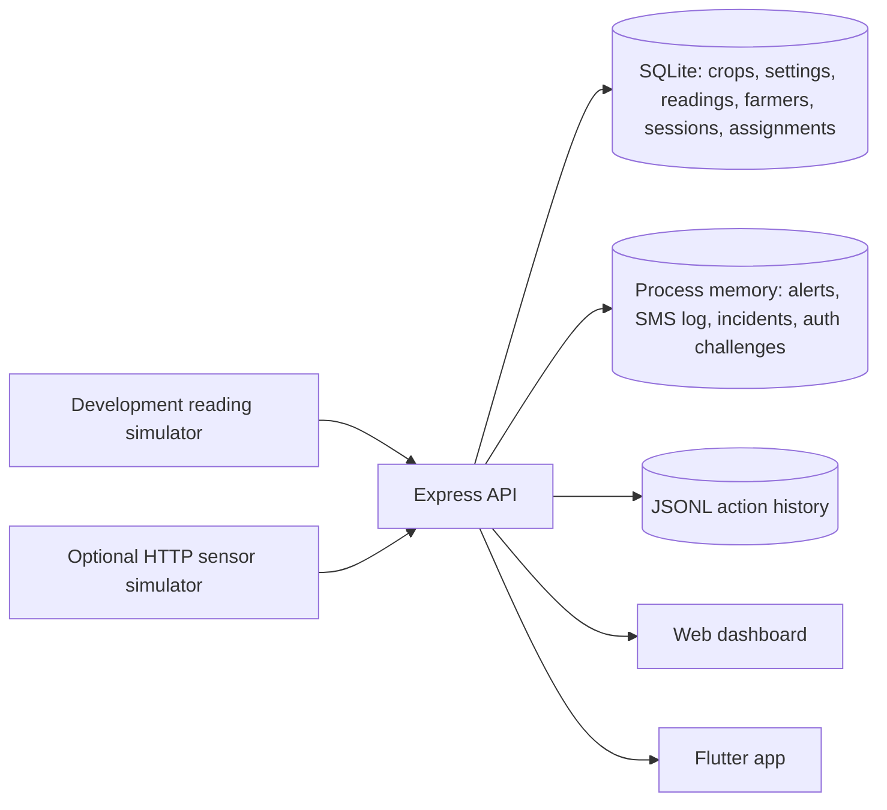

# Current implemented architecture

This describes the top-level checkout on branch `exe-work`. The research
proposal and older design documents describe planned work and are not runtime
evidence. Check `git log` and [HANDOFF.md](HANDOFF.md) for the latest verified
revision.

## Components

- `backend/server.js` serves the JSON API and static dashboard. Demo mode
  generates readings and publishes updates through server-sent events.
- `backend/database.js` uses the `sqlite3` CLI. SQLite persists crop profiles,
  active-crop settings, readings, farmer accounts, password hashes, sessions,
  farmer crop locations, and assigned sensor IDs. Crop profiles include a
  crop group, room-temperature/RH alert ranges, optional safe grain moisture
  guidance and a storage note. Existing databases are migrated on startup for
  crop metadata and prior account columns.
- Alert records, acknowledgement state, simulated SMS entries, incidents,
  OTP challenges, mobile QR challenges, rate-limit counters, and live event
  state are process memory and are lost on restart. Dashboard actions are
  appended to `backend/data/actions.jsonl`.
- `backend/public/index.html` is the browser client. `lib/` contains the
  Flutter client, `ApiService`, models and `DashboardController`.

## Authentication and mobile pairing

- Demo mode shows a one-tap **Demo mode** entry in both clients. It opens the
  shared built-in farmer, **Mr Lesego Lefoko** (`LLefoko@email.co.bw`). Demo
  does not issue or require session tokens, display login/verification forms,
  or expose password/OTP/QR authentication endpoints. Crop locations and
  sensor assignments belong to the shared farmer.
- Production mode retains phone verification, password credentials and
  authenticator/QR routes. Phone verification requires an SMS provider.
- An account without credentials can add an email/password after phone
  verification. Passwords are scrypt hashes with per-account random salts.
  Email/password sign-in is available from the web login page. Existing
  accounts can use phone/Google Authenticator sign-in where configured.
- In production, the web dashboard issues a random one-use mobile pairing
  challenge after web authentication. Mobile exchanges it for its own
  seven-day session. A signed-in phone can also approve a one-use web login QR.
  Both challenge directions expire in two minutes.
- Sign-in QR pairing works in both directions through the same backend: a web
  account can issue a phone login QR, and a signed-in phone can scan/approve a
  web login QR. Challenges are single-use and expire after two minutes.
- Session tokens are random bearer values; SQLite stores their SHA-256 hashes.
  Password hashes and session hashes are not returned by API responses.

## Data and synchronization boundaries

- The browser dashboard and mobile app share farmer accounts and farmer crop
  assignments when pointed at the same backend database. Separate backend
  instances have separate accounts and data.
- Farmer profile, crop-location and sensor-assignment endpoints require a
  valid session. The monitor's active crop, status, readings, alerts, and
  sensor-ingestion routes remain global rather than farmer-scoped.
- Sensor assignment is account metadata. Available sensor IDs are inferred
  from recent `site` values submitted to the readings API; device identity is
  not authenticated.
- Recent reading history and crop settings persist in SQLite. Alert/SMS and
  incident history are in memory. Trend history combines retained readings
  with clearly marked seeded synthetic history.

## Mobile behavior

The bottom tabs are Overview, Trends, My Crops, Alerts, and Settings, with My
Crops in the center. Status refreshes every 20 seconds; the dashboard keeps
the last connection state through two missed refreshes and reports offline
after three consecutive failures. The event stream also triggers refreshes.

Alerts and crop-quality estimates use configured limits. The mobile estimate
is shown only for Maize and Sorghum and uses ambient temperature and relative
humidity; it is a rough heuristic, not an inspection, grain-moisture reading,
spoilage classifier, or shelf-life forecast. Crop limits are illustrative.

The shared crop catalog is seeded by `backend/database.js` and grouped for
selection in web and mobile farmer crop setup. It includes Botswana-relevant
dry grains, pulses, oilseeds, vegetables and fruits. Farmer setup shows the
selected profile's room target and storage note; grain moisture is displayed
separately and is not inferred from RH. See
[the crop package](BOTSWANA_CROP_STORAGE_PACKAGE.md) for its sources, limits
and the proposed low-literacy workflow.

## Runtime and security boundaries

- The default backend uses plain HTTP. Demo mode binds to loopback and detected
  private IPv4 interfaces; production defaults to loopback unless `HOST` is
  explicitly configured.
- Production disables the demo reading simulator. Phone verification returns
  an error until SMS delivery is configured. Demo authentication routes are
  unavailable; demo requests use the shared demo farmer without a session.
- Global monitoring APIs are not account-scoped. Do not expose this prototype
  to untrusted networks or use it as production identity or sensor security.
- No physical sensor, carrier SMS, field pilot, calibrated threshold, or
  validated crop-quality model is included.

For startup and deployment settings, see [backend/DEPLOYMENT.md](../backend/DEPLOYMENT.md).
