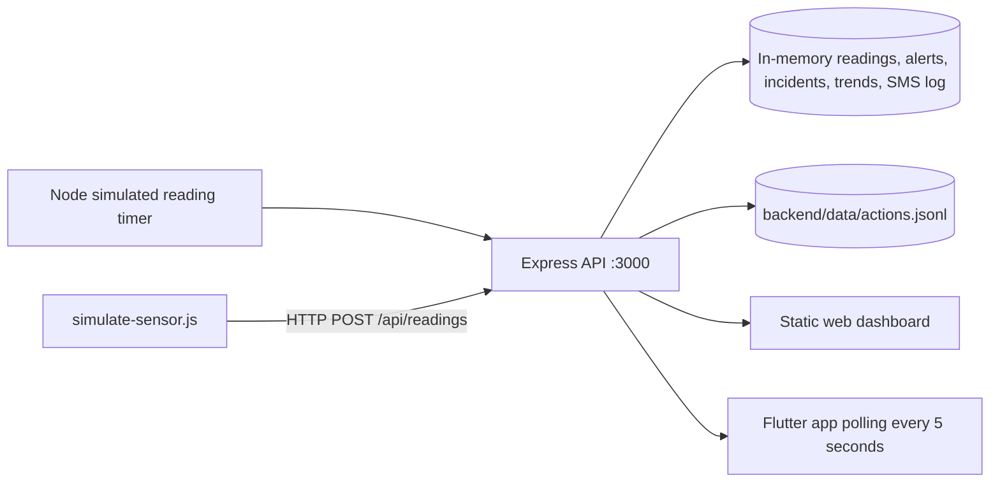

# Implemented architecture (baseline)

This describes the top-level checkout as inspected on 15 October 2026. It is intentionally separate from the target architecture in `PROJECT_CONTEXT.md` and the build guide.

## Components and boundaries

- `backend/server.js` serves `backend/public/`, binds to `0.0.0.0:3000`, enables unrestricted CORS, parses JSON, generates simulated data every five seconds, and evaluates readings against one process-wide active crop.
- `backend/simulate-sensor.js` is an optional second simulator that reads the active threshold from `/api/status` then submits a sample to `/api/readings`. It is not firmware and does not emulate a transport failure or real device identity.
- The API's readings (maximum 200), alerts (maximum 50), trend buckets (at most 90 days), SMS log (maximum 50), incidents, and selected thresholds live in process memory. Restart clears those collections and restarts the synthetic 24-hour chart baseline.
- User actions are separately appended to `backend/data/actions.jsonl` and reloaded on startup, capped to the most recent 2,500. This file is not a transactional domain database; a crash/partial write, concurrent writers, retention semantics, and recovery have not been tested.
- `backend/public/index.html` fetches dashboard data directly from the same API. It displays readings, alert/SMS log, trends, export actions and a heuristic storage-time estimate.
- Top-level `lib/` is the Flutter client. `ApiService` calls the same HTTP endpoints; `DashboardController` polls status-related data on a five-second timer. App settings can point at a LAN or emulator address.

## Current request/data flow

1. Backend startup seeds a 24-hour synthetic trend series and an immediate randomly generated reading; its five-second timer creates additional simulated readings.
2. A sensor simulator can POST finite numeric temperature/humidity and a non-empty site. Humidity is restricted to 0–100; temperature has no plausible physical range bound. If a crop is supplied, it must match the globally active crop.
3. A reading is tagged `simulation` or `sensor`, stored in memory, rolled into a minute aggregate, and compared to the active crop's hard-coded limits. Any temperature or RH bound crossing creates an alert and a simulated `logged` SMS record.
4. The web and Flutter clients poll status/alerts/history/trends. Crop selection replaces the global active crop, reseeds synthetic trends, and records a safe simulated reading.
5. CSV and Markdown exports are generated by API routes. CSV fields are quoted and selected textual fields are protected from spreadsheet formulas.

## Boundaries and non-claims

There is no real sensor ingestion identity/authentication, persistence for research measurements, stale-data indicator based on reading timestamps, SMS gateway, delivery receipt, access-control layer, or verified spoilage model. Trend startup points are synthetic. “Storage time estimate” values are fixed heuristic buckets. Threshold logic detects configured bounds only. The dashboard's hard-coded “Synced 5 mins ago” string is not derived from actual synchronization time. No SQLite schema or Wokwi/firmware configuration is in the top-level repository.
