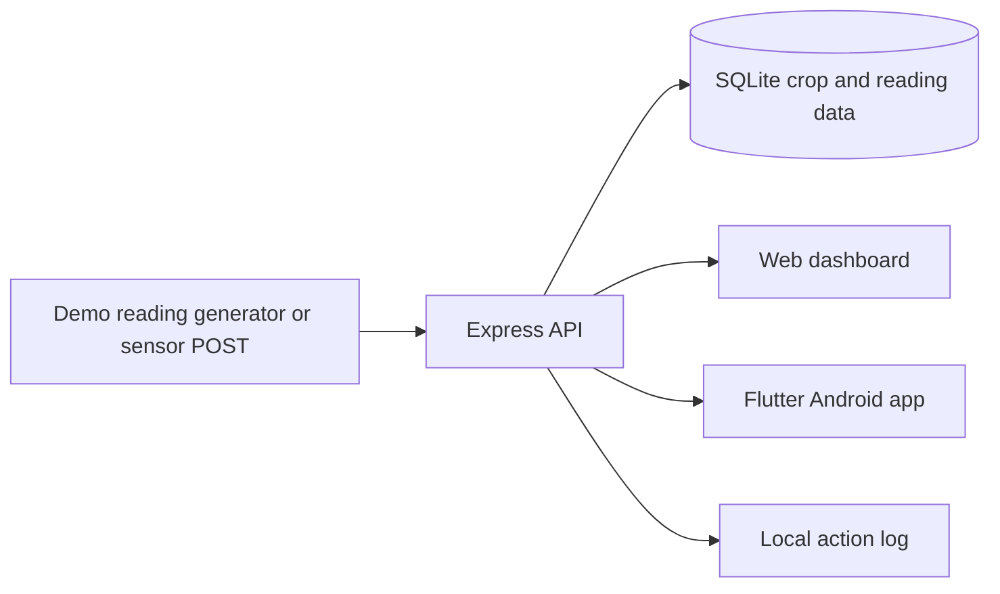

# Current implementation architecture

**Revision under development:** `pauls-branch`, based on `65d308c`.

## Runtime pieces

- `backend/server.js` provides the Express API and serves the web dashboard from `backend/public/index.html`.
- `backend/database.js` stores crop definitions, selected crop, and readings in SQLite through the system `sqlite3` command-line tool. The database path can be set with `DATABASE_PATH`.
- `lib/` contains the Flutter Android client. Both clients call the same backend for readings, trends, crop selection, alerts, and exports.
- `.github/workflows/android-build.yml` runs Flutter widget tests and analysis, builds a debug APK, and runs backend checks and tests on GitHub-hosted runners.

## Demo entry and data

Both clients show a **Demo mode** button and open the home page directly with the shared display profile Mr Lesego Lefoko (`LLefoko@email.co.bw`). The profile is presentation data. Demo mode does not verify a phone, create an account, or issue a session token.

The backend simulates readings outside production mode. Sensor readings, synthetic history, alerts, and alert logs must be distinguished from real hardware and delivered messages. No physical sensor or SMS provider is connected. The activity log is a separate JSONL file. The one selected crop and all monitoring readings are global to the backend, not separated by authenticated farmer or storage site.

The crop starter package has 24 grain, pulse, oilseed, vegetable, and fruit profiles. It includes room temperature/relative-humidity target bands, short handling notes, and grain moisture guidance where available. These are indicative starter references; they do not model variety, maturity, storage duration, ventilation, packaging, or actual produce moisture.

## Known boundaries

- There is no production login, phone verification, account provisioning, QR single sign-on, or API authorization in this revision. These must be designed and tested before adding an auth UI. No SMS capability is assumed.
- The API uses plain HTTP by default. Keep the demo on a controlled local network; do not expose it publicly.
- Crop choice is process-global. Multiple stores or crop lots cannot yet have independent thresholds or histories.
- A reading inside a configured target band means only that the room reading was within that band at that time. It does not prove crop safety, quality, remaining shelf life, or absence of spoilage.
- Alert, incident, and SMS-log behavior remains a simulation; no text message is sent.
- Custom crop limits are user-entered values. The built-in catalog notes source caveats, but does not claim locally validated spoilage thresholds.

## Intended data flow

See [HANDOFF.md](HANDOFF.md), [BOTSWANA_CROP_STORAGE_PACKAGE.md](BOTSWANA_CROP_STORAGE_PACKAGE.md), and [TEST_REPORT.md](TEST_REPORT.md) for current build status, data sources, and verification evidence.
