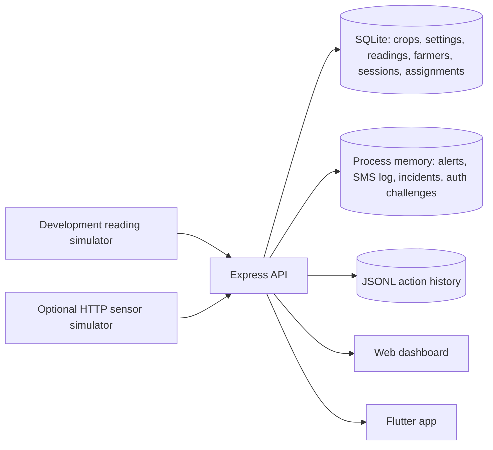

# Current implemented architecture

This describes the top-level checkout on branch `exe-work`. The research
proposal and older design documents describe planned work and are not runtime
evidence. Check `git log` and [HANDOFF.md](HANDOFF.md) for the latest verified
revision.

## Components

- `backend/server.js` serves the JSON API and static dashboard. Demo mode
  generates readings and publishes updates through server-sent events.
- `backend/database.js` uses the `sqlite3` CLI. SQLite persists crop profiles,
  active-crop settings, readings, farmer accounts, password hashes, sessions,
  farmer crop locations, and assigned sensor IDs. Existing account databases
  are migrated on startup to add email/password columns.
- Alert records, acknowledgement state, simulated SMS entries, incidents,
  OTP challenges, mobile QR challenges, rate-limit counters, and live event
  state are process memory and are lost on restart. Dashboard actions are
  appended to `backend/data/actions.jsonl`.
- `backend/public/index.html` is the browser client. `lib/` contains the
  Flutter client, `ApiService`, models and `DashboardController`.

## Authentication and mobile pairing

- Web accounts are created with a phone number; account creation is finalized
  after phone verification. In demo mode, there is no SMS delivery or PIN
  disclosure. A **Skip verification (demo)** route is available only when
  `NODE_ENV` is not production.
- An account without credentials can add an email/password after phone
  verification. Passwords are scrypt hashes with per-account random salts.
  Email/password sign-in is available from the web login page. Existing
  accounts can use phone/Google Authenticator sign-in where configured.
- The credential setup screen's demo skip calls an authenticated backend route,
  which confirms demo mode and persists the choice on the farmer account. Later
  demo phone sign-ins bypass credential setup; production does not honor that
  demo-only choice. The page shows an error if the demo session has expired.
- The web dashboard issues a random one-use mobile pairing challenge only
  after web authentication. A QR contains the backend address and challenge;
  it expires in two minutes. Mobile exchanges the challenge for its own
  seven-day session. The mobile sign-in screen also supports phone OTP or
  Google Authenticator for existing farmer accounts. Demo mode offers a
  verification bypass because no SMS is sent; production needs an SMS provider.
- Session tokens are random bearer values; SQLite stores their SHA-256 hashes.
  Password hashes and session hashes are not returned by API responses.

## Data and synchronization boundaries

- The browser dashboard and mobile app share farmer accounts and farmer crop
  assignments when pointed at the same backend database. Separate backend
  instances have separate accounts and data.
- Farmer profile, crop-location and sensor-assignment endpoints require a
  valid session. The monitor's active crop, status, readings, alerts, and
  sensor-ingestion routes remain global rather than farmer-scoped.
- Sensor assignment is account metadata. Available sensor IDs are inferred
  from recent `site` values submitted to the readings API; device identity is
  not authenticated.
- Recent reading history and crop settings persist in SQLite. Alert/SMS and
  incident history are in memory. Trend history combines retained readings
  with clearly marked seeded synthetic history.

## Mobile behavior

The bottom tabs are Overview, Trends, My Crops, Alerts, and Settings, with My
Crops in the center. Status refreshes every 20 seconds; the dashboard keeps
the last connection state through two missed refreshes and reports offline
after three consecutive failures. The event stream also triggers refreshes.

Alerts and crop-quality estimates use configured limits. The mobile estimate
is shown only for Maize and Sorghum and uses ambient temperature and relative
humidity; it is a rough heuristic, not an inspection, grain-moisture reading,
spoilage classifier, or shelf-life forecast. Crop limits are illustrative.

## Runtime and security boundaries

- The default backend uses plain HTTP. Demo mode binds to loopback and detected
  private IPv4 interfaces; production defaults to loopback unless `HOST` is
  explicitly configured.
- Production disables the demo reading simulator and demo verification skip.
  OTP requests fail until SMS delivery is configured.
- Global monitoring APIs are not account-scoped. Do not expose this prototype
  to untrusted networks or use it as production identity or sensor security.
- No physical sensor, carrier SMS, field pilot, calibrated threshold, or
  validated crop-quality model is included.

For startup and deployment settings, see [backend/DEPLOYMENT.md](../backend/DEPLOYMENT.md).
