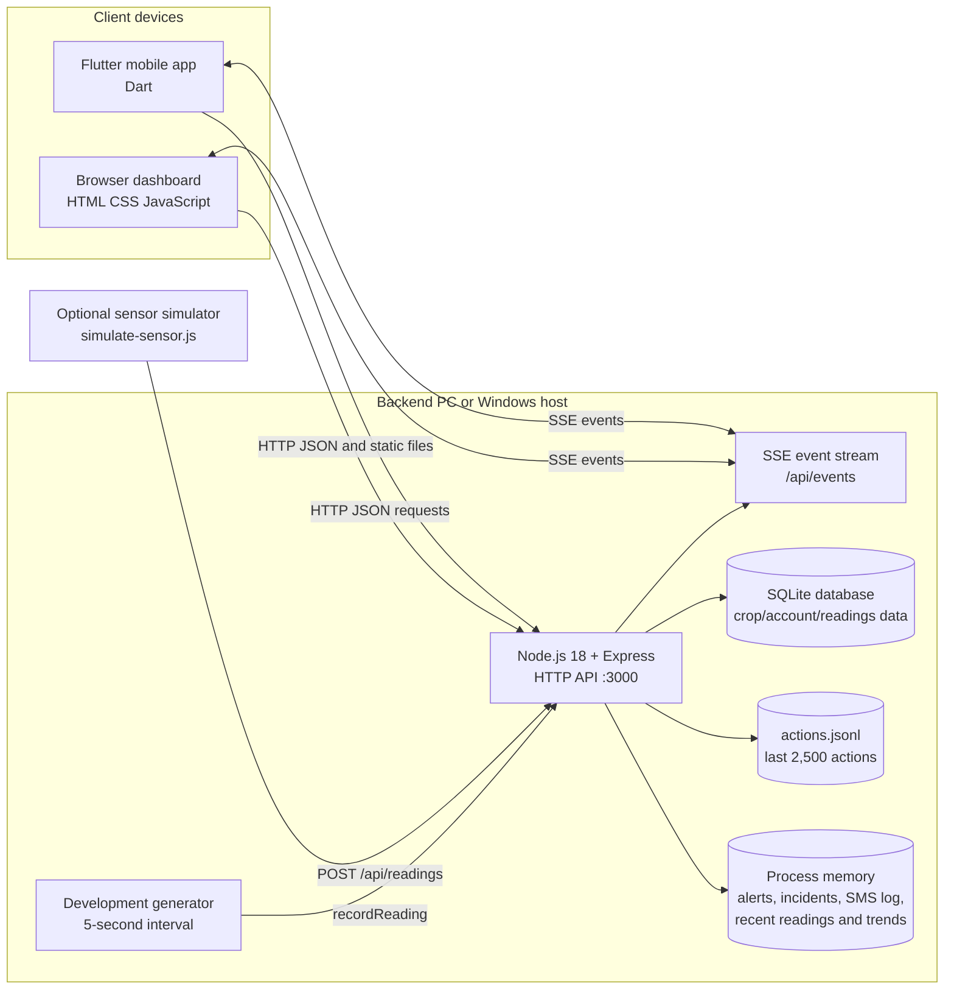
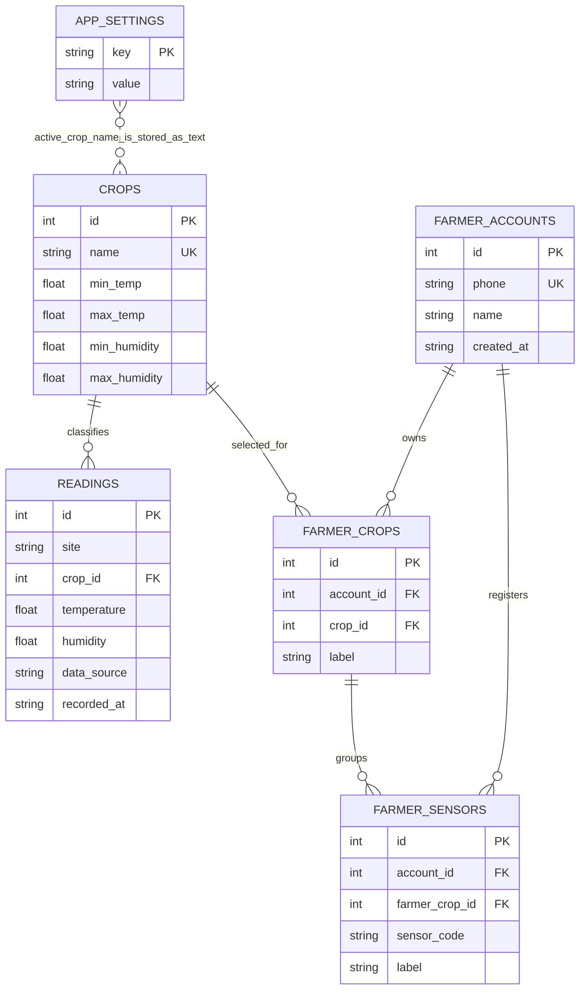

# Peo Yame Storage Monitor: Technical Research Project

**Repository state reviewed:** 7 November 2026
**Active branch:** `exe-work`
**Purpose:** describe the implemented application, its technology choices, data and network flows, persistence, build and deployment paths, and security posture. This is an implementation study, not a claim that the prototype is a validated agricultural monitoring instrument.

> Current as of commit `e2161c6`: farmer email/password sign-in, scrypt-hashed
> passwords, SQLite-backed hashed sessions, and one-use mobile QR pairing
> issued only from an authenticated web session are implemented. Demo PINs are
> not returned to clients; demo mode has an explicit verification bypass. The
> detailed OTP-QR and in-memory-session descriptions in earlier notes below
> are superseded by the current [architecture](ARCHITECTURE.md) and
> [handoff](HANDOFF.md). Global monitor APIs remain unscoped and default HTTP
> is not suitable for untrusted networks.

## 1. Project overview and scope

Peo Yame is a local-network produce-storage monitoring prototype. It has a Flutter mobile client, a browser dashboard served by a Node.js backend, simulated readings, crop threshold configuration, trend and alert displays, basic farmer accounts, crop-location records and sensor-assignment records. The Windows distribution is a packaged backend executable; it is not the Flutter Windows desktop client.

The backend can accept sensor-style HTTP readings and can generate synthetic readings in development mode. The current repository does not include sensor firmware or a physical sensor integration. Farmer sensor assignments are account metadata: readings are not associated with a farmer, crop location or sensor record. A logged “SMS” is a demo record, not a delivered message. Threshold breaches mean that a reading crossed configured limits; they do not establish spoilage or remaining shelf life.

The top-level repository is the active Flutter project. `flutter_application_1/`, `from sasa/`, `storage-demo.zip`, and the patched nested project are historical, copied or alternative materials. The backend Windows workflow and the Flutter project use the top-level sources, not those nested copies.

## 2. System architecture

### Main request and update paths

1. The backend starts, opens/creates SQLite tables, loads the last 200 saved readings, reconstructs trend buckets from persisted readings, loads the JSONL action log, and in development mode inserts a one-time synthetic history baseline and starts the reading generator.
2. A generated or submitted reading is checked against the globally active crop limits. The reading is written to SQLite and appended to a bounded in-memory list; its trend bucket and any alert/demo SMS-log entry are updated in memory. An SSE event tells connected clients that data changed.
3. The web dashboard fetches JSON from the same Express server and renders the UI in `backend/public/index.html`. Its JavaScript listens to `/api/events` and also refreshes on a 30-second interval.
4. The Flutter `DashboardController` fetches status, alerts and history together, loads trends, listens to the same SSE stream, and refreshes every 20 seconds as a fallback. It tolerates two missed refreshes before showing offline status. When the API is unavailable, the last loaded view remains on screen and the SSE connection retries with exponential backoff capped at 30 seconds.
5. The backend must keep running for live updates. Closing the Windows console terminates the Node process and HTTP/SSE service; the app is expected to show offline state and reconnect after restart.

## 3. Technology stack and language choices

| Technology / language | Use in this repository | Why it fits this implementation |
|---|---|---|
| Dart + Flutter | Main mobile client in `lib/`; shared UI/state and HTTP behavior | A single UI codebase can target Android and other Flutter platforms. Flutter provides the Material UI, navigation, widget lifecycle and plugin model used here. |
| JavaScript (Node.js 18) | Local backend, REST routes, demo data generation, packaging entry point | A small asynchronous HTTP service is convenient for serving static files, JSON APIs and SSE from one process. It also packages to a standalone Windows runtime through `pkg`. |
| Express 4 | Routing, JSON body parsing, static dashboard hosting | Provides the lightweight route/middleware structure used for API and static file delivery. |
| SQL (SQLite dialect) | Schema, constraints, indexes, queries and inserts in `backend/database.js` | A local, single-file relational store gives the prototype persistence without a separate database server. |
| SQLite command-line executable | Backend database adapter | The backend passes SQL on stdin to `sqlite3` via Node `execFileSync`; source runs expect `sqlite3` on `PATH`, while the Windows package embeds and extracts `sqlite3.exe`. This avoids a Node native database binding but makes each query a synchronous child-process call. |
| HTML, CSS and browser JavaScript | Separate responsive dashboard in `backend/public/index.html` | Static assets are served directly by Express, so the desktop dashboard needs no separate web server or frontend bundler. The page calls the same API as the mobile app. |
| PowerShell | `backend/build-windows.ps1` | Automates Windows-specific download, packaging, smoke startup, ZIP creation and cleanup. |
| Kotlin + Gradle Kotlin DSL | Android launcher and Android build configuration | Flutter still needs the native Android activity, permissions, Gradle plugin configuration and plugin registration. The app logic remains Dart. |
| Swift / Objective-C project glue | iOS Flutter runner and camera permission metadata | Required native shell and permission declaration for iOS builds; no separate iOS business logic is implemented. |
| C++ / CMake | Flutter desktop runners for Windows, Linux and macOS | Flutter's generated desktop shells use native C++ build systems. They are not the packaged Node backend. |
| YAML, JSON, XML, plist, Markdown | CI workflow, manifests, Android resources, iOS metadata, package configuration and documentation | Declarative configuration and cross-platform packaging/documentation formats. |

### Declared package and tool versions

- Dart SDK constraint: `^3.9.2`; Flutter SDK is supplied by the build environment rather than pinned in this repository.
- Flutter packages: `http ^1.6.0`, `shared_preferences ^2.3.0`, `share_plus ^11.1.0`, `mobile_scanner ^7.5.0`, and `cupertino_icons ^1.0.8`; `flutter_lints ^5.0.0` is a development dependency. Exact locked resolutions are recorded in `pubspec.lock`.
- Backend runtime target: Node.js 18; dependencies are `express ^4.19.2` and `cors ^2.8.5`.
- Windows packaging uses `pkg@5.8.1` through `npx`, targeting `node18-win-x64`. The build script downloads SQLite tools version 3.50.4.0 for Windows x64.
- Android project build configuration uses Gradle 8.14, Android Gradle Plugin 8.11.1, Kotlin Gradle Plugin 2.2.20, Java 11 bytecode target, and Java 17 in GitHub Actions. Current Flutter tooling warns these Gradle/plugin versions will need future compatibility updates.

## 4. Application components and source map

### Flutter client

- `lib/main.dart`: application root, mobile QR and phone-verification sign-in/session gate, dashboard screens, five-tab navigation, Settings, data exports and UI actions.
- `lib/api_service.dart`: HTTP request construction, JSON decoding, timeouts, SSE stream decoding, mobile QR/OTP/account/crop operations and exports.
- `lib/dashboard_controller.dart`: dashboard state, SSE lifecycle, reconnect loop, 20-second polling fallback, tolerance for two missed refreshes, request coalescing, crop loading, selection and error state.
- `lib/models.dart`: typed data objects for readings, trends, thresholds, status and alerts.
- `lib/account_screens.dart`: farmer Accounts and My Crops views, farmer-name edit dialog, crop-location listing and deletion. Some account summary counts, sensor-linking affordances and reading decoration remain design/demo content.
- `lib/config.dart`: `API_BASE_URL` build-time override, default emulator URL `http://10.0.2.2:3000`, and URL normalization. A physical device must be pointed at the backend PC, normally through a QR code.
- `pubspec.yaml` / `pubspec.lock`: Flutter package declarations and resolved package graph.

The app uses `ChangeNotifier` and Flutter widget state rather than a separate state-management framework. `ApiService` uses the `http` package and a reusable client. JSON is decoded into the model classes. Dashboard requests generally have 4–8 second request timeouts; a timed-out refresh is tolerated twice before the UI reports offline. `SharedPreferences` stores the backend URL and current farmer bearer token. `share_plus` passes generated exports to the device share sheet.

The camera plugin is `mobile_scanner`; Android declares Internet and Camera permissions, Android cleartext traffic is enabled for local HTTP, and Apple platform plists declare a camera usage string. The signed-out scanner accepts only the structured, one-use mobile-login QR issued from an authenticated web session. It does not scan an OTP QR or allow signed-out backend-address setup.

### Node backend and browser dashboard

- `backend/server.js`: Express application, CORS and body-size middleware, process configuration, process-local OTP/QR challenges and password-failure counters, sensor simulation, data validation, REST routes, SSE event fan-out, logs and startup. Farmer sessions are persisted through `database.js`.
- `backend/database.js`: SQLite file selection, schema initialization, seeded crops, SQL helpers, CRUD functions and historical trend queries.
- `backend/runtime_paths.js`: runtime data location. A packaged Windows app defaults to `%LOCALAPPDATA%/Peo Yame/data`; source runs default to `backend/data`. `APP_DATA_DIR` or `DATABASE_PATH` can override portions of this path configuration.
- `backend/public/index.html`: self-contained browser dashboard and farmer-account/crop management UI.
- `backend/public/qrcode-generator.js`: vendored QR encoder used locally to render connection and sign-in QR SVGs. Its accompanying license is in `backend/public/qrcode-generator.LICENSE`; QR content is not sent to an external QR service.
- `backend/simulate-sensor.js`: optional second process that reads `/api/status`, generates a safe sample and POSTs it to `/api/readings` every five seconds. It is a simulator, not firmware.
- `backend/launcher.js`: top-level exception/rejection reporting for the packaged process, friendly port/data-directory errors, a temporary startup log and a pause-on-error for interactive Windows runs.
- `backend/build-windows.ps1`: fetches temporary SQLite tools and the pinned Windows `rcedit` utility, runs the Node packager, embeds the branded multi-resolution `.ico` in the backend EXE, smoke-starts it on localhost port 3188, checks `/api/health`, `/` and database creation, and creates `Peo-Yame-Backend.zip` with a plain-language Read Me. The Flutter Windows runner separately uses the branded icon in `windows/runner/resources/app_icon.ico`.
- `backend/DEPLOYMENT.md`: source and production deployment notes, SQLite/WAL handling and known demo constraints.

The root `web/` directory is Flutter's web runner scaffold. The independent production-like browser dashboard used by the backend is `backend/public/` and is served by Express. Do not conflate the Flutter web target with that dashboard.

## 5. Database and persistence design

### SQLite schema

The schema is initialized idempotently with `CREATE TABLE IF NOT EXISTS` in `backend/database.js`; there is not yet a versioned migration framework.

| Table | Columns and constraints | Role and persistence |
|---|---|---|
| `crops` | Integer primary key; case-insensitive unique `name`; temperature bounds constrained to −50…100; humidity bounds constrained to 0…100; minimum must be less than maximum; `created_at` default UTC timestamp | Crop/commodity catalogue and configured monitoring thresholds. Maize and Tomato seed rows are inserted with `INSERT OR IGNORE`. |
| `app_settings` | Text primary key `key`, required text `value` | Stores the selected global active crop and the one-time history-seed marker. |
| `readings` | Integer primary key; required `site`; `crop_id` FK to `crops`; numeric temperature/humidity; required `data_source`; UTC `recorded_at`; humidity database check 0…100 | Durable readings, including generated demo data and submitted sensor-style data. Index on `recorded_at`. These rows are not tied to a farmer or registered sensor. |
| `farmer_accounts` | Integer primary key; case-insensitive unique `phone`; required `name`; UTC `created_at` | Farmer profile identity. OTP-based local registration creates a row after successful verification. |
| `farmer_accounts` (auth fields) | Unique email; nullable password salt/hash; nullable TOTP secret | Email/password credentials use salted scrypt hashes. Startup column checks add missing auth fields to existing databases. |
| `farmer_accounts.demo_security_skipped` | Boolean integer, default false | Persists a user's demo-only choice to defer email/password setup. The choice is honored only in demo mode. |
| `farmer_sessions` | Hashed token primary key; account FK; expiry timestamp | Persists bearer-session hashes and seven-day expiry; plaintext tokens are held by clients only. |
| `farmer_crops` | Integer primary key; `account_id` FK with `ON DELETE CASCADE`; `crop_id` FK; required location `label`; UTC creation time; unique `(account_id, crop_id, label)` | Crop/storage locations owned by a farmer. One farmer can have many locations, including multiple locations for a commodity. |
| `farmer_sensors` | Integer primary key; `account_id` FK cascade; `farmer_crop_id` FK cascade; `sensor_code`, `label`, `created_at`; unique `(account_id, sensor_code)` | Sensor identifiers assigned to a farmer's crop locations. Deleting the crop location cascades to these assignments. The route validates that the location belongs to the account before insertion. |

SQLite is opened in WAL mode (`PRAGMA journal_mode=WAL`) and foreign-key enforcement and a 5-second busy timeout are set for CLI calls. Most SQL is issued as synchronous `execFileSync` calls with a timeout and 8 MiB output limit. Strings are escaped by doubling apostrophes; numeric IDs are converted to numbers before interpolation. This is a small local adapter, not a connection pool or high-concurrency database layer.

### What is and is not durable

- Durable in SQLite: crop definitions and thresholds; selected active crop; farmer account profile and password hash; farmer session hashes and expiries; crop-location records; registered sensor assignments; readings.
- Trend history is queried from persisted readings at startup and compacted into hourly aggregates (the source query groups by hour). New process readings update in-memory minute buckets. The API trims trends to roughly the last 90 days.
- Development startup inserts a deterministic synthetic hourly history baseline once, marked in `app_settings`. The baseline is synthetic research/demo data, not observation from a physical sensor.
- Only the newest 200 readings are loaded to the process list for recent-history/status-related routes and CSV export. Longer stored history remains queryable for trend aggregation.
- In-memory only: OTP and mobile-QR challenge records, password failed-attempt counters, recent alert list (up to 50), “SMS” log (up to 50), incident list, active demo-breach timer, and live minute aggregates. Alerts, incidents and pending challenges disappear on restart; persisted farmer sessions, readings and account/crop records do not.
- `backend/data/actions.jsonl`: action events persist separately from SQLite. The file is loaded on startup and capped in memory at 2,500 entries. When the cap is reached the current retained set is rewritten; otherwise events append one JSON line at a time. It is not transactionally related to a SQLite update.

### Data ownership and relational gaps

The farmer account → crop location → registered sensor ownership path is implemented for profile and registration management. It is not yet integrated with readings: `readings` has a site and crop-master foreign key but no farmer-account, farmer-crop or sensor foreign key. Consequently the dashboard's current live status is process-wide and global, rather than filtered by account or registered sensor. Crop deletion removes its sensor registrations but does not delete historical readings for that commodity.

The `APP_SETTINGS` relationship is conceptual only: `active_crop` is stored as a string value, not as an enforced foreign key. Likewise, the intended account/sensor assignment does not establish ownership of `READINGS`.

## 6. Backend API surface

All routes use the configured Express host and port (`HOST`, default development `0.0.0.0`; `PORT`, default `3000`). JSON body parsing is limited to 32 KiB. Unless noted, reads and writes are not account-authenticated.

| Method and path | Purpose / data flow |
|---|---|
| `GET /api/health` | Lightweight process health response with status and time. |
| `GET /api/connection-info` | Lists selected private IPv4 addresses and port for client pairing QR creation. |
| `GET /api/events` | Opens an SSE response; emits initial connected event, then update notifications; keepalive comments every 15 seconds. |
| `GET /api/status` | Latest reading for the process-wide active crop, active threshold and breach boolean. |
| `GET /api/thresholds` | Current active crop threshold object. |
| `GET /api/crops` | Saved global crop catalogue and thresholds. |
| `POST /api/crops` | Validates and persists a crop and broadcasts a crop update. |
| `POST /api/commodity` | Changes the process-wide active crop and saved setting; notifies clients and creates/returns a safe reading in demo mode. |
| `POST /api/readings` | Validates a numeric temperature, RH 0…100 and non-empty site; optionally checks supplied commodity against the active crop; persists and broadcasts a sensor-tagged reading. No sensor credential is required. |
| `GET /api/readings` | Returns recent in-memory readings, optionally filtered by commodity and capped at 200. |
| `GET /api/readings/latest` | Returns the latest in-memory reading, optionally by commodity. |
| `GET /api/readings/history` | Returns current active-crop history from the recent in-memory list. |
| `GET /api/readings/trends?range=` | Returns trend buckets for `24h`, `month` or `3months`; defaults to 24h. Includes synthetic/live indicators. |
| `GET /api/readings/export.csv` | Exports retained recent readings, crop limits, data source and breach flag. Quoted CSV and formula-prefix protection are applied to selected textual fields. |
| `GET /api/alerts` | Returns recent alerts, optionally `unacknowledged=true`, bounded to 200. |
| `POST /api/alerts/:id/acknowledge` | Marks a process-memory alert acknowledged and broadcasts an update. |
| `GET /api/sms-log` | Returns simulated/logged notification records; no SMS is sent. |
| `GET /api/incidents`, `POST /api/incidents` | Reads/adds process-memory incident observations. Input checks commodity, date, description and outcome (`loss`/`noloss`). |
| `GET /api/actions`, `POST /api/actions` | Reads or records action log entries. Actor/source/details are client-supplied and not authenticated. |
| `GET /api/actions/export.md` | Builds a Markdown activity export and logs the export action. |
| `POST /api/sim/breach` | Injects a timed demo threshold breach, updates alert data and broadcasts an event. |
| `POST /api/auth/request-otp`, `POST /api/auth/verify-otp` | Phone challenge flow with five-minute expiry and attempt limit; demo responses do not include a PIN. Production OTP requests fail until delivery is configured. |
| `POST /api/auth/demo/skip-verification` | Development/demo-only verification bypass; disabled in production. Consumes an existing pending phone challenge. |
| `POST /api/auth/password` | Email/password login; validates salted scrypt hashes and applies a per-email failed-attempt window. |
| `PUT /api/account/credentials` | Authenticated email/password setup; validates unique email and stores a salted scrypt hash. |
| `POST /api/account/credentials/skip` | Authenticated demo-only continuation without setting a password; confirms demo mode and persists that choice. |
| `POST /api/account/mobile-login-qr`, `POST /api/auth/mobile-qr` | Authenticated web account issues a two-minute one-use QR challenge; mobile consumes it to create a separate session. |
| `GET /api/account`, `PATCH /api/account` | Authenticated farmer profile read/update, including email. |
| `POST /api/auth/logout` | Deletes the current persisted session hash. |
| `GET /api/farmer/crops`, `POST /api/farmer/crops`, `DELETE /api/farmer/crops/:id` | Authenticated farmer-owned crop-location list, create and delete. Delete cascades sensor assignments. |
| `GET /api/farmer/sensors`, `POST /api/farmer/sensors`, `DELETE /api/farmer/sensors/:id` | Authenticated farmer-owned sensor-assignment list, create and unlink. |
| `GET /api/farmer/available-sensors` | Lists distinct valid sensor IDs inferred from `site` values on persisted readings with `data_source='sensor'`, excluding IDs already assigned to a farmer. `connected` means the last such reading arrived within five minutes. |
| `POST /api/farmer/crop-setup` | Atomically creates a crop location and assigns one to 20 selected, currently connected backend sensor IDs. The sensor ID becomes both the registration code and display label. |

## 7. User and data flows

### Mobile backend pairing

1. Sign in to the web app, then select **Connect mobile app** from its menu.
2. The browser obtains a challenge through authenticated `POST /api/account/mobile-login-qr`, selects a backend address, and renders the QR locally.
3. The QR contains the backend URL and random opaque challenge, not an OTP. It is single-use and expires after two minutes.
4. In the signed-out mobile app, select **Scan sign-in QR**. The app saves the backend URL, checks reachability, and exchanges the challenge at `/api/auth/mobile-qr`.
5. Both devices need local-network reachability; the PC firewall must allow the port. The QR does not keep the backend running.

### Phone verification, credentials and account sign-in

1. Web and mobile request phone verification through `/api/auth/request-otp`. OTP challenge hashes and expiry/attempt data remain in process memory; the raw code is not returned to clients. Demo mode offers an explicit bypass button instead of exposing a code. The bypass consumes a pending challenge and is disabled in production. Mobile phone sign-in is for existing farmer accounts; new accounts are created on the web.
2. `/api/auth/verify-otp` checks the PIN when delivery is configured, or checks an authenticator code for accounts with TOTP enabled. Successful verification creates a server session for the requesting client; web proceeds to account credential setup when needed.
3. Accounts without password credentials can save a unique email and password at `/api/account/credentials`. The server derives a 64-byte scrypt hash with a per-account random salt; raw passwords are not stored. Demo mode permits skipping this step through authenticated `/api/account/credentials/skip`; SQLite remembers the choice for subsequent demo phone sign-ins. Production does not honor the demo skip.
4. Web email/password login calls `/api/auth/password`. Mobile can sign in with phone/authenticator verification or signed-in-web QR pairing. Password hashes and sessions are not returned in API payloads.
5. Farmer session token hashes and seven-day expiry are stored in SQLite, so valid sessions survive backend restarts. Flutter stores its bearer token in `SharedPreferences`; the browser uses `localStorage`.

### Account and crop management

- **Edit account:** mobile/web sends `PATCH /api/account` with bearer token, name, phone and email. The server validates and updates SQLite.
- **My Crops:** clients call authenticated `GET /api/farmer/crops`; the list includes crop, location label, threshold fields and sensor count. The add flow reads crop choices from `/api/crops`, available sensor IDs from `/api/farmer/available-sensors`, then sends crop/location/one-or-more sensor IDs together to `/api/farmer/crop-setup`. Mobile shows assigned IDs and supports deletion; web supports the same combined setup plus unlink and delete actions.
- **Sensor discovery boundary:** an ID is considered available after a `/api/readings` request with a valid `site` identifier persists a `data_source='sensor'` reading. It is marked connected for five minutes from its most recent reading. The backend does not authenticate the sender or prove a physical device identity; `site` is only the identifier claimed by the sender.
- **Delete:** `DELETE /api/farmer/crops/:id` checks that the ID is valid and belongs to the current account. SQLite foreign-key cascade removes registrations in `farmer_sensors` when the parent location is deleted.
- **Multiple sensors per account/location:** sensor assignment rows reference a farmer account and crop location; a farmer may add several unique sensor codes. This records intended assignment only and does not make readings sensor-specific.

## 8. Build, packaging and runtime

### Android client

The GitHub Actions workflow `.github/workflows/` runs on pushes, pull requests and manual dispatch. It installs Java 17 and stable Flutter, runs `flutter pub get`, builds a **debug** APK (`flutter build apk --debug`) and uploads `storage-monitor-android-debug` for 14 days. This is a test/debug artifact, not a signed Play Store release. Android's Gradle configuration targets the Flutter SDK's compile/min SDK values and uses Java 11 target compatibility.

### Windows backend

The separate `windows-backend` workflow job runs on Windows, installs Node 18, executes `npm ci`, runs `build-windows.ps1`, and uploads `peo-yame-backend-windows` for 30 days. The script temporarily downloads the SQLite tools ZIP and `rcedit`, embeds `sqlite3.exe` as a `pkg` asset, creates `Peo-Yame-Backend.exe`, sets the Peo Yame icon resource, smoke-starts it on localhost, confirms health/static UI/database creation, writes a simple start guide and ZIPs the deliverable. Temporary SQLite and resource-editor files are removed at the end.

At runtime the backend stores SQLite under `%LOCALAPPDATA%/Peo Yame/data/storage-monitor.sqlite` by default, opens the web dashboard at `http://127.0.0.1:3000`, and can expose its LAN address in the mobile connection QR. The executable is not a Windows service: closing its console stops it. Source execution requires Node and SQLite on PATH; the packaged EXE is intended not to require those installations.

Flutter has native runner scaffolds in Android, iOS, Windows, Linux and macOS. Their presence is not equivalent to release support: automated distribution currently covers Android debug and the Node Windows backend, and the Flutter Windows runner is not the backend executable.

### Runtime configuration

| Variable | Component | Meaning / default |
|---|---|---|
| `PORT` | Backend | HTTP port; defaults to `3000`. |
| `HOST` | Backend | Listen address; defaults to `0.0.0.0` outside production and `127.0.0.1` in production. |
| `NODE_ENV` | Backend | `production` disables demo generation and OTP demo delivery and changes CORS/listen defaults. Any non-production value enables local demo behavior. |
| `CORS_ORIGINS` | Backend | Comma-separated exact allowed origins. If unset, development is permissive; production disables cross-origin browser access by default. |
| `DATABASE_PATH` | Backend | Explicit SQLite path override. |
| `APP_DATA_DIR` | Backend | Explicit base data directory for SQLite and action log. |
| `SQLITE3_PATH` | Backend | SQLite CLI path override for source execution. Packaged runs use the embedded binary extracted as `peo-yame-sqlite3.exe` under the OS temp folder. |
| `NO_BROWSER` | Windows packaged backend | Setting to `1` suppresses automatic browser opening; used by CI smoke startup. |
| `API_BASE_URL` | Flutter build | Compile-time server URL override, read with `String.fromEnvironment`; default is the Android emulator alias `http://10.0.2.2:3000`. |
| `API_BASE_URL` | Sensor simulator | Environment override for backend URL; default `http://localhost:3000`. |
| `SITE` | Sensor simulator | Submitted site label; default `bay-2`. |
| `INTERVAL_MS` | Sensor simulator | Submission interval; default `5000` ms. |

## 9. Security and privacy considerations

### Protections already present

- OTP value uses Node `crypto.randomInt`; only SHA-256 digest is retained in the in-memory challenge object. Verification compares hashes with `crypto.timingSafeEqual`.
- OTP expires after five minutes, has a 30-second resend throttle per phone and is capped at five attempts.
- Session token is generated with 32 cryptographically random bytes and encoded base64url; only its SHA-256 hash and expiry are persisted. Farmer-profile and farmer-crop/sensor routes require a bearer session.
- Express JSON body parsing is capped at 32 KiB. Crop/reading/account inputs have route-level checks and SQL string quoting doubles single quotes.
- Crop-location and sensor delete/read/create routes scope IDs to the authenticated farmer. Foreign-key cascade removes linked sensor assignments with a deleted location.
- CSV export quotes values and prefixes formula-leading characters for selected text columns.
- Mobile QR scanning checks its structured payload and challenge shape. The QR challenge is generated after web authentication; it is not an OTP or a path for anonymous sign-in.
- Password sign-in applies a per-email limit of five failed attempts per five-minute window and compares derived hashes with constant-time comparison.
- Production mode disables the synthetic reading loop and demo baseline, rejects OTP requests until SMS delivery is configured, disables permissive default CORS, and defaults the backend bind to loopback.

### Important limitations and threat exposure

1. **Development is not a secure deployment mode.** It listens on `0.0.0.0`, uses plain HTTP and allows permissive CORS unless configured. Any reachable device may access unauthenticated global dashboard/sensor routes or attempt account flows. Keep it on a trusted isolated network.
2. **Production is not deployment-ready by itself.** Even though production defaults to loopback and OTP is blocked, remote mobile/web use requires deliberate host/reverse-proxy/CORS configuration. Use HTTPS, controlled firewall rules and provider-backed OTP before exposing it.
3. **Mobile QR challenges are short-lived bearer credentials.** The authenticated web account creates a random, one-use challenge that expires in two minutes. Anyone who obtains the QR before use can pair a mobile session. The challenge is process-local and does not provide a second-device confirmation step.
4. **Client token storage is not a secure vault.** Session hashes persist for seven days in SQLite, but browser `localStorage` is vulnerable to same-origin script compromise, and `SharedPreferences` is not equivalent to OS keychain/secure storage. Sessions can be revoked on logout, but there is no rotation/refresh-token scheme or account-wide session-management UI.
5. **Authentication coverage is partial.** Global reading, crop threshold, commodity selection, incidents, alerts, action-log and SSE endpoints are not behind farmer authentication. Sensor ingestion has no device key, signature, registration check or replay protection. Account ownership is not connected to readings.
6. **CORS is not authorization.** CORS controls browser access, not direct HTTP callers. In production with no allowed origins, browser dashboard use from a separate origin will also be blocked until exact origins are configured.
7. **Plain local HTTP exposes credentials/data on the LAN.** Bearer tokens, PIN verification and QR payloads are unencrypted in transit. Android explicitly enables cleartext traffic for the local prototype.
8. **Abuse protection is partial.** OTP has a per-phone resend delay and attempt counter; password login has a process-local per-email failure window. There is no IP throttling, provider-abuse protection, persistent attempt accounting, or distributed coordination. OTP/QR challenges are process-local.
9. **SQLite and filesystem protections are operational.** There is no database encryption at rest, backup/restore automation, schema migration versioning, file ACL hardening, audit immutability or concurrent multi-host design. WAL files must remain with the database on local storage.
10. **Synchronous database subprocesses block Node's event loop.** This is acceptable only at demo scale. Slow filesystem/database operations can delay all API and SSE clients; no queue or pool controls exist.
11. **Action log is not trusted audit evidence.** It accepts caller-supplied actor/source/details and most writes are unauthenticated. It can contain user-provided content, has no integrity signatures and is separate from SQLite transactions.
12. **Input/response security headers are limited.** The server does not show a configured Content Security Policy, security-header middleware, TLS termination, CSRF framework or structured redaction policy. User-supplied text must continue to be escaped at HTML sinks.
13. **Physical-world validity is not established.** Simulated readings, illustrative thresholds, in-memory alerts and logged SMS cannot support operational claims about storage safety, sensor accuracy, spoilage or notification delivery.
14. **Packaging supply-chain assurance is limited.** The Windows build downloads upstream SQLite tools and invokes a pinned `pkg` version, but the script does not verify a cryptographic checksum/signature for the SQLite archive or sign the resulting EXE. GitHub artifact retention is temporary.

### Recommended production hardening sequence

1. Define the deployment/network boundary, turn on HTTPS, restrict host/firewall/CORS, and add TLS for both browser and native clients.
2. Connect a real SMS/identity provider and implement IP/account throttling. The current QR already uses a backend-issued one-use opaque challenge, not an OTP; preserve that property.
3. Persist sessions securely or use a well-reviewed identity provider; use secure client storage, session revocation/expiry policy and explicit logout everywhere.
4. Put authorization and device authentication on every mutating/reading route; scope sensor data, alerts and exports to tenant/account ownership.
5. Tie readings to authenticated device, farmer, crop location and sensor records; validate instrument ranges, timestamps, calibration and replay behavior.
6. Replace synchronous SQLite CLI calls with a maintained database binding/service if throughput warrants; add migrations, verified backups, restore drills, monitoring and audit policy.
7. Separate demo-generated data from empirical records at every UI/export/API boundary, and validate crop thresholds with domain evidence before research conclusions.
8. Add automated route, auth-denial, owner-isolation, persistence, deletion-cascade, SSE reconnect, input-boundary and build/release checks; sign production app/backend artifacts.

## 10. Research interpretation and non-claims

This repository is evidence of a software prototype and its data-handling design. It is not evidence that a specific crop will remain safe for a given number of days, that a real sensor was calibrated, that a registered sensor sent a reading, that an SMS reached a farmer, or that the current PIN flow is suitable for public account security. Synthetic history and threshold breaches should be labeled as simulated in demonstrations, exports and any academic results. See `docs/BASELINE_AUDIT.md`, `docs/RISK_REGISTER.md`, and `docs/TEST_REPORT.md` for more detailed evidence and known gaps.

## 11. Key project references

- `README.md` — setup, pairing, build artifact and user flows.
- `lib/main.dart`, `lib/account_screens.dart` — mobile pages and interaction flows.
- `lib/api_service.dart`, `lib/dashboard_controller.dart`, `lib/models.dart`, `lib/config.dart` — API, state, data types and configuration.
- `backend/server.js`, `backend/database.js`, `backend/runtime_paths.js` — service, persistence and filesystem paths.
- `backend/public/index.html` — web UI and QR/sign-in/account browser flows.
- `backend/build-windows.ps1`, `backend/launcher.js`, `.github/workflows/` — Windows packaging and CI.
- `backend/DEPLOYMENT.md`, `docs/ARCHITECTURE.md`, `docs/BASELINE_AUDIT.md`, `docs/RISK_REGISTER.md`, `docs/TEST_REPORT.md` — deployment, audit, risk and verification context. The older architecture document may describe an earlier baseline; this research document reflects the current source inspected for this report.
