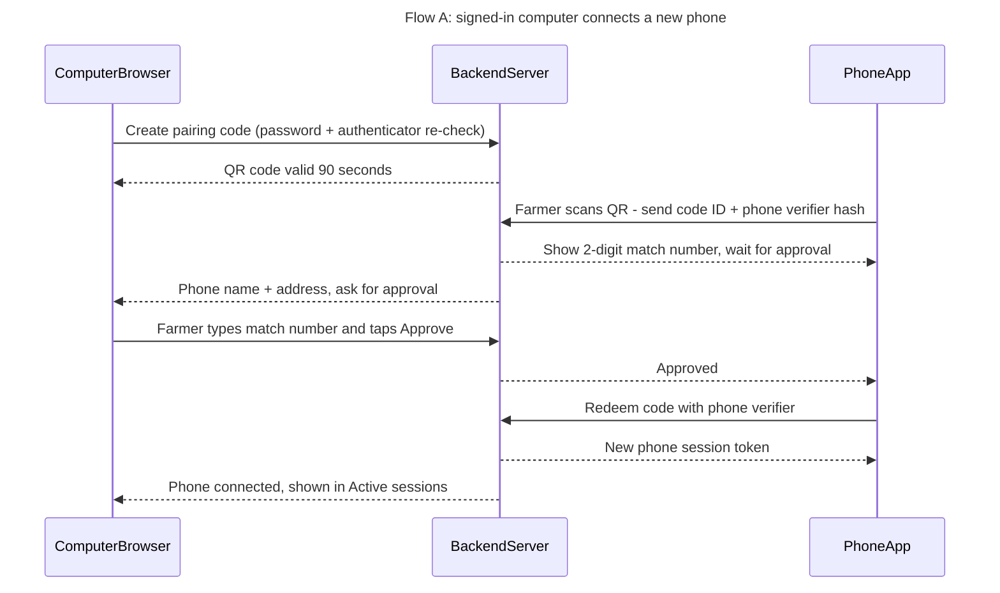
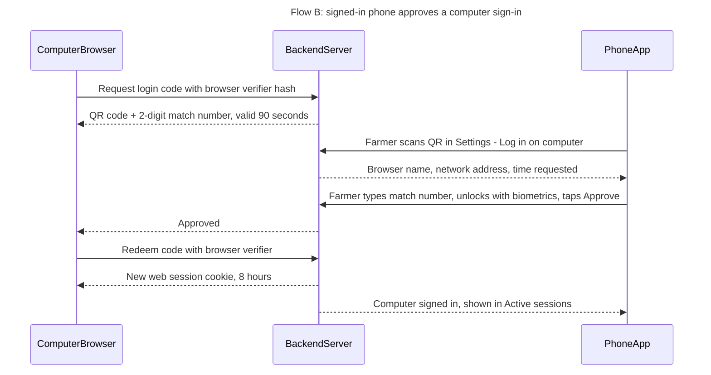

# Prompt: Peo Yame web + Android design, parity, QR sign-in, Demo mode and rough estimate

Version 2 (11 November 2026). Paste everything below the line into your coding agent and attach the screenshots and the Figma link. Part of this prompt is a design specification, so the agent should treat it as the source of truth for how the apps look and behave.

---

## 1. Context and what to read first

You are working on **Peo Yame**, a storage-monitoring prototype: a Flutter Android app (`lib/`), an Express + SQLite backend (`backend/`) and a web dashboard (`backend/public/index.html`). Active branch: `exe-work`.

Before changing anything, read `HANDOFF.md`, `docs/FEATURE_PARITY.md`, `docs/TEST_REPORT.md`, then run `git status --short` and `git log -4 --oneline`, and read the backend route definitions and the auth tests. Do not assume earlier work was finished.

The design lives in Figma: **"Peo Yame — App Design System & Flows"**, https://www.figma.com/design/QCAgcYA4AXWk3tErtG2i5c (see section 9 for what is in it, and appendix A for node IDs). The attached screenshots come from a **6 November 2026 build** and show defects. Some may already be fixed. For every defect in section 11, check the current source first, then report one of: **still present**, **already fixed (cite file or test)**, or **not reproducible from source**.

## 2. Non-negotiables

1. **Demo mode has two levels, and both are visible on the web and mobile entry screens.**
   - **Instant Demo** (one tap, label "Explore Demo mode"): opens the dashboard immediately as the shared profile Mr Lesego Lefoko (`LLefoko@email.co.bw`). It never asks for OTP, PIN, verification, a QR scan or an account. It creates no session or token, works if authentication is unavailable, and shows only shared synthetic data.
   - **Guided demo** (a button inside Instant Demo, "Start guided demo"): an explicit, opt-in mode that lets the presenter show *everything*, including sign-in, both QR flows, farmer-owned crop locations, sensor linking, authenticator setup, Active sessions and export. It creates a **temporary, flagged demo account** with its own isolated data. Full rules and the run sheet are in section 8.
   - *Owner approval note:* the Guided demo changes the earlier rule that Demo must never create a signed-in session. The owner asked for it so the QR functionality can be demonstrated. Instant Demo still follows the original rule exactly.
2. **Real sign-in is phone number + password** (Botswana numbers, `+267` or 8-digit local), with optional authenticator (TOTP). **QR is an additional sign-in method, not a replacement.** Registration asks for name, phone and password only. No email field.
3. **No SMS, OTP or PIN anywhere.** No provider exists. Remove every "one-time PIN", "Continue with OTP", "Continue with PIN" and "verified by one-time PIN" string. Never show a sample PIN as if it proves identity.
4. **A rough estimate is allowed again, under strict rules** (this replaces the old "no predictions" rule). The app may show a *Rough storage estimate* (a range, never a single number, never a percentage) and a rough risk level. Every appearance must (a) use the word "estimate", (b) say it is guessed from temperature and humidity only and does not inspect the crop, and (c) tell the user to **check their crops by hand**. It must be hidden when readings are stale or offline. Full rules are in section 7. Status wording stays range-based ("In range" / "Outside target band"), never "Safe".
5. **Label data honestly.** Shared synthetic Demo readings, farmer-owned account data, the simulated alert log (SMS is *not sent*) and estimates must be visibly distinct and never called live, verified or accurate.
6. **QR sign-in follows section 5 exactly:** backend-mediated, short-lived, single-use, approved on the *already signed-in* device with number matching, bound to the device that asked, never carrying a password or reusable token.
7. **Process:** small, understandable changes. Do **not** run local builds or tests. Push to a branch after reviewing the full diff and verify through GitHub Actions. Never stage, edit or delete `backend/vendor/sqlite3.exe`. Update `docs/FEATURE_PARITY.md`, `HANDOFF.md` and `docs/TEST_REPORT.md` only with evidence you actually have.

## 3. Architecture goal: one backend, two thin clients

- The backend is the single source of truth. Both clients use the **same API contracts, field names, status wording and error messages.**
- Both clients subscribe to the same server-sent-event stream (named events: reading, crop selection, alert, account, session). Mobile polling is the fallback. Offline state appears after repeated failures, and last-known values are labelled with their real timestamp.
- **One** "last synced" value per client, derived from the last successful backend response. Remove any second or hard-coded freshness label (the web header showed "Synced 23:31:27" while the page body showed "Data refreshed 23:30:22").
- Derived summaries (crop counts, sensor counts, online/offline) come from backend records, never from hard-coded fixtures.
- Estimates, status wording and band checks are computed **once on the backend** and returned to both clients, so the clients can never disagree.

## 4. Feature parity

Same destinations, same names, same order on both platforms. Mobile bottom navigation has **five** tabs: **Overview, Trends, My Crops (centre), Alerts, Settings**. Web uses the same five sections as its top tabs (and collapses to a bottom nav below 768 px). Accounts/profile is reached from Settings on both, not as a tab.

| Capability | Web | Android | Parity rule |
|---|---|---|---|
| Demo entry | "Explore Demo mode" on the sign-in gate | "Explore Demo mode" on the Welcome screen | Same label, same result |
| Guided demo + Demo tools | Settings → Demo tools (demo only) | Settings → Demo tools (demo only) | Same actions (section 8) |
| Register | Name, phone, password | Name, phone, password | Same validation messages |
| Sign in | Phone + password, optional TOTP | Same | Same errors, lockout message, expiry behaviour |
| QR sign-in | Both directions (section 5) | Both directions | Same states, same copy |
| Active sessions | List + revoke | List + revoke | Same data, same wording |
| Session | Restore on reload, explicit sign-out | Restore on launch, explicit sign-out | Sign-out clears the local token even if the server is unreachable |
| Overview | Status, temperature, humidity, estimate, crop selector | Same | Same wording, same gauge labels |
| Trends | 24 hours / 1 month / 3 months | Same | Same series, axes, units, threshold bands, **same range labels** |
| My Crops | Create/delete owned locations, link/unlink sensors | Same | Same operations; refresh on `account` events |
| Alerts | Alert list, mark reviewed, alert log | Same | Log says "SMS not sent" |
| Settings | Profile, authenticator, backend info, QR, export, sign-out | Same | Every web setting has a mobile equivalent, or a documented reason |
| Offline/stale | Banner + last-seen time | Same | Never present stale values as current |

If a feature genuinely cannot exist on one platform (for example camera scanning on a desktop browser), say so in `FEATURE_PARITY.md` with the reason. Do not leave silent gaps.

## 5. QR sign-in: who does what, and when

There are **three parties**: the **Computer** (web browser), the **Backend** (server) and the **Phone** (Android app). The rule that fixes the earlier design flaw: **the device that is already signed in is the one that approves, and it approves only after the person types a number shown on the *other* device.** The scanning device never approves itself.

### 5.1 Flow A: signed-in computer connects a new phone

| # | Party | Action |
|---|---|---|
| A1 | Computer | Farmer opens **Settings → Connect phone by QR**. If the last password check is older than 5 minutes, ask for the password (and the authenticator code if enabled). |
| A2 | Computer → Backend | Create a pairing code. Backend stores a hash of a random ≥128-bit ID, lifetime **90 seconds**, bound to this account and this web session, state `pending`. |
| A3 | Backend → Computer | Returns the QR payload: backend address + code ID (nothing else). The computer shows the QR with a countdown, refreshes it automatically before expiry (the old code dies) and listens on the event stream. |
| A4 | Phone | On the **Welcome** or **Sign in** screen the farmer taps **Sign in with QR code**. The app explains why it needs the camera, then asks for permission, then scans. If the backend address in the QR is not already saved, the app shows **"Connect to *192.168.x.x:3000*?"** and only accepts private-network addresses over HTTP. |
| A5 | Phone → Backend | Send the code ID, a **hash of a secret the phone just generated** (the "verifier"), and the phone's name and app version. The first valid request wins, atomically. A second scan gets "already used". |
| A6 | Backend → Phone | Returns a random **2-digit match number**. The phone shows "Waiting for approval on your computer" and the number in large type, plus Cancel. |
| A7 | Backend → Computer | Pushes an approval dialog: phone name, app version, network address, time, and "Enter the number shown on your phone". |
| A8 | Computer → Backend | Farmer types the number and taps **Approve** (or **Deny**). Three wrong numbers destroy the code. |
| A9 | Backend → Phone | Tells the phone it is approved (event stream, or a poll if the stream is down). |
| A10 | Phone → Backend | Redeems the code by sending the **verifier**. The backend checks the hash, that the code is approved, unexpired and unused, then consumes it atomically. |
| A11 | Backend → Phone | Issues the phone's **own new session** (its own token, shorter lifetime, inherits the approving session's authenticator status). The phone stores it in the Android keystore and opens Overview. |
| A12 | Backend → Computer | "Pixel 7 connected." The phone appears in **Active sessions** and the security log. |

### 5.2 Flow B: signed-in phone approves a computer sign-in

| # | Party | Action |
|---|---|---|
| B1 | Computer | On the sign-in gate the farmer chooses **Sign in with QR code**. The browser generates a random **verifier** and keeps it in memory only (a reload makes a new code). |
| B2 | Computer → Backend | Request a login code with the verifier's hash. Rate-limited per address. Backend creates a code (≥128-bit ID, **90 seconds**, state `pending`) and a random **2-digit match number**. |
| B3 | Backend → Computer | Returns the QR payload and the match number. The computer shows the QR, the number ("Match code **47**") and a countdown. It refreshes automatically. |
| B4 | Phone | Farmer opens **Settings → Log in on computer** on the *signed-in* phone and scans the QR. |
| B5 | Phone → Backend | Look up the request using the phone's session. The backend marks the code `scanned` by this session. |
| B6 | Backend → Phone | Returns what the phone must show: browser and system ("Chrome on Windows"), network address, time. It does **not** return the match number. |
| B7 | Phone | Shows the approval sheet: those details, "Enter the number shown on your computer", **Approve** and **Deny**. Approve requires the **device biometric or screen lock** (Android BiometricPrompt). |
| B8 | Phone → Backend | Sends the typed number. Three wrong numbers destroy the code. If correct, the backend marks the code `approved` for this account. |
| B9 | Backend → Computer | Tells the waiting browser it is approved. |
| B10 | Computer → Backend | Redeems with the **browser verifier**. The backend checks the hash and consumes the code atomically. |
| B11 | Backend → Computer | Sets the web session cookie (**HttpOnly, SameSite=Strict**, 8-hour limit, 30-minute idle limit). The dashboard opens and shows **"Signed in as Mr Lefoko (+267 •• ••• 567)"** so a wrong account is obvious. |
| B12 | Backend → Phone | "Computer signed in." The session appears in **Active sessions** and the security log. |

### 5.3 States every flow must handle (both clients, with the same copy)

Expired ("This code expired. Get a new one."), already used, wrong backend, wrong number (shows attempts left, then "Too many tries. Start again."), denied, offline (retry within the 90 seconds using the same verifier), camera permission refused (explain, offer **Open settings** and **Enter code manually**), camera unavailable, not signed in (Flow B), session expired mid-flow, and double-tap protection (buttons disable while a request is in flight; approvals are idempotent).

**Accessibility fallback:** "Can't scan? Enter code" lets the farmer type the short pairing code shown under the QR (8 characters, Crockford base-32, same lifetime, rate-limited, same approval and number matching).

### 5.4 Why the design is shaped this way (security conventions check)

| Threat | Control in this design |
|---|---|
| Someone photographs or screenshots the QR | The QR alone grants nothing. It needs approval on the signed-in device and the matching number; the session is released only to the device that holds the verifier. |
| Remote phishing ("QRLjacking": a fake page shows the victim a QR from the attacker's own session) | Number matching: the victim's phone asks for a number that appears only on the attacker's screen. The approval sheet shows the requesting browser and address, which will not match the victim. |
| Attacker signs *their own* phone in to the victim's browser (account confusion) | Needs the number from the victim's screen, and the dashboard shows the signed-in identity prominently after sign-in. |
| Replay or race (two scans, double approve) | Single-use, atomic consumption, 90-second life, first claim wins. |
| Stealing the session by intercepting the approval | Tokens go only to the verifier holder. (Caveat: plain HTTP on the demo LAN can still be sniffed. See section 12.) |
| Malicious QR that points the phone at a fake backend | The phone shows the host and requires a confirmation; HTTP is accepted only for private addresses; HTTPS is required beyond the demo. |
| QR used to skip the authenticator | The approving session must itself have passed the authenticator when it is enabled. The new session inherits that. |
| Brute-forcing the match number | 3 attempts, then the code is destroyed; creation and approval are rate-limited; failures appear in the security log. |
| Lost or forgotten sessions | Active sessions list with revoke, "Sign out everywhere", shorter lifetimes for QR-issued sessions. |

### 5.5 Workflow logic check (modern app conventions)

| Finding | Convention | What the design does |
|---|---|---|
| Earlier design put a "Confirm sign-in" button on the *scanning* phone in Flow A | Approval belongs on the authenticated device | Phone shows "Waiting for approval"; the computer approves |
| Earlier diagram had no expiry, denial, retry or offline branches | Every flow needs error and exit paths | Section 5.3 lists them; each has copy and a recovery action |
| No explanation before the camera permission prompt | Ask for permission in context, after a reason | Pre-permission screen, then the system prompt, then a graceful fallback |
| No non-camera path | Accessibility and device failure | Manual code entry; password sign-in always available |
| Backend address only reachable by a separate "Scan backend QR" link | One task, one entry point | The QR carries the address; Settings → Backend connection handles manual entry |
| Sign-in succeeds silently | Confirm outcomes | Phone toast plus entry in the security log; computer shows who it signed in as |
| App reopened after a long background period | Mobile apps lock after inactivity | Biometric app lock after 5 minutes in the background (Settings toggle, on by default) |
| Session expires mid-task | Preserve context | Return to sign-in with a clear message, then back to the screen the person was on |
| Demo vs real QR | Demos must not weaken real behaviour | Guided demo runs the real protocol with a flagged demo account (section 8) |

## 6. Backend entry and sync on mobile

- **Settings → Backend connection** (and first launch if no address is saved): enter an address manually **or scan a QR**. The Flow A QR carries the validated backend address, so one scan can set the address and start pairing, after the confirmation in step A4. If the address differs from the saved one, confirm the switch and sign out of the old backend first.
- Validate by calling the health endpoint (which reports `authEnabled`) before saving. Show *connected / unreachable / wrong server*, plus the real last-sync time.
- The web QR must offer LAN addresses (for example `192.168.x.x:3000`), never `127.0.0.1`, and warn when the dashboard itself is open on a loopback address. Text: "Phone and computer must be on the same Wi-Fi."
- Plain HTTP is for a controlled demo network only. State this in the UI and in `backend/DEPLOYMENT.md`, and allow cleartext HTTP on Android only for the documented demo configuration.
- The backend address is persisted and editable. The current mobile "Address hidden" row needs a clear purpose (a show/hide toggle with a lock note) or removal.

## 7. Rough storage estimate (allowed, but only as an honest estimate)

The owner wants a rough estimate in the app. It is a **guess, not a measurement**, and the user must always be told to check their crops themselves.

### 7.1 What is shown

- A **"Rough storage estimate"** card on Overview (below the status card), inside each active alert, and on each My Crops location card.
- The value is a **range in weeks**, prefixed with "About", for example **About 3–5 weeks**. Never a single number. Never a percentage. Never "days" for a long range.
- An **"Estimate"** badge (neutral chip) sits next to the title, and the card's accessible name begins "Estimate:".
- A **rough risk level** (Low / Moderate / High) may appear as a chip labelled "Rough risk (estimate)". Use text plus an icon, not colour alone.
- Under the value, always show this caption: **"A rough guess from temperature and humidity only. It does not inspect your crop. Check your crops by hand every few days."**
- A button **"I checked my crop"** records the date and time of the person's own inspection per location and resets a reminder (default: every 3 days; for items in an *Outside target band* state, prompt "Check your crop now").
- A link **"How is this estimated?"** opens a sheet that explains the method in plain language and lists what the estimate ignores: grain or produce moisture, variety, maturity, pests, packaging, ventilation and how long the crop was already stored.

### 7.2 When it changes or disappears

| Situation | Behaviour |
|---|---|
| Readings in range | Show the range with the caption |
| Outside target band | Range shortens; banner "Conditions are outside the target band. **Check your crop now.**" |
| Last reading older than 15 minutes, or client offline | **Hide** the estimate; show "Estimate not available while readings are old" with the last-seen time |
| Instant Demo / Guided demo | Show it, with the "Demo data" chip and the text "Demo estimate from simulated readings" |
| No crop selected, or crop has no baseline | Hide it and show "Choose a crop to see a rough estimate" |
| User has marked the crop inspected | Show "Last checked by you: today, 09:10" under the caption (this never changes the estimate) |

### 7.3 Method (backend only; return the result to both clients)

1. For the selected crop's temperature and humidity target bands, compute the distance of the latest readings from each band's midpoint, scaled by half the band width. Take the larger of the two as `d`.
2. Use a per-crop `baselineWeeks` value stored in the catalog (an indicative placeholder per crop until the supervisor approves the numbers) and map `d` to a range: `d ≤ 0.5` → baseline range; `0.5–1.0` → about half; `1.0–1.5` → about a quarter; `> 1.5` → "Less than a week".
3. Round to whole weeks, show a range of at most two weeks wide, and return an `estimateMethod` version string and a `confidence: "rough"` field.
4. Document the method, its inputs and its limits in `docs/` and in the CSV and Markdown exports (add an `estimate_note` column: "Rough estimate from temperature and humidity only. Check your crop.").
5. In the interim report call it an **unvalidated heuristic** (this is the earlier risk R8). Do not call it a prediction, a shelf-life model or an accuracy result.

*Optional, if the owner insists on a quality percentage:* show it only as "about 80 % (rough estimate)" with the same caption and badge. The recommended design does not use one, because a precise-looking percentage invites over-trust.

## 8. Demo mode: show the full functionality

### 8.1 The two levels

| | Instant Demo | Guided demo |
|---|---|---|
| Start | One tap on the gate / Welcome screen | "Start guided demo" button inside Instant Demo, plus a confirmation sheet |
| Account | None | A **temporary demo account** named "Demo Farmer (temporary)" with an obviously fake number |
| Session | None | A normal-looking session that is **flagged `demo`**, labelled "Demo session" in a persistent bar |
| Data | Shared synthetic readings | Isolated: its own locations, sensors, alerts and sessions |
| Can show | Overview, Trends, Alerts, crop catalog, estimate, Demo tools | Everything, including both QR flows, Active sessions, authenticator setup, My Crops, export |
| Ends | Leave the screen | After 2 hours, or on **Reset demo** (deletes the demo account and all its data) |

### 8.2 Guardrails for the Guided demo

- It exists only when the backend is started with a demo setting. In a normal install, the button is absent and the endpoints return 404.
- Demo accounts are flagged `isDemo`, cannot use a real number, cannot be converted into real accounts, and **can never read or write real farmer data**.
- It runs the **real** QR, session, number-matching and TOTP code paths. Nothing is faked in the protocol. Only the account and the sensor data are synthetic.
- A persistent bar reads **"Demo session. Data is simulated and will be deleted."** on every screen.
- No SMS, no real PIN. When the demo shows authenticator setup, it displays the setup key in the demo only.

### 8.3 Demo tools (Settings → Demo tools, demo only, same on web and mobile)

**Simulate breach** (push the readings outside the target band) · **Simulate sensor reading** (submit a reading for a chosen sensor ID such as `PY-DEMO-1`, so it can be discovered and linked) · **Simulate network loss** (on this client only) · **Switch crop** · **Reset demo** · **Next step** (a checklist that follows the run sheet and ticks items off).

### 8.4 Run sheet (about 10 minutes)

Preparation: backend running on the laptop with the demo setting on; laptop and phone on the same Wi-Fi; the dashboard opened at the laptop's **LAN address** (not `127.0.0.1`); the Android app installed and signed out. State clearly at the start that readings and sensors are simulated and nothing is sent by SMS.

| # | Device | Presenter does | Audience sees | Proves |
|---|---|---|---|---|
| 1 | Computer | Tap **Explore Demo mode** | Overview with "Demo data" chip, gauges, rough estimate and its disclaimer | Instant Demo, honest labelling |
| 2 | Computer | Demo tools → **Simulate breach** | Status turns "Outside target band", alert appears, banner "Check your crop now", estimate shortens | Alert logic, estimate rules |
| 3 | Computer | **Mark as reviewed** | Alert moves to history | Alert lifecycle |
| 4 | Computer | Switch crop (Tomato → Maize) | Bands, gauges and estimate update | Crop catalog |
| 5 | Computer | **Start guided demo**, confirm | "Demo session" bar; empty My Crops with a first-run checklist | Guided demo |
| 6 | Computer | **My Crops → Add storage location**; Demo tools → **Simulate sensor reading** `PY-DEMO-1`; link it | Location with one online sensor | Owned sites and sensors |
| 7 | Both | **Flow A.** Computer: Settings → Connect phone by QR (password re-check). Phone: **Sign in with QR code**, scan | Phone shows a 2-digit number; the computer shows an approval dialog | QR step 1 and device roles |
| 8 | Computer | Type the number, **Approve** | Phone lands on Overview with the Demo bar; computer shows "Phone connected" | QR sign-in end to end |
| 9 | Both | Change the crop on the phone, then **Simulate breach** on the computer | Both screens update within seconds | One-backend sync |
| 10 | Phone | Demo tools → **Simulate network loss**, then restore | Offline banner with last-known labels, then recovery | Offline and reconnect |
| 11 | Both | **Flow B.** Open a second browser window: **Sign in with QR code**. Phone: Settings → Log in on computer, scan | The browser shows a QR and a match number; the phone shows browser details | QR step 2 |
| 12 | Phone | Type the number, unlock with biometrics, **Approve** | Browser opens the dashboard as the demo farmer | Phone-approves-web |
| 13 | Phone | Settings → **Active sessions** → revoke the second browser | Browser returns to the sign-in gate | Session control |
| 14 | Computer | Show failure cases: wait 90 s for "expired"; scan an already used code; type a wrong number three times | Each shows its own message | Security behaviour |
| 15 | Computer | Settings → **Export readings** | CSV with the `estimate_note` column | Export and honesty |
| 16 | Computer | Demo tools → **Reset demo** | Demo account deleted; back to Instant Demo | Clean end |

*Fallbacks:* if the camera fails, use **Enter code manually**; if Wi-Fi blocks device-to-device traffic, put both on a phone hotspot; if the backend is unreachable, Instant Demo and the screens in Figma still tell the story, but say so.

## 9. Design specification (looks, panels, iconography)

This section describes the design in the Figma file in enough detail to build both clients without opening it. Where a "Delta" is marked, the Figma file must change to match this prompt (see appendix A).

### 9.1 Design principles

1. **Calm and trustworthy.** Pale green canvas, white cards, one strong green for actions, deep green only for the app bar and the status card.
2. **Say what you know and no more.** Status is "In range" or "Outside target band", labelled Demo or simulated where true, and estimates are always called estimates.
3. **One primary action per screen**, at the bottom on mobile (thumb zone) and at the end of the form on web.
4. **Same words, same order, same icons** on web and mobile.
5. **Never rely on colour alone.** Every state has text; important states also have an icon.
6. **Large, forgiving touch targets** (48 px minimum), plain language, short sentences.

### 9.2 Colour tokens

Create these as design tokens (Flutter `ThemeData` / `ColorScheme` extension, and CSS custom properties). Names match the Figma variables. All values are one light theme for now.

| Token | Hex | Used for |
|---|---|---|
| `bg/app` | #F1F6F2 | Screen background (pale green) |
| `bg/surface` | #FFFFFF | Cards, inputs, sheets, nav bar, web tab bar |
| `bg/header` | #112821 | App bar (mobile), top bar (web) |
| `bg/brand-soft` | #E1F0E6 | Icon tiles, active nav pill, hero disc, QR side panel, summary strip |
| `bg/muted` | #EAF0EC | Segmented-control track, gauge track, neutral chip, nested rows |
| `brand/primary` | #176B4D | Primary buttons, links, active nav, icons |
| `brand/primary-dark` | #0F4A35 | Status card, gauge marker ring |
| `brand/leaf` | #4CAF3A | Decorative accents on dark surfaces only (scanner frame) |
| `text/primary` | #14231B | Headings and body |
| `text/secondary` | #5C6E64 | Captions, helper text, inactive nav |
| `text/on-brand` | #FFFFFF | Text and icons on dark green |
| `border/default` | #DDE6DF | Card borders, dividers, grid lines |
| `border/input` (**new**) | #768A80 | Input outlines and other control boundaries (**Delta**: replaces `border/strong` #B7C7BD, which is only 1.76:1 on white) |
| `border/strong` | #B7C7BD | Decorative handles only (sheet grabber) |
| `status/in-range` / `-bg` | #1F7A52 / #E3F4EA | In-range chip, positive banner, target segment |
| `status/warning` / `-bg` / `-border` | #8A6516 / #FFF3D6 / #EBD59A | Notices, offline, expiring codes |
| `status/danger` / `-bg` | #B3382C / #FBE9E7 | Outside band, destructive actions, alert card border |
| `status/info` / `-bg` | #2F5FBF / #E6EEFC | Demo chip, info banner |
| `chart/temperature` | #1F7A52 | Temperature line and its band |
| `chart/humidity` | #4A7FD4 | Humidity line and its band |
| `scrim` | #0B1410 | Scanner background, sheet backdrop (use at ~60 % behind sheets) |

**Rules:** Green means *in range or an action*, never decoration on white. Red only for outside band, errors and destructive actions. Amber for notices and offline. Blue for Demo and information. Leaf green (#4CAF3A) is only 2.8:1 on white, so use it on dark backgrounds only.

### 9.3 Contrast (WCAG 2.2, computed from the tokens)

| Pair | Ratio | Verdict |
|---|---|---|
| `text/primary` on `bg/app` | 14.93 | Pass (AAA) |
| `text/primary` on surface | 16.33 | Pass (AAA) |
| `text/secondary` on surface / on `bg/app` / on `bg/muted` | 5.43 / 4.96 / 4.70 | Pass (AA) |
| White on `brand/primary` / `primary-dark` / `bg/header` | 6.47 / 10.24 / 15.56 | Pass (AA to AAA) |
| `brand/primary` on surface / on `brand-soft` | 6.47 / 5.49 | Pass (AA) |
| In-range text on its bg | 4.64 | Pass (AA, close to the limit) |
| Warning text on its bg | 4.82 | Pass (AA) |
| Danger text on its bg / on white | 5.09 / 5.97 | Pass (AA) |
| Info text on its bg | 5.13 | Pass (AA) |
| White on `status/danger` | 5.97 | Pass (AA) |
| `border/input` #768A80 on white / on `bg/app` | 3.67 / 3.36 | Pass (3:1 non-text) |
| `border/strong` #B7C7BD on white | 1.76 | **Fail** for control outlines (Delta) |
| `brand/leaf` on `bg/header` | 5.56 | Pass (graphics) |
| `brand/leaf` on white | 2.80 | **Fail**: never use as text or sole indicator on white (**Delta**: the web tab underline must use `brand/primary`) |
| Humidity line on white | 3.98 | Pass for graphics (3:1) |

### 9.4 Typography (Inter, one family on both platforms)

Inter was used in the Figma file. The current Flutter build looks like Roboto, so ask the owner to approve Inter and bundle it (`google_fonts` or font assets); on the web load it with a system-font fallback stack. Turn on **tabular figures** for readings so digits do not jump.

| Style | Size / line | Weight | Used for |
|---|---|---|---|
| Display | 32 / 40 | Bold | Welcome headline, large status numbers on mobile |
| Metric | 40 / 48 | Bold | Big readings on web gauge cards |
| Title | 24 / 32 | Bold | Page titles, sheet titles, mobile gauge value |
| Heading | 18 / 26 | Semi Bold | Section headings, wordmark in the app bar |
| Subheading | 16 / 24 | Semi Bold | Card titles, back-bar title |
| Body | 16 / 24 | Regular | Paragraphs, input values |
| Button | 16 / 24 | Semi Bold | Button labels |
| Label | 14 / 20 | Medium | Secondary text, banners, list sub-lines |
| Label Strong | 14 / 20 | Semi Bold | Field labels, list titles, active tab (web) |
| Caption | 12 / 16 | Regular | Help text, timestamps, disclaimers |
| Caption Strong | 12 / 16 | Semi Bold | Chips, nav labels (active), group headers |

Rules: sentence case everywhere; **dynamic type** up to 200 % must reflow without clipping (use `sp` on Android; rem units on web); body copy line length 45–75 characters on web; the 12 px Caption is for supporting text only, never for the only copy of an instruction; Welcome headline breaks as "Welcome to / Peo Yame" to avoid an orphaned word.

### 9.5 Spacing, shape, elevation

- **Grid:** 4 px base. Scale: 4, 8, 12, 16, 20, 24, 32, 48. Screen side padding: **16** on main screens, **24** on auth screens. Gap between cards: **12** (mobile), **20** (web). Card padding: **14–16** (mobile), **20–24** (web). Section gap in forms: 16 (14 on the longer Create account form).
- **Radius:** 8 small, **12** inputs / icon tiles / nested rows / banners, **14** buttons and list rows, **16** cards, **20** status card, **24** web gate card and large panels, **28** sheet top corners and the scanner frame, **999** chips, segmented control and avatar. Device frames in Figma use 32 only for presentation.
- **Elevation:** flat by default (1 px `border/default`, no shadow). A bottom sheet uses the scrim backdrop plus a soft shadow (0 −4 24, 16 % of `scrim`). Menus and the profile dropdown use 0 8 24 at 12 %.
- **Focus:** 2 px `brand/primary` ring with a 2 px offset on every interactive element (web and Android keyboard).

### 9.6 Iconography

- **Style:** Lucide-style line icons on a **24 px grid, 2 px stroke, round caps and joins, no fills**, one icon family on both platforms. In Flutter use the `lucide_icons` package or bundled SVGs; on web use an inline SVG sprite. Do not mix Material filled icons into screens.
- **Sizes:** 16 (dropdown chevrons in the profile pill), 18 (chevrons in rows, gauge title icons), 20 (banner icons, icons in 40 px tiles, link icons), 22 (alert icon, refresh in the app bar), 24 (nav, back, close, status check), 40 (icon tiles), 56 (Welcome hero), 72 (scanner QR glyph).
- **Colour:** on light surfaces `brand/primary` for brand/navigation icons and `text/secondary` for inactive nav and chevrons; on dark surfaces #FFFFFF; status icons use their status colour (danger for alert, warning for notice, info for info, in-range for check). Never put `brand/leaf` on white.
- **Icon tiles:** a 40 × 40 square, radius 12, `bg/brand-soft`, 20 px `brand/primary` icon, used as the leading element in list rows. The hero uses a 112 px disc in `bg/brand-soft` with a 56 px sprout; the confirmation screens use an 80 px disc with a 40 px shield.
- **Touch area:** every icon-only control is a **48 × 48** target (the app bar refresh is 44 × 44 with an invisible 48 hit area), with a text label for screen readers and a tooltip on web. Do **not** ship icon-only buttons without labels (this was defect 13).

| Icon (Lucide name) | Where it is used |
|---|---|
| `home` | Overview tab |
| `trending-up` | Trends tab |
| `sprout` | My Crops tab, Welcome hero, crops summary strip |
| `bell` | Alerts tab |
| `settings` | Settings tab |
| `info` | Info and notice banners |
| `triangle-alert` | Alert card header, notice emphasis |
| `circle-check-big` | "In range", "Connected", success banner |
| `refresh-cw` | Refresh / last synced |
| `thermometer` | Temperature gauge |
| `droplet` | Humidity gauge |
| `user` | Profile row |
| `shield` | Authenticator, confirmation hero, security |
| `wifi` | Backend address, connection |
| `monitor` | Log in on computer |
| `qr-code` | Sign in with QR code, scanner glyph |
| `download` | Export readings |
| `log-out` | Sign out |
| `chevron-right` / `chevron-down` | Row navigation / dropdowns |
| `search` | Search fields |
| `plus` | Add storage location, add crop |
| `x` | Close scanner |
| `arrow-left` | Back |
| `radio` | Sensors, linked sensor rows |
| `lock` / `eye` / `eye-off` | Password field and reveal toggle |
| `camera` | Permission rationale |
| `hourglass` | Rough storage estimate card |
| `trash-2` | Delete location |

- **Brand mark:** use the approved Peo Yame logo (house, grain, wifi arcs, thermometer, droplet, leaves). The Figma file holds a **simplified placeholder tile** (component "Brand / Logo tile", 48 × 48, radius 12, white) that must be swapped for the real image. On the dark bar, always place the logo on its **white rounded tile**. Minimum size 32 px; clear space of one quarter of the logo height; never recolour, stretch or add effects. Use the approved monochrome master for the Android **themed (monochrome) launcher icon**, and place the full-colour mark inside the **66 dp safe zone** of the adaptive icon on a `bg/brand-soft` background. Include the favicon and a 192 / 512 px web manifest icon.

### 9.7 Components (build each once, reuse everywhere)

**Button.** Height 52, radius 14, label Button style, full width in forms. *Primary*: `brand/primary` fill, white label. *Secondary*: surface fill, 1.5 px `brand/primary` border, `brand/primary` label. *Tertiary*: no fill, `brand/primary` label, still 52 tall. *Destructive outline* (Sign out, Delete): danger border and label. States: **pressed** (primary-dark fill, Android ripple), **disabled** (reduced contrast with a visible reason), **loading** (20 px spinner replaces the label, width fixed, button disabled), **focus** (ring). One primary button per screen.

**Text input.** Label above in Label Strong (never placeholder-only). Field 52 high, radius 12, 1 px `border/input`, surface fill, Body text, placeholder in `text/secondary`. Focus: 2 px `brand/primary`. Error: 2 px `status/danger` plus an icon and message under the field in Caption danger. Helper text in Caption secondary. Phone field: fixed "+267" prefix, numeric keypad, autofill hint `telephoneNational`. Password field: reveal toggle (`eye`), autofill hint `password`, strength meter on Create account ("Strength: Strong" in `status/in-range`). Validate on blur and on submit, not on every keystroke.

**Status chip.** Pill, padding 10 × 4, Caption Strong. Variants: In range (green), Outside target band (red), Demo data (blue), Warning/offline (amber), Neutral (grey). **Delta:** add a 12 px leading icon (check, alert, info) so state is not colour-only.

**Banner.** Padding 12, radius 12, 10 gap, 20 px icon, Label text. *Notice*: warning bg with warning border. *Info*: info bg. Used for Demo notice, "SMS not sent", same Wi-Fi hint, plain-HTTP warning.

**Card.** Surface, 1 px `border/default`, radius 16, padding 14–16 (mobile) / 20–24 (web), no shadow.

**List row / group.** Rows at least 56 high (padding 12 × 14), 40 px icon tile at left, title (Label Strong) over subtitle (Caption secondary), optional neutral chip and a chevron at the right, 1 px dividers inside a rounded group card. Group header in Caption Strong secondary, upper-case acceptable.

**Segmented control.** Track `bg/muted`, pill, padding 4; each segment at least 44 high; selected = surface fill, Label Strong, primary text; unselected = Label, secondary text. Labels on both platforms: **24 hours / 1 month / 3 months**.

**Bottom navigation (mobile).** 80 high including the gesture inset, surface fill, 1 px top border. Five equal items (≥ 72 wide). Each: a 24 px icon inside a 56 × 32 pill and a label (always visible). Active: `bg/brand-soft` pill, `brand/primary` icon and label in Caption Strong. Inactive: #5C6E64 icon and Caption label. Order: Overview, Trends, **My Crops (centre)**, Alerts, Settings. **Alerts badge:** a 16 px danger dot with the count (white, 11 px) when there are unreviewed alerts, announced to screen readers.

**Top app bar (mobile main screens).** `bg/header`; status-bar area 44; bar content 68 high: white logo tile 48 + 10 gap + "Peo Yame" in Heading white at left; at right a status chip (Demo data, or the farmer's name) and a refresh control. **Sub-screens** use a light bar: back arrow in a 48 × 48 target and the title in Subheading.

**Web top bar and tabs.** Dark `bg/header` bar, 80 px side padding, 14 px vertical padding: logo tile + wordmark at left; at right a connection chip ("Backend connected · synced 2 min ago") and the profile pill (surface, pill, 28 px `brand-soft` avatar with initial, name in Label Strong, `chevron-down`; opens a menu with Settings and Sign out). Below it, a white tab bar with a 1 px bottom border and tabs Overview, Trends, My Crops, Alerts, Settings. Active tab: Label Strong in `brand/primary` with a **3 px underline in `brand/primary`** (**Delta**: the Figma file used leaf green, which fails contrast).

**Status card.** `brand/primary-dark`, radius 20, padding 18. Icon 24 + "In range" (Heading) + one-line context (Label) + the two readings in Display (mobile) + the caption "In range means within the configured limits. It does not confirm crop quality." Variants: **Outside target band** (`status/danger` fill, white text, "Check your crop now"), **Stale / offline** (muted fill, secondary text, amber chip with last-seen time), **Demo** (adds the Demo chip).

**Gauge card.** Surface card with icon (18) + Label Strong, the value in Title (mobile) or Metric (web), then a **track** (140 × 8 mobile, 240 × 8 web, radius 4, `bg/muted`) holding a **target segment** (the middle 50 %, `status/in-range`) and a **marker** (16 px circle, surface fill, 3 px `brand/primary-dark` ring) positioned by `clamp((value − scaleMin) / (scaleMax − scaleMin))`, where the scale runs from the band minimum minus half a band width to the band maximum plus half a band width. Under it the labels **Low · Target · High** (not "High · Low · High") and "Target 10–20 °C". When outside the band the marker ring turns danger and the Overview chip says "Below target" or "Above target".

**Rough estimate card (new).** Surface card, radius 16, padding 16. Title row: `hourglass` icon + "Rough storage estimate" (Subheading) + neutral **Estimate** chip. Value "About 3–5 weeks" in Title. Caption disclaimer (section 7). Row of two actions: **I checked my crop** (secondary) and **How is this estimated?** (tertiary). Last-checked line under the actions.

**Chart card.** Legend with 10 px dots (Temperature °C, Humidity % RH); plot area; 1 px `border/default` grid lines with y labels (0 / 50 / 100 mobile, 0 / 25 / 50 / 75 / 100 web); two 2.5 px round-capped lines (`chart/temperature`, `chart/humidity`); **target bands** drawn as translucent rectangles (same colours at 14 % opacity); five x-axis time labels; a caption "Shaded bands show each target range. History includes simulated Demo points; recent points update from the backend." **Delta (usability):** because temperature and humidity live on very different ranges, show them as **two stacked mini-charts** (each with its own axis and band) or add a "Temperature / Humidity / Both" switch, defaulting to the two-chart layout on mobile. Tapping a point shows a tooltip with value, time and in/out of band.

**Readings row.** Card row (padding 14 × 12, radius 14, border): values in Label Strong ("15.6 °C · 90.3 % RH") over a Caption time ("Today, 23:44") at left; status chip at right.

**Alert card.** Surface, 1.5 px `status/danger` border, radius 16, padding 16: alert icon (22, danger) + "Tomato · Store A" (Subheading) + "Outside target band · today, 23:44" (Caption); two value rows in `status/danger-bg` (radius 12) showing the reading in Heading danger and "Target 10–20 °C"; a short plain-language explanation ("Warm air can speed ripening. Very humid air can encourage mould on damp produce. Humidity of the air does not show the crop's own moisture."); the **rough estimate** line; actions **Mark as reviewed** (primary) and **See readings in Trends** (secondary).

**QR panel (web).** White rounded tile (radius 16, padding 14) containing a QR of at least **200 px** (220 px in Settings) with a 4-module quiet zone and error-correction level M, black on white only (never tinted). Under it: a countdown chip (warning style: "Expires in 1:28 · works once"), a **Get a new code** link, and a "Can't scan? Enter code" link with the short code. The QR auto-refreshes before expiry; the countdown is announced to screen readers at 30 and 10 seconds.

**Scanner (mobile).** `scrim` background, 280 × 280 viewfinder with radius 28, a 4 px dashed `brand/leaf` outline (dash 28, gap 14) and a 6 % white fill; Body instruction in white above; Caption help below; a **torch** toggle and **Enter code manually** below the frame; Cancel at the bottom. Frames the camera with a subtle scan line unless reduced motion is on.

**Bottom sheet.** Surface, 28 px top radius, padding 24 sides, 12 top, 28 bottom, a 40 × 5 grabber (`border/strong`), Title, a detail card (`bg/app`, radius 14, padding 14, label/value pairs), a Notice banner, then stacked buttons. Dismiss by swipe, scrim tap or Deny; dismissal on the approval sheet means Deny.

**Dialog (web approval).** Centered, 440 px wide, radius 24, scrim behind. Title "Approve phone sign-in?", detail card (device, app version, network address, time), a **match-number field** (2 digits, large type, auto-focus), Notice "Only approve if you started this on your phone just now", buttons **Approve** (primary) and **Deny** (secondary).

**Snackbar.** Bottom on mobile, bottom-left on web; dark fill, white Label text, optional **Undo**; auto-dismisses after 6 seconds; never used for errors that need action (use inline banners).

### 9.8 Screens and panels (mobile, 390 × 844)

Every screen has a 44 px status-bar area. Main screens: dark app bar, scrolling body (padding 16, gap 12), bottom nav. Auth screens: light, padding 24.

1. **Welcome.** Logo tile + "Peo Yame" at top left, connection chip at right; a 112 px sprout disc; Display headline "Welcome to / Peo Yame"; Body subtitle; then (bottom-anchored) **Sign in** (primary), **Create account** (secondary), **Explore Demo mode** (tertiary), a Notice "Demo mode uses simulated readings and creates no account", and the Caption "Backend: 192.168.178.24:3000 · Change".
2. **Connect to your backend.** Back bar; Body explanation; Info banner (same Wi-Fi); **Backend address** input; **Scan backend QR instead** (secondary); a connection result card (in-range tint with check, "Connected · accounts enabled · checked just now"); Caption on plain HTTP; **Save and continue** (primary).
3. **Sign in.** Back bar; Title "Welcome back"; **Mobile number** and **Password** inputs; **Sign in** (primary); an "or" divider; **Sign in with QR code** (secondary); **New farmer? Create an account** (tertiary); Caption about the authenticator code.
4. **Scan sign-in QR.** Dark scanner: close (x), "Scan sign-in code", instruction ("On your computer, open Settings → Connect phone by QR…"), viewfinder, Caption about 90 seconds and single use, **Cancel**. Precede it with a **camera rationale** screen (camera icon, "We use the camera only to scan the code on your computer", **Continue** / **Not now**).
5. **Waiting for approval (Delta; replaces "Confirm sign-in").** Back bar; shield disc; Title "Approve on your computer"; the **match number** in Display ("47"); "Enter this number on your computer"; Caption "Expires in 1:12"; **Cancel**. States: approved (check, "Signing you in…"), denied, expired.
6. **Create farmer account.** Back bar; inputs: Full name, Mobile number, Password (strength note), Confirm password; Caption about the authenticator; **Create account** (primary) and **I already have an account** (tertiary). After success, the first-run checklist (add a storage location, link a sensor, turn on the authenticator).
7. **Overview.** App bar (Demo data chip when applicable); status card; two gauge cards side by side; **Rough storage estimate** card; **Active crop** row ("Change" with `chevron-down`); "Recent readings" header with "View all"; reading rows. Pull-to-refresh.
8. **Trends.** Title; segmented control (24 hours / 1 month / 3 months); chart card (see 9.7); two stat cards ("Temperature · 24 h: Low 13.5 °C, High 17.1 °C", "Humidity · 24 h: Low 88.6 %, High 92.7 %").
9. **My Crops.** Title; summary strip (`brand-soft`, sprout icon, "2 storage locations · 3 sensors linked · 1 offline", **derived from backend data**); search field (48 high, radius 12, `search` icon, "Search crop, location or sensor ID"); location cards (title "Tomato · Store A", "2 sensors", chevron; sensor rows with ID, latest reading, last seen, status chip; the rough estimate line); bottom **Add storage location** (primary). Empty state: sprout illustration, "No storage locations yet", **Add storage location**.
10. **Alerts.** Notice banner ("Alert log. Text messages are not sent in this edition."); "Needs attention" with count chip; alert card (9.7); "Alert history" with count and rows.
11. **Settings.** Title; groups (header, then a rounded card of rows): **Account & security** (Profile; Authenticator app with an Off/On chip; **Active sessions**), **Connection** (Backend address; Last synced), **Other devices** (**Log in on computer**), **Data** (Export readings), **Demo tools** (only in demo), then a destructive-outline **Sign out**. Also a toggle **Lock app with biometrics**.
12. **Log in on computer (scan).** Same scanner as 4 with the instruction "Open the Peo Yame web dashboard and choose Sign in with QR code. Then scan the code on your screen."
13. **Approve web sign-in (sheet).** Over the scrim: grabber, Title "Approve sign-in on computer?", detail card (Device "Chrome · Windows", Address, Requested "Just now · expires in 0:52"), **match-number field** (**Delta**: add), Notice ("Only approve if you started this sign-in just now. Never approve a request someone sent you."), **Approve** (primary; triggers biometrics), **Deny** (secondary).
14. **Active sessions (new).** List of sessions (device name, type "Phone · QR sign-in" / "Computer · password", last active, "This device" chip), **Revoke** per row with confirmation, **Sign out everywhere** (destructive).
15. **Demo tools (new, demo only).** Group card with the six actions in 8.3, and the **Next step** checklist.

### 9.9 Screens and panels (web, 1440 × 1024)

Common: dark top bar + white tab bar (9.7). Content column **1100 px wide, centred**, 32 px vertical padding, 20 px between sections.

1. **Sign-in gate.** Centred card 920 wide, radius 24, 1 px border, split 50/50. **Left (white, padding 40):** logo + wordmark, Title "Sign in", Mobile number, Password, **Sign in** (primary), **New farmer? Create an account** (tertiary), **Explore Demo mode** (secondary), Caption about Demo and the authenticator. **Right (`brand-soft`, padding 40):** Heading "Sign in with QR code"; the QR tile (200 px) with "Illustrative code" removed in the real build; countdown chip and **Get a new code**; the **match number** shown large next to the QR ("Match code 47"); the three steps ("1. Open Peo Yame on your phone and sign in. 2. Go to Settings → Log in on computer. 3. Scan this code, enter the number, tap Approve."); Caption "Works once, and only for a phone signed in to this backend."
2. **Overview.** Title row with a Demo chip at the right. **Row 1:** three equal cards: status card (dark green), Temperature gauge (value in Metric), Humidity gauge. **Row 2:** the **Active crop** bar (label + select showing "Tomato", plus **Add crop**). **Row 3:** the **Rough storage estimate** card at full width (**Delta**). **Row 4:** chart card (2/3 width: heading "Temperature & humidity", segmented control, chart, caption) beside **Recent readings** (1/3 width: four reading rows).
3. **Trends / My Crops / Alerts.** Same patterns as the mobile screens, laid out in the 1100 px column: Trends with the two stacked charts and stat cards in a row; My Crops with location cards in two columns and a side panel for the selected location; Alerts with the alert card at left and history at right.
4. **Settings.** Two columns. **Left (flexible):** grouped cards "Account & security" (Profile, Authenticator, Active sessions) and "Connection & data" (Backend address, Last synced, Export readings), **Demo tools** (demo only), and **Sign out** (destructive outline). **Right (420 wide):** the **Connect phone by QR** card: heading, explanation, a **network address select** ("This computer's network address", default the first private address), the QR (220 px), countdown chip, **Get a new code**, an Info banner ("Phone and computer must be on the same Wi-Fi. This demo uses plain HTTP: keep it on a private network.").
5. **Approval dialog** (Flow A) and **Active sessions** page, as in 9.7.

### 9.10 Responsive behaviour

| Width | Layout |
|---|---|
| ≥ 1200 px | As above (1100 px column, 3-card first row, 2/3 + 1/3 second row) |
| 768–1199 px | Single column, gauges two across, chart full width, readings below, Settings stacks the QR card above the groups |
| < 768 px | Mobile layout: light/dark app bar, bottom nav replaces tabs, gauges two across, sheets instead of dialogs |

Android: design for 360–411 dp widths, verify at 320 dp and at 200 % font scale, support edge-to-edge with correct insets, light status-bar icons on the dark bar, and the system back gesture (back closes sheets and scanners first, then pops to the previous destination; on a top-level tab it returns to Overview, then exits).

### 9.11 Motion

Fast and quiet. 150 ms fades for state changes, 250 ms ease-out for sheets, 200 ms for the nav pill, a one-time 400 ms line draw on first chart load, shimmer skeletons (1.2 s loop) while loading. Respect **reduce motion**: replace movement with fades and turn off shimmer and the scan line. No celebratory animation on approvals; a short haptic tick on Approve and Deny.

### 9.12 Accessibility checklist

- Contrast per 9.3; 3:1 for control outlines and chart lines.
- Targets ≥ 48 × 48; spacing ≥ 8 between targets.
- Every icon-only control has a text name; every chip and gauge has a spoken equivalent ("Temperature 15.6 degrees Celsius, in range, target 10 to 20").
- Status changes and countdowns use live regions (polite; assertive only for "Check your crop now").
- Full keyboard use on web, visible focus ring, logical order, skip link, ARIA landmarks (banner, navigation, main).
- Text resizes to 200 % without loss; layouts do not rely on colour alone.
- Time limits (the 90-second QR) are visible, auto-refresh, and can be restarted.
- Plain language, short sentences; avoid jargon such as "target band" without the first-use explanation ("the range this crop likes").

## 10. Usability conventions the apps must follow

1. **Onboarding and first run.** Welcome → connect backend (only if none saved) → sign in or Demo. After the first sign-in, show a dismissible **first-run checklist**: add a storage location, link a sensor, turn on the authenticator, check crops.
2. **Navigation.** Five top-level destinations always visible; the active one is obvious; sub-screens have a back arrow; deep content is never more than three taps away; do not hide navigation in a hamburger. Keep names consistent ("My Crops" for the screen, "storage location" for one entry).
3. **Progressive disclosure.** Show status first, detail on demand: chart tooltips, "How is this estimated?", "Why this matters" on alerts.
4. **Feedback.** Every action shows a result within 100 ms (pressed state), a progress indicator after 1 s, and a clear success or failure. Use skeletons for loading lists and charts.
5. **Empty, loading, error and offline states** for every list and card, each with an explanation and a next step. Offline: keep last-known values, label them with their real time, disable actions that need the server, and retry automatically with backoff.
6. **Forms.** Labels above fields; correct keyboards; autofill hints; inline errors in plain language ("Enter an 8-digit Botswana number"); do not clear the form on error; preserve input across rotation and process death.
7. **Destructive actions.** Confirm with a specific title and verb ("Delete Store A?" / "Delete location"); offer **Undo** where possible instead of confirmation; sign-out and revoke are never one accidental tap.
8. **Pull to refresh** on all data lists; the refresh control also shows the real last-synced time.
9. **Search and filter** in My Crops and the alert history (by crop, location, sensor ID, status).
10. **Notifications.** If push or local alerts are added: ask the Android 13+ notification permission in context, explain the benefit first, and make each alert link to its screen.
11. **Security UX.** Biometric app lock; explicit approvals with the requester's details; Active sessions list; clear sign-out; no secrets in screenshots on sensitive screens; never show a token or full QR payload.
12. **Consistency across platforms.** Same copy, same order, same icons, same status wording; platform differences only where the platform expects them (bottom nav vs top tabs, sheets vs dialogs, system back).
13. **Performance.** Cold start to Overview under 2 s on a mid-range phone when cached; no layout shift while loading; images and charts lazy-loaded.
14. **Localisation.** Strings externalised so Setswana can be added; allow 30 % text expansion; dates as "6 Nov, 23:44" or "Today, 23:44" (24-hour clock); phone numbers as "+267 71 234 567"; temperatures to one decimal in detail and rounded in summaries.
15. **Honest language.** "In range" and "Outside target band" (never "Safe"); "Demo data" and "simulated" where true; "SMS not sent"; "estimate" for every estimate; "Check your crops" wherever an estimate or a status appears.

## 11. Defects and design deltas to verify and fix

The first 22 rows come from the 6 November screenshots (rows 6 and 7 changed because the owner now wants a labelled estimate). Rows 23–34 are changes found while designing and reviewing the flows. For each row report: still present / already fixed (cite) / not reproducible.

| # | Where | Observed or required change | Required outcome |
|---|---|---|---|
| 1 | Web + mobile login | "Continue with OTP", demo-PIN banner, "No password to remember" | Phone + password form, Demo button, QR option; no PIN or OTP copy |
| 2 | Web create account | "Continue with PIN", no password field | Name, phone, password, confirm; button "Create account" |
| 3 | Mobile login | Two unexplained links: "Scan sign-in QR" and "Scan backend QR" | One "Sign in with QR code"; backend entry through section 6 |
| 4 | Web + mobile | No visible Demo entry | One-tap "Explore Demo mode" on both (section 8) |
| 5 | Mobile nav | Six tabs, Accounts is a tab, labels crowd the edge | Five tabs; Accounts under Settings; labels fit at small widths |
| 6 | Mobile Alerts | "Estimated crop quality 79 %", "Estimated degradation risk: Moderate" | Replace with the **Rough storage estimate** card (range in weeks, "Estimate" badge, disclaimer, "I checked my crop") per section 7. **No percentage.** |
| 7 | Mobile Overview | "Storage estimate ~180 days", "Conditions are safe" | Replace with the same card (never a single number or "days" for long ranges); status text "In range" |
| 8 | Web + mobile | "Safe" status and "Safe range" labels | "In range", "Target range", plus the one-line note that this means within configured limits, not crop safety |
| 9 | Both gauges | Scale labelled "High · Low · High" | "Low · Target · High"; marker shows position against the band |
| 10 | Mobile Accounts | "verified by one-time PIN" | "Phone + password account" |
| 11 | Mobile My Crops | Summary "2 crops · 4 sensors, 3 online · 1 offline" above a list showing 1 location and 0 sensors | Derive from backend records; matches the list and the web page |
| 12 | Mobile My Crops | "Refresh" wraps into "Re / fre" | Layout fix so an action never wraps mid-word |
| 13 | Web header | Icon-only buttons (download, QR, refresh, alert) without labels | Text labels or tooltips plus accessible names |
| 14 | Web dashboard | "Connect mobile app by QR" opens a backend-address QR only | Move into Settings; implement Flow A; rename "Connect phone by QR" |
| 15 | Web banner | "one-time PIN delivery is shown locally until an SMS provider is connected" | Accurate Demo or sensor wording; no PIN reference |
| 16 | Web | "Alerts & SMS" panel implies SMS exists | Rename "Alert log (SMS not sent)" |
| 17 | Web vs mobile Trends | Line chart (0–100 axis) vs unlabelled bar chart | Same chart type and series, labelled axes and units, threshold bands, same range labels; two stacked mini-charts (9.7) |
| 18 | Web vs mobile | Two timestamps on web; "just now" on mobile | One real last-sync value, same format |
| 19 | Web vs mobile | "Mr Lefoko" vs "Mr Lesego Lefoko", `71234567` vs `+267` format | One display name and one phone format ("+267 71 234 567") everywhere |
| 20 | Web vs mobile | Two different "Add crop" actions | "Add crop to monitor" (catalog) vs "Add storage location" (owned) |
| 21 | Web IA | Single page with buttons for Accounts / My Crops | Same five destinations as mobile |
| 22 | Mobile Settings | No sign-out, export, authenticator or QR items | Add per the parity table |
| 23 | Mobile screen "Confirm sign-in" (Flow A) | Approval was on the *scanning* phone: not a security control | Replace with "Waiting for approval" + match number; approve on the computer (5.1) |
| 24 | Web | No approval dialog for Flow A | Add the approval dialog with device details and match-number field (9.7) |
| 25 | Web gate + mobile approval sheet | No number matching, no verifier binding | Add match number (B3, B7, A6, A8) and verifier hashes (A5, B2) |
| 26 | Mobile | No camera rationale, no manual-code fallback | Add rationale screen and "Enter code manually" (9.8, 5.3) |
| 27 | Both | No Active sessions screen | Add list + revoke + "Sign out everywhere" |
| 28 | Both | No Guided demo or Demo tools | Add per section 8 |
| 29 | Both | No rough estimate card | Add per section 7 and 9.7 |
| 30 | All inputs | Outline `border/strong` is 1.76:1 on white | New token `border/input` #768A80 |
| 31 | Web tabs | Active underline in leaf green (2.80:1 on white) | Use `brand/primary` |
| 32 | Status chips | Colour-only state | Add 12 px leading icon |
| 33 | Welcome | Title wraps leaving "Yame" alone | Break as "Welcome to / Peo Yame" |
| 34 | Logo | Simplified placeholder tile in the Figma file | Replace with the approved logo asset |

## 12. Security hardening (requirements, not nice-to-haves)

The goal is the most robust posture this prototype can reach on a private network. Do not weaken any item to make a demo easier, and say plainly in the docs which items are implemented, tested or still open. *Proposed defaults below need the owner's approval.*

**Sessions and tokens**
- Store only a hash of every session token, QR code ID and verifier on the server. Tokens are random (≥ 256 bits), have an idle timeout and a hard maximum lifetime, and are rotated after sign-in, password change and authenticator changes.
- Existing password sessions last seven days. **QR-issued sessions are shorter:** web **8 hours absolute, 30 minutes idle**; phone **24 hours absolute** (sign in again by QR or password). They are labelled "QR sign-in" in **Active sessions**, where the farmer can revoke any of them, and "Sign out everywhere" exists.
- QR sign-in never bypasses the authenticator. The approving session must itself have passed it when it is enabled.
- Require re-authentication (password, plus authenticator code when enabled) for sensitive actions: creating a pairing code, changing password, enabling or disabling the authenticator, changing the phone number, revoking all sessions, deleting the account.

**Credentials and abuse resistance**
- Keep memory-hard password hashing (scrypt or argon2id) with per-user salts; minimum length 10; reject very common passwords; never log secrets.
- Rate-limit and temporarily lock sign-in, authenticator codes, code creation, scanning, approval attempts and redemption, by account and by address. Return one generic error for "unknown phone" and "wrong password".
- Keep a security log (sign-in, failure, lockout, QR approve/deny/expire, revoke) that the farmer sees in Settings. Never log passwords, tokens or full QR payloads.

**Clients**
- Android: tokens in the keystore (EncryptedSharedPreferences or `flutter_secure_storage`), excluded from backups; secure-flag screens (no screenshots) for password, QR and approval screens; biometric app lock; cleartext HTTP only for the documented demo configuration.
- Web: session cookie HttpOnly + SameSite=Strict (+ Secure once TLS exists); CSRF protection on state-changing routes; strict Content-Security-Policy and standard security headers; CORS restricted to the dashboard's own origin instead of `*`; the QR verifier lives in memory only.
- Validate every request on the server (types, ranges, lengths, JSON size limits). Never trust client-supplied actor, source or details fields.

**Transport and deployment**
- Plain HTTP is for an isolated demo network only. **On plain HTTP the match number and tokens can be read by anyone on the same network.** State that limit in the UI and docs; require TLS beyond the demo (a local certificate the phone trusts is acceptable) and bind the server to the specific interface in use.
- The QR design protects against casual misuse and phishing on a private network. It does not protect against an attacker who can read or alter the traffic.

**Verification**
- Add negative tests for: replayed, expired, cross-account, concurrently used and wrong-verifier codes; wrong and repeated match numbers; token reuse after revoke; lockout; missing or wrong authenticator code; sensitive actions without re-authentication; oversized or malformed bodies; access to another farmer's sites or sensors; Guided-demo accounts reaching real data.
- Update the threat model (`05-backend-schema-security-and-threat-model.md`) with each control and its test. Passing tests are not an independent security review. Say so, and list what a reviewer should still check.

## 13. Acceptance and evidence

- Add or extend automated tests for each QR state in section 5.3, the backend-switch confirmation, the estimate rules (hidden when stale, range not number, disclaimer present in API payload fields), and the Guided-demo guardrails. Verify through GitHub Actions and cite run URL and commit.
- Label every result with exactly one of: **Automated test**, **Manual observation** (device/browser, date, steps), **Source inspection** (implementation fact only), **Not verified**. Do not claim physical-camera, real-sensor, SMS, biometric or visual-quality results without manual evidence.
- Run the section 8.4 run sheet once end to end on real devices before the demo and record the outcome per step.
- Avoid unsupported words in UI copy and docs unless evidenced: "verified", "safe", "live", "real-time", "accurate", "complete", "parity".

## 14. How to work and report back

1. First reply: a short plan listing the files you inspected, which of the 34 rows are still present, and any conflicts between this prompt and the current code. Ask before resolving conflicts that change the non-negotiables (especially the Guided demo, which changes an earlier rule).
2. Implement in small, reviewable commits in this order: copy and wording fixes → design tokens and components → navigation and parity → backend connection flow → QR Flow A → QR Flow B → Active sessions → rough estimate → Demo tools and Guided demo → tests → docs.
3. After each push, inspect every CI job and artifact, fix failures and record the result.
4. Final reply: what changed, evidence per item with the labels above, what remains unverified, what you deliberately did not do.

---

## Appendix A: Figma map (file key `QCAgcYA4AXWk3tErtG2i5c`)

**Pages:** Foundations & components (`0:1`) · Mobile screens (`1:4`) · Web screens (`1:5`). The free Figma plan limits a file to 3 pages.

**Variables:** "Peo Yame / Colour" (25 variables) and "Peo Yame / Spacing & radius" (space 4–48, radius sm–pill). **Text styles:** Display, Title, Heading, Subheading, Body, Label, Label Strong, Caption, Caption Strong, Metric, Button.

**Components:** Button / Primary `2:165`, Secondary `2:167`, Tertiary `2:169` · Input / Text `2:173` · Chip / In range `2:179`, Outside band `2:181`, Demo `2:183`, Warning `2:185`, Neutral `2:187` · Banner / Notice `2:192`, Info `2:198` · Brand / Logo tile (placeholder) `2:206` · Nav / Bottom set `2:382`.

**Mobile screens (390 × 844):** 01 Welcome `4:2` · 02 Connect to backend `4:42` · 03 Sign in `4:77` · 04 Scan sign-in QR `4:109` · 05 Confirm QR sign-in `4:140` (**replace**, row 23) · 06 Create account `4:176` · 07 Overview `5:58` · 08 Trends `5:181` · 09 My Crops `5:282` · 10 Alerts `6:181` · 11 Settings `6:277` · 12 Log in on computer (scan) `6:420` · 13 Approve web sign-in sheet `6:451`.

**Web screens (1440 × 1024):** W1 Sign-in gate `7:2` · W2 Overview `7:219` · W3 Settings with Connect phone by QR `7:357`.

**Not yet in Figma (to add):** Waiting-for-approval screen with match number, camera rationale, manual code entry, Active sessions (mobile and web), Demo tools and Guided demo confirmation, rough estimate card and "How is this estimated?" sheet, web approval dialog, error and empty states, `border/input` token, tab underline fix, icon-prefixed chips, stacked trend charts.

**Known limits of the Figma file:** the logo is a placeholder; QR codes are illustrative and not scannable; only some screens were visually inspected; the file was built with Inter.

## Appendix B: Change log (version 2 vs version 1)

- Added Demo mode levels, Guided demo, Demo tools and a 16-step run sheet (sections 2, 8).
- Replaced the QR section with device-by-device tables, corrected approval roles, number matching, verifier binding, sequence diagrams, a security conventions check and a workflow logic check (section 5).
- Reversed the "no predictions" rule into rules for a labelled rough estimate (sections 2, 7, 9.7, rows 6, 7, 29).
- Added the full design specification and usability conventions (sections 9, 10).
- Added design deltas found in review: input border contrast, tab underline, icon-prefixed chips, stacked charts, Active sessions, camera rationale (section 11).
- Updated security requirements for QR sessions, biometric app lock and demo guardrails (section 12).
