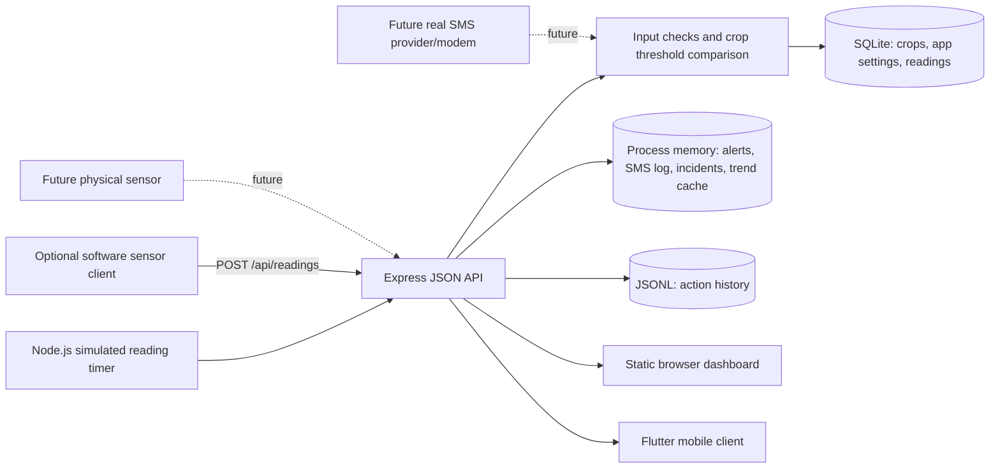

# Technical Requirements Document (TRD)

> **Current runtime update (7 Nov 2026):** Demo API calls use the shared Demo
> Farmer without a session. Authentication endpoints are disabled in demo mode;
> production authentication and QR SSO remain available.

> **Historical planning snapshot (24 October 2026).** Route and authentication status here predates the current implementation. For current contracts and verified behavior, see the [architecture](../ARCHITECTURE.md), [test report](../TEST_REPORT.md) and [handoff](../HANDOFF.md).

**System:** Peo Yame low-cost storage-monitoring prototype
**Document purpose:** Technical baseline, interface contracts and report traceability
**Status:** Working specification based on the top-level checkout inspected 24 October 2026. The code is authoritative for current behavior; older architecture/audit notes may describe a previous revision.
**Related documents:** `01-product-requirements-document.md`, `03-app-flow-and-user-flows.md`, `05-backend-schema-security-and-threat-model.md`, `06-implementation-plan.md`.

> **Implementation truth:** The inspected current `backend/database.js` creates SQLite `crops`, `app_settings` and `readings` tables; `backend/server.js` still keeps alerts, SMS log and incidents in memory and action history in JSONL. This is a mixed persistence design. The login screen has no server authentication. HTTP/CORS configuration is demo-oriented. Physical sensors and real SMS are absent.

> **Later schema update (7 November 2026):** The crop table now also has
> `crop_group`, nullable `safe_moisture_pct` and `storage_note` fields, added to
> existing databases at startup. The built-in catalog covers grains, pulses,
> oilseeds, fruits and vegetables. Storage ranges are starter guidance, and
> grain moisture is separate from room RH. See the current
> [crop package](../BOTSWANA_CROP_STORAGE_PACKAGE.md); the October endpoint and
> implementation descriptions below are historical where they conflict.

## 1. Technical objectives

- Maintain one backend API shared by browser and Flutter clients.
- Separate reading ingress, validation, threshold evaluation, storage and presentation.
- Keep synthetic data explicit and reproducible enough for demonstrations.
- Provide durable storage for the entities currently designed to persist and identify volatile entities accurately.
- Preserve the documented route contracts unless coordinated with clients/reporting.
- Establish technical controls and a staged path toward secure deployment without claiming those controls exist today.

## 2. System context

Clients should treat the backend as the source of truth for current state and alert determination. The mobile client currently uses server-sent events plus periodic refresh; the web dashboard uses API polling/updates as implemented in its HTML/JS. Confirm exact interval behavior from current source before claiming quantitative latency.

**Figma-driven frontend increment:** the supplied design adds phone-number login, six-digit OTP verification, farmer Accounts and a My Crops collection with multiple assigned sensors, search and status filters. These screens now exist in Flutter with local demo state and fixed sensor fixtures. No authentication provider, OTP verification, SMS transport, farmer-account ownership or live sensor registry is established by current backend code. Treat the endpoints and model below as future requirements, not current routes.

## 3. Current technology baseline

| Layer | Current implementation | Evidence | Limitations / report boundary |
|---|---|---|---|
| Runtime | Node.js | backend package/source | Record exact runtime version at report build if relevant |
| API | Express 4 | `backend/package.json`, `server.js` | No authentication middleware; request validation is route-specific |
| Cross-origin | `cors` package, configurable origins; default permissive in development | `server.js` | Do not expose on untrusted network; tighten before deployment |
| Database | SQLite accessed through native `sqlite3` command-line invocation from Node | `database.js` | Operational database availability/locking/backup behavior needs verification; JSON values are quoted manually, not parameter bindings |
| Web frontend | Static HTML/CSS/JavaScript served by Express | `backend/public/index.html` | Same-origin when served by Express; remote cross-origin config depends on CORS |
| Mobile frontend | Flutter/Dart top-level `lib/` | `lib/main.dart`, `lib/account_screens.dart`, `api_service.dart`, `dashboard_controller.dart` | Includes local phone/OTP demo flow and Accounts/My Crops sample screens; no backend auth/device data; API is plain HTTP in current demo config |
| Reading generator | In-process timer (development/demo) and optional `simulate-sensor.js` | `server.js`, simulator script | Synthetic data only; no sensor fidelity/calibration evidence |
| Event channel | Server-Sent Events `/api/events`, with client refresh fallback | server and Flutter API/controller | Reconnect/offline behavior needs measured tests |
| Exports | CSV readings and Markdown action log | Express routes and clients | Review privacy, injection/escaping and record scope |
| SMS | In-memory log entry, `status: logged` | `recordReading()` | No external delivery, retries, receipts or offline queue |

## 4. Operating environments

### Development/demo (observed intent)

- Express listens on port 3000; host defaults to `0.0.0.0` outside production, enabling local-network phone demo.
- Browser dashboard served from the backend.
- Flutter app points to an API base URL. Android emulator commonly uses `10.0.2.2`; physical device uses a reachable LAN address.
- HTTP is used. Only use an isolated trusted network and non-sensitive synthetic data.

### Production-like target (not current deployment)

Before any real data, participant deployment or external network exposure: bind behind a controlled reverse proxy or private interface; HTTPS; restrictive CORS; authentication and authorization; sensor identity; secure secret management; rate/size limits; audit controls; durable backups; monitoring; data-retention policy; incident response; secure SMS adapter; documented patch process. Do not use this target list as evidence of implementation.

## 5. API requirements and current contracts

Response shapes must be inspected on the current running branch before release. The contracts below reflect source-level behavior and project notes; response shape details can evolve.

| Endpoint | Method | Purpose / current response | Input / key checks | Access-control status |
|---|---|---|---|---|
| `/api/health` | GET | `{status,time}` health response | None | Public in current demo |
| `/api/status` | GET | `{latest,threshold,breached}` | None | Public in current demo |
| `/api/events` | GET | SSE stream of update events | Accept event-stream | Public; can consume connections/resources |
| `/api/readings` | GET | Recent readings; optional limit/crop | Limit capped in route | Public |
| `/api/readings/history` | GET | Active crop history array | Optional limit (source currently parseInt fallback; verify max bound) | Public |
| `/api/readings/latest` | GET | Latest matching reading or null | Optional crop | Public |
| `/api/readings/trends` | GET | `{range,includesSyntheticBaseline,points}` | Range values `24h`, `month`, `3months`; defaults to 24h | Public |
| `/api/readings` | POST | `{reading,threshold,alert}` with HTTP 201 | finite numeric temperature/RH; RH 0–100; non-empty site; active crop mismatch rejected | No auth; must be protected for real device input |
| `/api/crops` | GET | Crop profile array | None | Public |
| `/api/crops` | POST | Created crop, HTTP 201 | name and four numeric limits; range and min<max; duplicate => 409 | Mutating, unauthenticated today |
| `/api/thresholds` | GET | Active threshold object | None | Public |
| `/api/commodity` | POST | `{threshold,reading}` after active crop change | name must match saved crop | Mutating, unauthenticated today |
| `/api/alerts` | GET | Alert array, optional limit/unacknowledged | Limit capped | Public |
| `/api/alerts/:id/acknowledge` | POST | Updated alert | Existing alert ID | Mutating, unauthenticated today |
| `/api/sms-log` | GET | In-memory simulated dispatch entries | None | Exposes demo phone/message fields; sanitize/redact before real data |
| `/api/incidents` | GET/POST | In-memory incident records | Date, crop, description, outcome checks | Mutating; sensitive context possible; unauthenticated today |
| `/api/actions` | GET/POST | JSONL-backed activity history / append action | Action non-empty max 120 chars; source/actor limited; details object | Actor/source client supplied; must not be trusted as identity |
| `/api/readings/export.csv` | GET | CSV of latest retained readings | source label optional | Public data export |
| `/api/actions/export.md` | GET | Markdown activity export | source and limit | Public data export |
| `/api/sim/breach` | POST | Creates a deliberate simulated breach; 201 | Optional source | Development-only operation; must be disabled/protected outside demo |

### Proposed future endpoints for account and sensor concepts

These are planning examples only. Do not document them as implemented until routes, persistence, authorization and tests exist.

| Proposed endpoint | Purpose | Security and behavior requirements |
|---|---|---|
| `POST /api/auth/otp/request` | Request a one-time PIN challenge for a registered phone | Generic response to limit account enumeration; strict rate/resend limit; short expiry; no PIN returned/logged; SMS provider and consent decision required |
| `POST /api/auth/otp/verify` | Verify six-digit challenge and create authenticated session | Single use, expiry, attempt cap, replay rejection; HTTPS; session/token has expiry and revocation |
| `POST /api/auth/logout` | Revoke/clear current session | Server-side revocation or token rotation as selected |
| `GET /api/account` | Return authenticated farmer profile and authorized crop/sensor counts | Derive account from verified principal, never caller-supplied account ID |
| `GET /api/account/crops` | Return farmer crop groups and linked sensor summaries | Tenant scoping; paginated; latest value includes source and last-seen/freshness semantics |
| `GET /api/sensors` | List authorized linked sensors with optional crop/status filters and search | Enforce account scope/query caps; offline rows clearly marked stale |
| `POST /api/sensors/link` | Pair/register a device and associate with account/site/crop | Proof-of-possession or expiring pairing token; authenticated user; audit ownership change |
| `PATCH /api/sensors/:id/assignment` | Change crop assignment | Owner/admin authorization; retain assignment history and audit event |
| `DELETE /api/sensors/:id/link` | Revoke/remove a linked device | Verify owner; revoke device credential; preserve data lineage per policy |

The screenshot’s “New farmer? Create an account” entry also needs a specified registration/approval flow. The image does not show registration fields, consent, recovery, duplicate-account behavior or phone ownership checks; resolve these before implementation.

### API design requirements

- Use JSON for API data and meaningful 4xx/5xx status codes.
- Validate shape, type, range, maximum size, timestamp semantics and allowed fields server-side.
- Never use client-supplied `actor` as authenticated identity. Derive actor from session/token once authentication exists.
- Distinguish simulated vs device-origin readings, and keep source provenance in storage and exports.
- Keep response errors useful to a user but free from stack traces, SQL, secrets or personal data.
- Add versioning/deprecation practice before incompatible contract changes.
- Apply rate limiting to writes, login, event streams, exports and demo controls when network-accessible.

## 6. Data flow and processing

1. Demo timer or simulator submits reading data.
2. Express validates input and active crop.
3. Server stamps time/source/context, persists reading through `database.js`, updates in-process trend cache, evaluates active limits.
4. Breach creates an in-memory alert and in-memory simulated SMS log item.
5. Server broadcasts an SSE update.
6. Web and Flutter clients refresh/read status, history, trends, crops and alerts.
7. User actions append to JSONL. CSV and Markdown exports are generated from in-memory/DB/log sources as implemented.

### Error and failure requirements

- DB write failure: return/record failure; never silently show a reading as durably stored.
- Client offline: show stale connection state, last successful fetch time and safe retry; do not present old values as current.
- Event stream disconnect: reconnect with bounded backoff; periodic refresh remains a fallback.
- Invalid reading: reject without side effects; preserve a safe, non-sensitive error response.
- Duplicate/replayed device payloads: future device contract should support unique device ID + monotonic sequence/idempotency key.
- SMS provider outage (future): create durable delivery job, retry with bounded policy, avoid duplicate sends and expose pending/failed/sent/delivered distinctly.

## 7. Interface and quality requirements

| ID | Requirement | Verification evidence to collect |
|---|---|---|
| TR-01 | Preserve API contract used by web/mobile clients | Request/response samples and client integration walkthrough |
| TR-02 | Persist configured crops/settings/readings in SQLite and establish explicit retention/backup | DB inspection and restart test with before/after IDs/counts |
| TR-03 | Mark synthetic-history points and simulated readings | API sample, visible UI state, exported source column |
| TR-04 | Prevent boundary-rule ambiguity | Tests at min, max, just below, just above for temperature and RH |
| TR-05 | Bound request body and query limits | Source review plus oversized input and limit probes |
| TR-06 | Protect state-changing routes | Negative auth/role tests after auth is implemented |
| TR-07 | Use HTTPS outside isolated local demo | TLS/config review and client connection verification |
| TR-08 | Handle client disconnection without misleading status | Disable/recover backend and capture UI state/refresh behavior |
| TR-09 | Make exports safe and scoped | CSV formula/escaping fixtures; verify exported data minimization |
| TR-10 | Keep a reproducible build/run record | README/SETUP and version/hash/commands in evidence log |

## 8. Proposed deployment topology and constraints

**Current demo:** one laptop hosts the API + SQLite + browser dashboard; Android phone/emulator connects over local network; simulated data is produced by the backend; no edge device or provider is attached.

**Future intended topology:** environmental sensor/controller -> authenticated local API -> durable readings/alert event -> dashboard/mobile client and SMS adapter. A robust offline SMS-first design likely needs a local dispatch queue and a gateway reachable during internet loss; this is a design requirement to refine, not present functionality.

## 9. Open technical decisions

- Which project tree/branch is final submission source? Top-level app is the observed runtime; nested app copies may be stale.
- Should alerts, incidents and SMS dispatch attempts be migrated to SQLite for reliable IR2 evidence?
- What is the allowed reading-retention period and backup/export policy?
- What exact site and sensor identity model is approved?
- Is authentication in assessed scope or is the prototype explicitly isolated and demo-only?
- Which SMS path is expected (GSM module, hosted gateway, or logic-only simulation) and what evidence is possible?
- Should the API allow device-specific crop IDs/timestamps instead of one globally active crop?
- What temperature bounds/precision and stale-reading threshold are appropriate?

## 10. Report-ready technical status language

Prefer: “The current prototype persists crop profiles, active-crop setting and reading rows through SQLite; alert and incident objects are kept in process memory in the inspected server implementation. The application logs a simulated dispatch event with status `logged`; no SMS is transmitted.”

Avoid: “The secure platform stores all data and sends SMS alerts.” That statement is unsupported by the inspected code.
