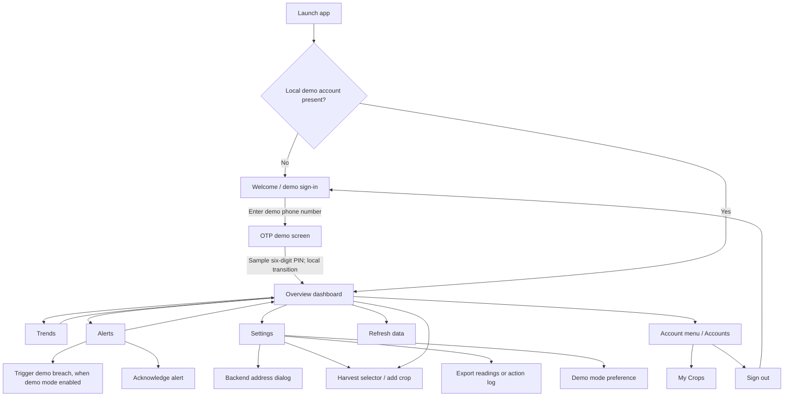
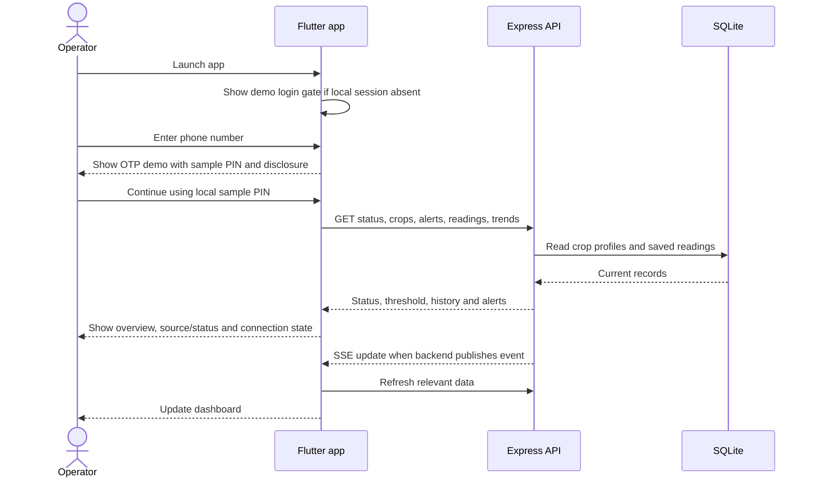
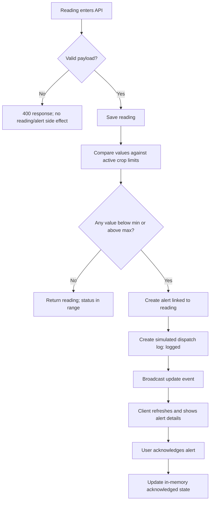
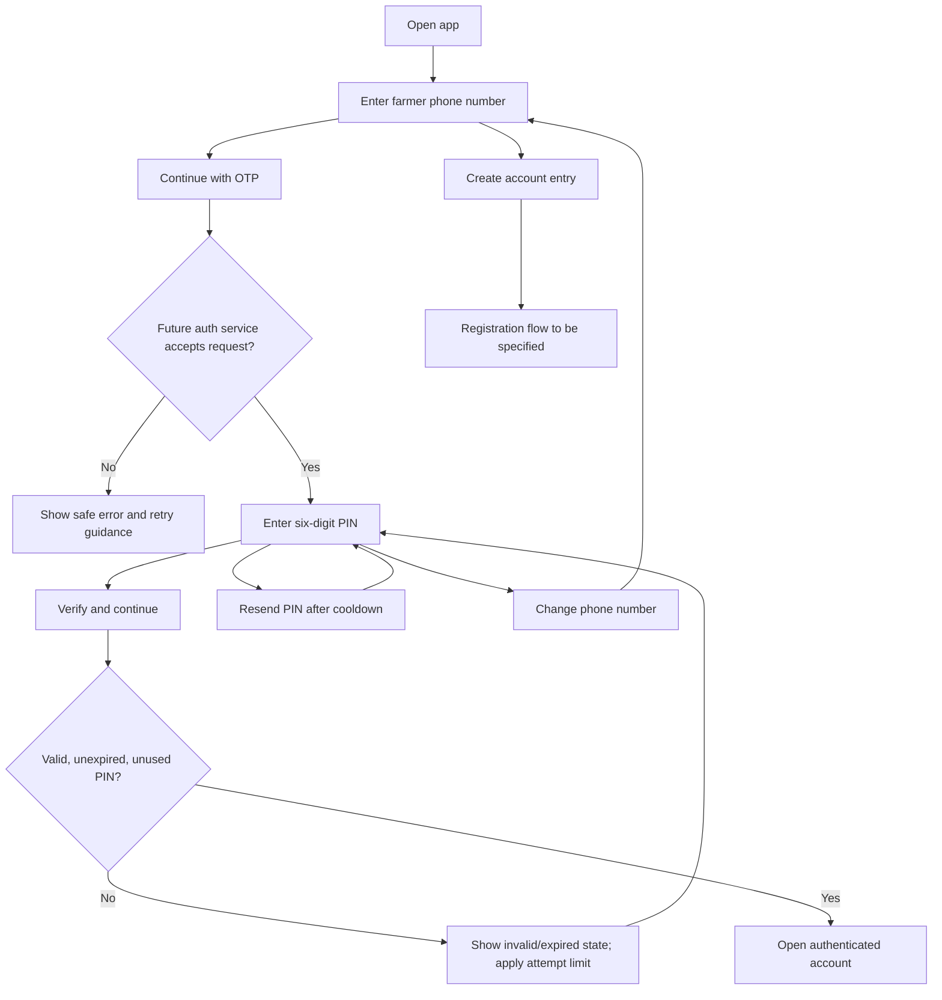
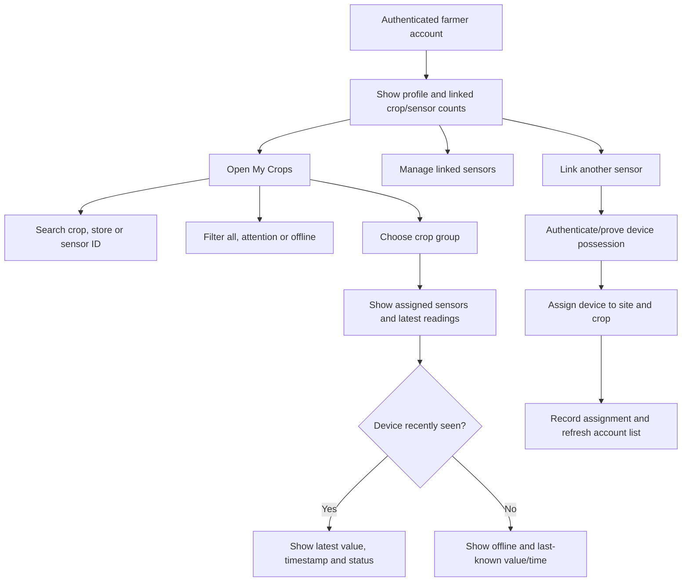

# App Flow and User Flows

**Product:** Peo Yame storage-monitoring prototype
**Purpose:** Describe current user journeys and target flows for Interim Report 2 design/evaluation
**Status:** Current screen names and actions were inspected in the top-level Flutter app. Flow diagrams are explanatory specifications, not proof that every path was tested.

## 1. Scope and flow conventions

The Flutter app now has a phone-number sign-in screen, a six-cell OTP demo screen, an Accounts screen and a My Crops screen in addition to its four-destination bottom navigation (Overview, Trends, Alerts, Settings). OTP and account/crop/sensor interactions are local demo behavior. The sample PIN advances a local profile; there is no authentication backend, OTP delivery, account service or linked-device registry. Do not describe this as secure login or live multi-sensor monitoring.

The web dashboard now mirrors these entry and account journeys: phone entry, six-cell sample PIN, browser-local demo profile, Accounts summary, and searchable/filterable My Crops sensor fixtures. The browser stores only a demo profile in local storage; the monitor API remains separate and has no authenticated session or account-scoped data. Web sensor rows use fixed sample values and freshness labels. Both clients disclose that login, SMS and device connectivity are not implemented.

The monitoring flow uses simulated data in the current project. Some data may be seeded synthetic history. Any future real-sensor route should preserve clear source labels and require authenticated device identity before being used outside a controlled demo.

## 2. Information architecture

## 3. Primary operator flow: open and interpret current conditions

**Expected user outcome:** The operator can identify selected harvest, latest displayed values, limit context and whether the demo rule indicates a breach. They should also see whether data is simulated, its timestamp and whether the backend is connected. The current UI and API should be reviewed for stale/fixed timestamp labels before any user evaluation.

## 4. Crop selection flow

1. Operator opens Overview or Settings and opens the Harvest control.
2. App loads available crop profiles from `GET /api/crops`.
3. Operator selects a crop; app sends `POST /api/commodity`.
4. Backend verifies the crop exists, updates the single global active crop setting, and returns active threshold and a reading (in development mode it can create an immediate safe simulated reading).
5. App refreshes status/history/trends and displays the selected crop and its illustrative limits.
6. If selection fails, preserve previous selection and show a recoverable error; never silently switch thresholds.

**Important constraint:** This is one active harvest for the whole demo backend, not per-user/per-bay selection. A second client can change the same global value.

## 5. Add crop flow

1. User opens Add a crop from the harvest control.
2. User supplies name and min/max temperature and RH values.
3. UI validates empty/basic numeric entry; backend validates again and enforces configured bounds and min < max.
4. On success, new crop is stored in SQLite and becomes selectable; on duplicate/invalid data show a clear error.
5. The team should cite the source and crop stage before treating a new profile as meaningful research configuration. A raw numeric profile does not establish validated thresholds.

Current backend API does not require role authorization. For the demo, adding crops should only occur on a controlled machine/network; future admin-only behavior belongs in the security design.

## 6. Trend review flow

1. User selects Trends from bottom navigation.
2. User chooses `24h`, `month` or `3months`.
3. Client requests `GET /api/readings/trends?range=...`.
4. API returns hourly/bucketed points and synthetic/live metadata.
5. Client renders trend and at-a-glance summary.

**Acceptance and interpretation:** chart should label units, period and synthetic baseline; no extrapolated forecast should be shown. Explain missing ranges and offline errors. The trend is descriptive history, not an estimate of future spoilage or validated remaining life.

## 7. Alert flow

**Critical wording:** “Alert created” and “dispatch logged” are supported; “SMS sent/delivered” is not. The current alert and SMS collections are in memory, so restart persistence is not established for them.

## 8. Demo-breach flow

1. Enable Demo mode in Settings.
2. Open Alerts and invoke the demo-breach action (if exposed by current screen).
3. Client posts to `/api/sim/breach`.
4. Backend inserts a synthetic out-of-range reading, creates an alert and a simulated SMS log entry, holds the breach during the phone demonstration window, then resumes generation.
5. Capture the client state and API/log response as evidence; caption as generated demo data.

A deliberate demo breach is an interface/rule demonstration, not a sensor test, SMS test or spoilage event.

## 9. Settings, connection and export flows

### Backend address

- Open Settings > Monitor connection address.
- Enter host/IP and port; app normalizes the URL and stores it in local preferences.
- Attempt API requests; show connected/error state.
- For emulator, host loopback mapping differs from physical phone LAN address. The server and device must share reachable network for local demo.
- Current transport is HTTP; do not send sensitive/real participant data.

### Export readings

- Choose export sensor data.
- Client downloads CSV from `/api/readings/export.csv` and opens the platform share sheet.
- Verify export is from the intended time range/source and has no unnecessary sensitive fields.

### Export activity log

- Choose export activity log.
- Client requests Markdown from `/api/actions/export.md` and shares/saves response.
- Actor strings are client-supplied in current implementation, so treat action log attribution as demo metadata, not verified identity.

### Log out

- Account menu > Log out returns to local login gate. This clears local in-memory account view only; there is no server session/token to revoke.

## 10. Phone login and OTP demo flow

The supplied screenshot’s login and OTP designs are now represented by interactive Flutter screens. The screenshot and in-app disclosures state that authentication and SMS are not connected. The displayed PIN is prefilled demo input and does not verify an account. Thus the UI journey exists, while the secure authentication journey remains future work.

**Current UI behavior:** phone input leads to six prefilled PIN cells; back/change-number return to login; resend shows that no PIN was sent; six filled cells continue to a local demo profile. The create-account link opens a minimal local demo-profile dialog. None of these steps verifies an identity. **Target acceptance:** phone ownership is verified server-side; PIN is short-lived, single-use, rate-limited and never returned/logged; resend has a cooldown; invalid/expired/reused challenges fail safely; account enumeration is mitigated; successful verification creates an expiring/revocable session. Registration fields, OTP provider, expiry, recovery, consent and account approval still need design approval.

## 11. Farmer Accounts and My Crops demo flow

The Flutter artifact now renders the screenshot’s account model using local demo fixtures: Accounts shows two crops/four sensors; My Crops groups Maize and Sorghum, searches crop/store/sensor IDs, filters All/Attention/Offline, and shows sample values/freshness. Link/Add controls explain that linking is not connected. These sample values and online/offline states are not backend sensor records. The current API remains one globally active crop with generated readings.

**Current demo rule:** offline sample values are labeled last-known and the page discloses that all readings are demo data. **Target data rule:** use a real last-seen timestamp and distinguish connection freshness from threshold state; scope search, filters, counts and exports to the authenticated farmer; require device proof/approved provisioning. No account ownership, pairing, per-device heartbeat or multiple live sensors are implemented in the backend.

## 12. Failure and edge flows to specify/test

| Situation | Expected user-visible behavior | Current status to verify |
|---|---|---|
| Backend unavailable at launch | Show unavailable state; no fabricated “safe” status; allow retry/settings | API timeout/error handling exists; visual behavior needs walkthrough |
| SSE interrupted | Keep app responsive, reconnect, refresh on fallback, communicate last update age | Reconnect loop and periodic refresh exist; exercise and capture evidence |
| Invalid reading | Reject request safely; do not create alert | Route has numeric/RH/site checks; edge coverage incomplete |
| Missing latest reading | Empty-state explanation, not zero values | Confirm widget behavior |
| No alerts | Neutral empty state | Confirm screen behavior |
| Crop switch fails | Keep old crop and explain error | Controller sets error; verify UI restoration |
| DB write failure | Clearly report save failure; no false persistence confirmation | Needs controlled failure test; current error path may need improvement |
| Data is synthetic | Visible simulation indicator on overview and graph | Verify all relevant screens/exports |
| Alert acknowledged | Status changes, acknowledgement time/actor if supported | Route exists; persistence and UI affordance need verification |
| App backgrounded/reopened | Reconnect and refresh safely | Verify; preferences include demo mode/backend address according to source |

## 13. User-flow acceptance scenarios

1. **View current status:** given backend available and readings exist, user enters dashboard, sees active crop, latest value and units, limit context, data source and status.
2. **Change crop:** given a saved crop, selection updates active threshold and client displays its limits; invalid crop is rejected.
3. **Inspect history:** user changes trend window and gets only the requested timeframe; synthetic history is labeled.
4. **Respond to breach:** known out-of-range generated reading creates an alert with measured value and configured limit; screen labels demo/dispatch status honestly.
5. **Acknowledge alert:** valid alert is marked acknowledged and the UI reflects it; non-existent alert gives a recoverable not-found response.
6. **Export evidence:** CSV contains expected fields and source provenance; Markdown export contains action records without claiming authenticated attribution.
7. **Recover from outage:** disable API, observe explicit connection failure, restore API and see updated data without stale state being presented as current.
8. **Phone/OTP demo:** enter a valid-length number, view the prefilled sample PIN and disclosure, return/change number, view resend notice, then continue to the local demo profile. This validates navigation only, not authentication.
9. **Browse sample crops/sensors:** open Accounts from the Overview user menu, open My Crops, search a sensor ID, filter Attention/Offline, and verify the visible demo notice and last-known label. This validates UI behavior only, not device connectivity or account isolation.

## 14. Suggested report evidence

- Screenshot each main destination with date/build and caption.
- Record crop change before/after and `/api/thresholds` response.
- Capture breach API response, alert list and simulated SMS log. Caption “simulated dispatch logged; no carrier message sent.”
- Capture synthetic-vs-live trend indicators.
- Capture connection failure and recovery if tested.
- Attach export samples with sensitive values anonymized.
- Record user journey owner and observed result in the contribution/evidence log.
