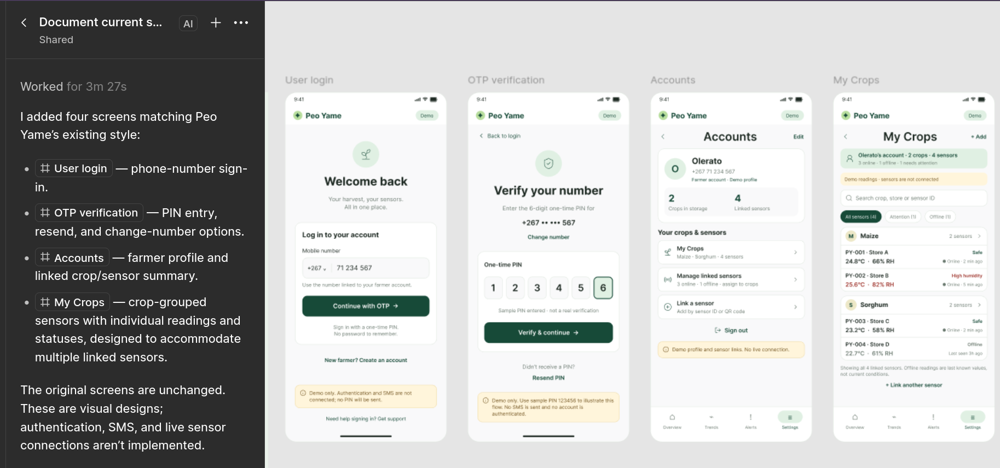

# UI/UX Design Brief

**Product:** Peo Yame storage monitoring web and Flutter mobile prototype
**Audience:** Small agricultural aggregator staff, project demonstrators and evaluators
**Purpose:** Document current visual language and screen behavior for Interim Report 2
**Status:** Existing style tokens/components are inferred from `lib/main.dart` and `backend/public/index.html`; suggested specifications below should be validated against rendered screenshots and intended users. They are not evidence of a usability study.

**Implementation update:** The web artifact now includes a local demo phone/OTP gate and Accounts/My Crops views alongside the existing responsive monitoring dashboard. It uses browser-local profile state and static sample sensor fixtures; no web authentication or account-linked device data is implemented. The web dashboard's quality and storage-duration estimates were removed; storage status is explicitly tied to configured crop limits. The Flutter prototype still contains illustrative estimate UI, so do not present those values as validated findings.

## 1. Design intent

Design a calm, legible monitoring interface for users who need to understand storage conditions quickly. Put the current condition and alert reason first. Use familiar language, visible units and timestamps, and clear simulation/network cues. Maintain the Peo Yame agricultural identity through forest-green branding and warm, neutral surfaces while reserving amber/red for attention states. Never make color the only carrier of meaning.

### Design principles

1. **State before analysis:** overview status and latest reading precede trend details.
2. **Explain the why:** show measurement, bound, crop and timestamp behind every alert.
3. **Trustworthy provenance:** label simulated readings, synthetic baseline, last update, logged dispatch and heuristic content.
4. **Readable in a store:** high contrast, large numeric values, short labels and thumb-friendly controls.
5. **Accessible by default:** text + icon + color, scalable text, semantic buttons, keyboard/focus support on web, and minimum comfortable touch targets.
6. **No false reassurance:** loading/error/stale states must never look like an in-range reading.

## 2. Users and key tasks

| User role | Primary task | Design implication |
|---|---|---|
| Storage attendant | See whether current displayed conditions are within configured limits; understand an alert | Strong status hierarchy, simple wording, actionable alert card |
| Supervisor/manager | Review readings and alert history; export evidence | Filters, readable trend labels, clear provenance and export feedback |
| Student demonstrator | Select crop, trigger synthetic breach and explain simulation | Explicit demo mode controls and a persistent simulation label |
| Evaluator | Inspect evidence and compare behavior with requirements | Consistent screen states, units, timestamps and testable controls |

## 3. Current visual foundations and proposed token reference

Tokens marked **observed** are found in the Flutter source. Tokens marked **proposed** are design guidance and should be checked against web styles before standardization.

### Color

| Token | Value | Use | Status |
|---|---|---|---|
| `brand.forest` | `#176B4A` | Primary actions, brand, selected states | Observed Flutter |
| `surface.header` | `#10251F` | Dark app bar/header | Observed Flutter |
| `surface.canvas` | `#F3F7F3` | Main background | Observed Flutter |
| `text.primary` | `#172923` | Main text | Observed Flutter |
| `surface.card` | `#FFFFFF` | Cards and dialogs | Observed Flutter |
| `border.subtle` | `#DCE6DF` | Card outline/dividers | Observed Flutter |
| `brand.tint` | `#E0F0E3` | Selected navigation indicator | Observed Flutter |
| `text.secondary` | `#65776F` | Secondary copy | Observed Flutter |
| `status.good` | `#2F694F` / related green | In-range state; always pair with “In range” text/icon | Observed family; confirm exact usage |
| `status.warning` | `#8A6C27` / amber family | Attention / uncertain or stale state | Observed Flutter |
| `status.alert` | `#9E332B` / red family | Threshold breach | Observed Flutter |
| `status.info` | Proposed `#245D7A` | Informational/connection state | Proposed; verify contrast |

Do not use red/green alone to distinguish status. Ensure text/background contrast meets the chosen accessibility target. Use a monochrome simulation/connection icon and explicit label.

### Typography (proposed scale; confirm with actual Flutter theme)

- Screen title: 24–30sp, semibold/bold.
- Section title: 18–20sp, semibold.
- Metric value: 28–36sp, bold; tabular numerals preferred.
- Body: 14–16sp, regular; captions should not carry essential instructions below comfortable readability.
- Unit and helper label: 12–14sp; maintain adequate contrast.
- Use sentence case, plain language and consistent units: `°C`, `% RH`, UTC/localized time clearly identified.

### Spacing and shape (proposed shared scale)

- Base spacing unit: 4 px logical.
- Typical spacing: 8, 12, 16, 20, 24, 32.
- Card radius: 14 logical px (observed in Flutter card theme).
- Card padding: 16–20 logical px.
- Mobile content gutter: 16–24 logical px; constrained maximum width on tablet/web.
- Touch target: at least 48×48 logical px for primary interactions.
- Elevation: restrained; use border and spacing rather than heavy shadows.

## 4. Navigation and responsive behavior

### Flutter mobile

- Top app bar: brand/product name, connection affordance and account/menu access as current screen permits.
- Bottom navigation: Overview, Trends, Alerts, Settings (observed four destinations).
- Preserve selected navigation state and avoid hidden-only access to critical alert status.
- Use scrollable content on compact heights; dialogs should fit keyboard-open layouts.

### Browser dashboard

- Dashboard is served as static HTML from Express. Audit exact current responsive rules before final report screenshots.
- At narrow widths, stack metric cards and chart/alert panels; avoid horizontal scrolling for essential data.
- At larger widths, use a clear primary column plus secondary panels. Keep the visual hierarchy consistent with Flutter.

## 5. Component inventory and specifications

| Component | Purpose | Content/states | Interaction/accessibility |
|---|---|---|---|
| Brand mark / app identity | Identify Peo Yame and orient user | Logo, name, short tagline | Decorative logo has empty semantic label unless meaningful; title exposed to screen reader |
| Login/demo gate | Demonstrate entry screen | Email, optional phone, password field, login and test-user action | Current is local-only; label as demo access; password is not sent or verified; secure version needs server auth |
| App bar | Product context and high-level actions | Product title, optional connection indicator, account menu | Large hit area, semantic names; do not hide connection state only in color |
| Bottom navigation | Switch main destinations | Overview, Trends, Alerts, Settings | Selected state includes icon + text; keyboard and screen reader support |
| Connection pill | Indicate backend reachability | Connected/disconnected text, visual status | Must reflect real request age/state; no static “synced” copy |
| Simulation banner | Disclose generated data | Persistent message that demo data is simulated | Visible without scrolling on critical monitoring screens; concise and explicit |
| Status hero | Summarize current state | In-range / threshold alert / unavailable / stale; timestamp and crop | Status word + icon + color; unavailable is not “safe” |
| Metric card | Show temperature or RH | Value, unit, applicable min/max, timestamp/source | Provide accessible label with value and range |
| Crop/harvest selector | Change active crop profile | Selected crop and associated numeric limits | Confirm selection; prevent stale old-crop values appearing as current |
| Trend card/chart | Show historical measurements | Range selector, axes, units, synthetic/live legend | Text summary or accessible data table; no misleading forecast line |
| Alert card/breakdown | Explain a breach | Severity, triggering reading, crop, limit, time, dispatch state, acknowledge action | Focus order; clear distinction “logged/not sent”; acknowledgment confirmation |
| Alert history list | Browse past runtime alerts | Alert summary, time, acknowledgement state | Empty state; stable ordering; don’t imply persistence beyond what exists |
| Add crop dialog | Add threshold profile | Name, min/max temperature and RH | Inline validation, keyboard numeric input, unit labels, duplicate/error/success feedback |
| Backend-address dialog | Configure API URL | Host, port, save/cancel, connectivity result | Explain local network and HTTP demo constraint; validate URL; avoid persisting secrets |
| Export row/action | Share CSV/Markdown | Label, explanation, loading/success/failure | Confirm destination/share sheet; provide safe errors |
| Demo mode toggle | Enable test controls | Toggle and explanatory helper text | Clear warning it changes synthetic demonstration state |
| Empty/loading/error state | Explain absent data or failed request | Skeleton/loading, no readings, backend offline, retry | Never replace missing data with zero or green status |

## 6. Screen specifications

### Screen A — Welcome / demo login

**Goal:** Let a demonstrator enter the local app presentation.
**Current controls:** Peo Yame identity/brand mark, email, optional phone, password, Log in, Login as test user.
**Layout:** Centered single-column card, max width around 420 logical px, generous whitespace and safe scrolling.
**Validation:** Required email-like field and non-empty password; phone optional. Current handler derives a display name from email and does not contact an auth service.
**Required explanatory copy:** “Demo access only. This prototype does not verify accounts.” Avoid telling users their credentials are protected/authenticated.
**States:** pristine, validation error, entered, successful local transition, future server rejection/loading.
**Evidence to capture:** screen, test-user transition, source code confirming no API auth call.

### Screen B — Overview

**Goal:** Answer “what are the current displayed storage conditions and do they cross demo limits?”
**Priority order:** simulation/source disclosure → crop selector → overall status hero → temperature/RH cards → last update time → latest alert/action → secondary summary.
**Data:** active crop, latest record, configured min/max, source, timestamp, breach flag, connection state.
**States:** loading; connected/in-range; connected/breach; no data; offline/stale; simulated vs future live.
**Behavior:** refresh manually; switch crop; open alert detail; move to Trends/Alerts/Settings.
**Do not show:** validated spoilage probability or predictive shelf-life output. Any legacy heuristic must be removed from claims, clearly tagged, or hidden from research-facing evaluation.

### Screen C — Trends

**Goal:** Inspect descriptive history and understand its provenance.
**Controls:** 24h / month / 3months selectors; temperature/humidity chart if supported.
**Chart requirements:** time axis and timezone, units, range, legend separating synthetic baseline from live/simulated readings, missing-data gaps and a non-forecast caption.
**States:** loading, data, empty, backend error, synthetic-only, mixed synthetic/live.
**Accessibility:** textual summary and optionally table/list equivalent; chart colors distinguish series with line styles/markers too.

### Screen D — Alerts

**Goal:** Review current and previous threshold events and demonstrate response.
**Content per alert:** crop, reading value(s), exceeded boundary, recorded time, acknowledgement state, simulated dispatch status.
**Actions:** acknowledge; demo-breach trigger only while demo mode enabled.
**Empty state:** “No threshold alerts in the available record.” Avoid implying the environment is guaranteed safe if data may be stale.
**Critical copy:** “Dispatch logged (simulation); no text message was sent.”
**Evidence:** API alert object, client screenshot, matching SMS log and timestamp.

### Screen E — Settings

**Goal:** Manage demo connection and preferences.
**Sections:** backend address/connection test; selected crop/add crop; export readings/activity; demo mode; local account details/logout.
**Safety:** distinguish local demo account from real identity; protect demo-only destructive/state-change actions if LAN exposed; clearly note that backend is unauthenticated.
**States:** saved address, invalid address, unreachable server, export progress/failure/success, crop add validation.

### Screen F — Add crop dialog

**Fields:** Crop/commodity name; min and max temperature in °C; min and max RH in %.
**Rules:** nonempty safe name, numeric finite values, temperature within backend-supported range, RH 0–100, minimum < maximum, duplicate response.
**Required helper:** thresholds must be sourced/reviewed before operational interpretation.
**Post-save:** show saved crop and source/validation status; do not silently select it unless intended.

### Screen G — Backend address dialog

**Fields:** server host/base URL and port, save/cancel.
**Rules:** normalize scheme and trailing slash; reject invalid URI; test connection and show actual result/last successful time.
**Security note:** development HTTP is only for trusted isolated demo networks. Do not enter secrets or sensitive records.

## 7. Content and microcopy rules

- Use “In range for configured demo limits,” not “safe” or “fresh.”
- Use “Threshold breach detected,” not “produce spoiled.”
- Use “Simulated reading” or “Synthetic history,” not “sensor data” unless physically measured.
- Use “Dispatch logged (simulation; not sent)” rather than “SMS sent.”
- Use “No recent reading available”/“Connection unavailable,” not green zeroes.
- Include threshold values and units in context: “21 °C; configured maximum 20 °C.”
- Display “Indicative” for any descriptive/heuristic estimate, but preferably remove it from core operational flow if it risks interpretation as validated prediction.

## 8. Interaction and state rules

- Prevent duplicate submissions while a crop/action request is pending.
- Preserve prior screen selection but refresh data after active crop changes.
- Announce asynchronous state changes to assistive tech.
- Provide cancel/retry and clear success/error feedback.
- Keep demo controls visually distinct from routine operator actions.
- Confirm action completion only after server response; when persistence is unknown, say “recorded by demo” rather than “saved permanently.”
- Provide a visible timestamp for the last successful refresh and distinguish it from the reading timestamp.

## 9. UI/UX evaluation plan for IR2

Use a small scenario-based review appropriate to the approved ethics plan. Potential tasks: identify current displayed status; locate the exceeded limit in an alert; switch crop; locate the synthetic-history indicator; export a data file; recover from an unavailable backend. Record participant role (anonymized), task completion, observed errors/questions and feedback only with required approvals/consent. Do not claim representative usability from an informal demonstration. If human evaluation is not approved, perform expert inspection against a documented checklist and state that limitation.

### Checklist

- [ ] Status is understandable without color perception.
- [ ] Simulation, stale data, backend error and logged-not-sent dispatch are conspicuous.
- [ ] Units and timestamps are visible and consistent.
- [ ] Crop limits and alert comparisons are understandable.
- [ ] Forms explain valid ranges and errors.
- [ ] Main controls are reachable and sized for mobile use.
- [ ] Web layout works at narrow and desktop widths.
- [ ] Charts have text alternatives and synthetic/live legend.
- [ ] No UI copy implies confirmed spoilage, secure login, real SMS or calibrated measurement without evidence.

## 10. Figma design reference and implementation alignment

**Design file:** [Peo Yame — Storage Monitor Mobile App](https://www.figma.com/design/xc2ErOTLftSvxz2ZlVQHcU/Peo-Yame-%E2%80%94-Storage-Monitor-Mobile-App?node-id=0-1)
**Inspected node:** `0:1`, page/canvas named “Mobile app screens”.
**Evidence available in this review:** Figma node metadata plus the user-provided screenshot of Figma AI’s response. The screenshot provides visual evidence for the four newly added frames; exact Figma typography/fill/component properties and clickable prototype behavior have not been inspected. Figma MCP Starter-plan limits prevented retrieving design-context renders. The screenshot is copied into this pack as [figma-ai-added-screens-2026-10-24.png](figma-ai-added-screens-2026-10-24.png).

The screenshot’s note says the original screens are unchanged and the new frames are visual designs: authentication, SMS and live sensor connections are not implemented.

### Screens found in Figma metadata

| Figma frame / node | Structure visible in metadata | Relationship to current app |
|---|---|---|
| Overview | Main monitoring tab, referenced by the shared bottom navigation; a full-frame node ID and its detailed metadata were not captured in this review | Corresponds to the current dashboard concept; inspect the frame directly before specifying its detailed layout |
| `02 · Trends` / node `3:85` | 390×844 mobile frame; range selector; trend-chart card and plot; at-a-glance minimum/maximum cards; recent readings; four-tab navigation | Current Flutter app has Trends and range selection; compare chart type, accessible summary and synthetic-history labeling in implementation |
| `03 · Alerts` / node `3:164` | 390×844 mobile frame; alert summary; “Needs attention” open-alert card; reading/range row; acknowledge button; earlier/resolved card; SMS disclosure card | Current app has Alerts and acknowledgement route; confirm current UI includes the same lifecycle and explicit simulated/not-sent disclosure |
| `04 · Settings` / node `3:219` | 390×844 mobile frame; connection card/edit action; harvest selector and temperature/RH ranges; illustrative-threshold note; activity and CSV exports; SMS limitation notice | Closely maps to existing Settings, crop selection and exports. Verify connection freshness is measured rather than static text |
| `My Crops` / node `32:1743` | 390×844 frame; account scope; demo notice; search for linked sensors; filters; crop groups with assigned sensor rows, status/readings/freshness; bottom navigation | Broader sensor-to-crop collection model than the current backend’s one global active crop. Treat multi-sensor grouping/search as design intent unless implemented |
| `Accounts` / node `32:1664` | 390×844 frame; farmer profile; linked crop/sensor totals; farm-management actions; sign-out action; demo disclosure | Current Flutter has a local login gate/account menu, but profile counts and account management are not proof of server-side identity or authorization |
| `OTP verification` / node `32:1610` | 390×844 frame; six PIN slots, sample PIN text, Change number, Resend PIN and Verify & continue | OTP flow is a visual design only. Screenshot explicitly says sample PIN is not real verification and no SMS/account is connected |

The Figma file uses a 390×844 mobile canvas for the identified frames. The metadata also shows repeated brand/status bars and bottom navigation. Confirm exact production device dimensions, safe-area behavior and typography in Figma; do not copy the measurement as a universal device requirement.

### Added-screen specifications from the supplied screenshot

The four new frames follow the existing Peo Yame visual language: white/light neutral canvas, dark forest-green primary buttons and headings, pale-green identity/status surfaces, rounded cards and amber demo disclosures. These are visual observations from the screenshot, not extracted design tokens. Record exact token values from Figma before implementing a token-perfect match.

#### User login — phone-number sign-in

- **Purpose:** Start sign-in using the phone number linked to the farmer account.
- **Visible hierarchy:** Peo Yame brand and Demo badge; “Welcome back” heading; short harvest/sensor supporting line; login card; country code `+267` and phone number input; “Continue with OTP” primary button; “New farmer? Create an account” secondary entry; amber demo disclosure; support link.
- **Interaction intent:** Enter/confirm a phone number, then continue to OTP verification. New account action opens account creation (the screenshot does not show that form, so its fields and approval path remain unspecified).
- **Disclosure:** Demo only; authentication and SMS are not connected, so no PIN is actually sent.
- **Current implementation:** The Flutter app now has this phone-number entry and transitions to the OTP demo screen. It validates phone length locally only and does not call an authentication service. Account creation opens a small local demo-profile dialog because Figma did not provide a registration screen.

#### OTP verification

- **Purpose:** Illustrate phone-number verification.
- **Visible hierarchy:** Back to login; “Verify your number”; masked `+267` number; Change number link; six one-time PIN input cells; explicit sample-PIN notice; Verify & continue primary action; Resend PIN; amber demo disclaimer.
- **Interaction intent:** Enter six digits, verify, request a resend, or return to change the number. Define expiry, attempt limits, resend cooldown, error states and accessibility behavior before any real OTP service is implemented.
- **Disclosure:** The displayed sample PIN is illustrative, not a real verification; no SMS is sent and no account is authenticated.
- **Current implementation:** Six PIN cells are prefilled with sample digits and editable. Any six filled cells continue locally; Resend PIN displays a “no PIN was sent” notice. No OTP API, real PIN generation/verification, SMS provider or account-authentication service is connected.

#### Accounts

- **Purpose:** Summarize a farmer profile and provide entry points to crop/sensor management.
- **Visible hierarchy:** Profile name `Olerato`, masked/example Botswana phone, “Farmer account · Demo profile” label; counts for crops in storage and linked sensors; “Your crops & sensors” group; My Crops, Manage linked sensors and Link a sensor actions; Sign out; amber demo-profile/sensor-link disclosure; bottom navigation.
- **Interaction intent:** Open the crop collection, manage assignments, begin linking a sensor, or leave the local demo profile.
- **Data model implied by design:** A farmer account can own multiple crops and have multiple linked sensors. The screenshot’s example shows 2 crops and 4 sensors.
- **Current implementation:** Accounts screen renders a demo profile, example totals and navigation to My Crops. Edit/profile and sensor-link actions show a not-connected notice. Backend does not provide authenticated farmer accounts, linked sensor inventory or sensor ownership.

#### My Crops

- **Purpose:** Browse crops grouped with their assigned sensors and latest condition summaries.
- **Visible hierarchy:** My Crops title and Add action; account summary showing crops/sensor counts and online/offline/attention counts; demo-reading disclosure; search across crop/store/sensor ID; All sensors / Attention / Offline filters; crop groups (example: Maize and Sorghum); sensor rows with sensor/store IDs, temperature, RH, condition and freshness; note that offline values are last known rather than current; Link another sensor; bottom navigation.
- **Interaction intent:** Search/filter linked sensors, open a crop group, inspect each sensor’s status, add/link another sensor.
- **Data semantics:** Offline readings are stale last-known values. Display the “last seen” timestamp and never present offline values as current. The screen says demo readings are not connected to live sensors.
- **Current implementation:** My Crops renders four fixed demo sensor fixtures grouped under two crop names; local search and filters work. The page discloses that sensors are not connected, and offline rows say their values are last known. The backend still simulates readings for one globally active crop and has no device ownership, heartbeat or per-account assignments.

### Design-to-code gaps to track

1. **Account and OTP:** The Flutter UI now implements the phone and PIN screens, but only as a local demo transition. There is no server auth endpoint or real verification. Keep the disclosure and implement the approved authentication journey only if in scope.
2. **Crop and sensor hierarchy:** The Flutter UI now displays grouped sample sensors; backend still applies one global active crop and a simulator. No authenticated multi-sensor inventory exists. Keep fixture labels visible until data model/API are expanded and tested.
3. **Alert lifecycle:** Figma distinguishes open and earlier/resolved alerts and provides an acknowledgement action. Current backend has an acknowledgement route, but alerts and acknowledgment state are in memory. A restart test or persistent alert schema is required before describing this as durable history.
4. **Connection freshness:** Figma names connection/freshness indicators. Current implementation must display an actual last-seen/last-refresh value before claiming freshness; a fixed label is not sufficient.
5. **SMS disclosure:** Figma includes an SMS disclosure/limitation area. Keep copy explicit that the current application records a simulated dispatch and does not transmit a message.
6. **Trends:** The Figma Trends frame includes range controls, chart, min/max summaries and recent-reading rows. Ensure synthetic points are distinguishable, no forecast is implied, and chart data remains aligned with the server response.

### Figma review evidence still needed

- [ ] Open the Figma file and capture clean screenshots of Overview, Trends, Alerts, Settings, My Crops, Accounts and OTP verification.
- [ ] Record actual color, type, spacing, radius, component and icon properties from the selected frames/components.
- [ ] Inspect prototype links and interaction states for login/OTP, crop selection, alert acknowledgment and connection editing.
- [ ] Confirm which screens are approved current scope and which are concepts or future work.
- [ ] Compare each approved Figma screen with the running Flutter build; mark matches, partial matches and gaps with dated screenshots.
- [ ] Reconcile the design’s sensor/crop/account model with the approved project scope and current backend schema.

### Reference status

This document’s observed code tokens remain sourced from `lib/main.dart`; the Figma review above adds only the frame names and structural metadata successfully returned by the design file. Exact Figma visual tokens have not been verified in this review.
